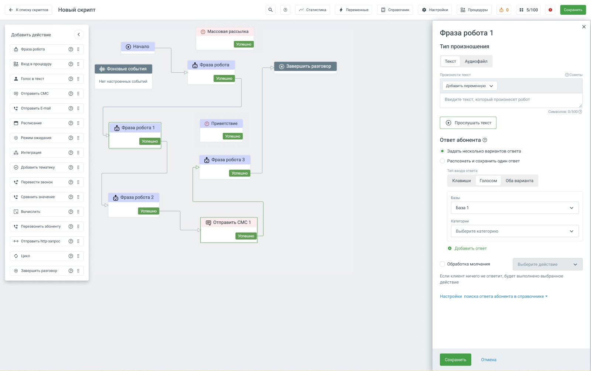
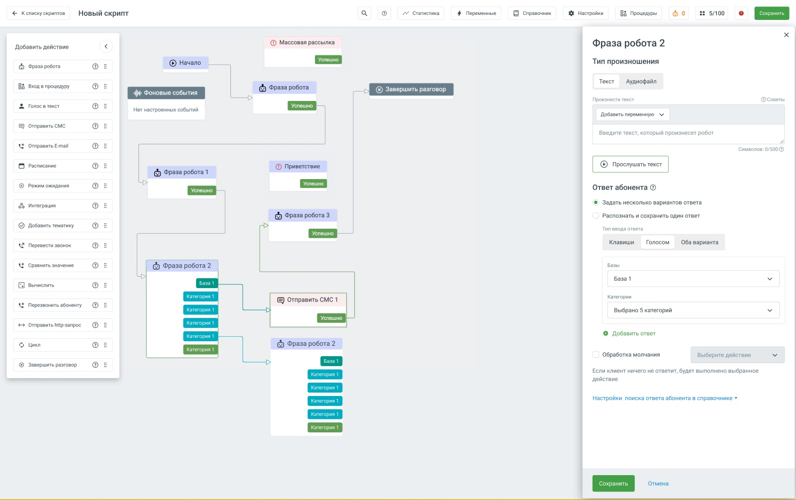
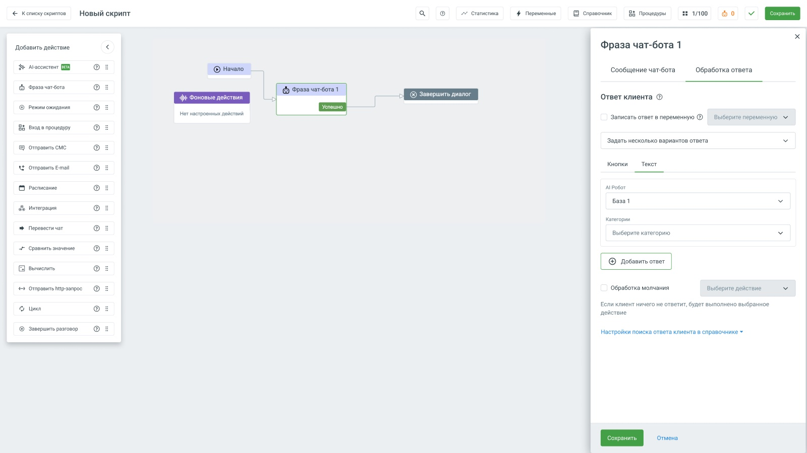
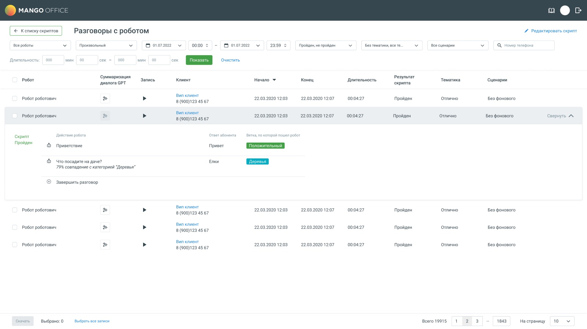

# AI-робот в конструкторе роботов и чат-ботов

AI-робот определяет смысл фразы клиента с помощью модели машинного обучения. До него робот сравнивал фразы со словарями ключевых слов и на живом клиенте ошибался даже при точном совпадении. Кейс о том, как устроена модель, какие требования к интерфейсу из этого следуют и чем релиз отличается от постановки.

MANGO OFFICE · роботы и чат-боты · 2025 · задачи `ROBOTS-5170`, `ROBOTS-5177`, `ROBOTS-5181`

---

**Роль.** Продуктовый дизайнер. Я сделала страницу настройки модели (`ROBOTS-5170`, о ней отдельный кейс) и макеты блоков «Фраза робота» и «Фраза чат-бота», в которых модель подключается к сценарию (`ROBOTS-5177`, `ROBOTS-5181`).

**Команда.** Разработчик движка, продуктовая команда, команда внедрения.

**Сроки.** Продуктовый разбор из пяти записей, закрытая бета и системное демо.

**Масштаб.** В постановке на дизайн три базы знаний, 30 категорий на базу, 30 фраз в категории. Одна модель занимает около 2 ГБ памяти.

**Статус.** В продакшене. В интерфейсе фича называется «AI-робот», с октября 2025 года работает в чат-ботах.

---

## Коротко

**Что было.** Робот распознавал ответ клиента по словарям ключевых слов. Движок отбрасывал окончания слов и на живом клиенте выбирал похожую фразу вместо точной. Клиент исправлял это вручную, добавляя в словарь сотни вариантов окончаний.

**Что я сделала.** Нарисовала макеты блоков «Фраза робота» и «Фраза чат-бота», через которые модель подключается к сценарию, и страницу настройки модели, о ней отдельный кейс. Команда встроила модель классификации с порогом достоверности, цветовой разметкой фраз и отдельным обучением. Ключевые слова остались страховкой. В чат-боте ответ можно обрабатывать моделью, ветвить сценарий по категориям и проверять на отдельной тестовой странице.

**Главная находка.** Продуктовая команда сократила лимиты в постановке на дизайн по сравнению с июньским разбором: категорий на базу со 100 до 30. На разборе это обсуждали как вопрос нагрузки и удобства, а разработчик движка потом объяснил техническую причину: чем больше близких категорий, тем чаще модель ошибается.

**Результат.** Фича в продакшене и называется «AI-робот». Решения июньского разбора о блоках сценария дошли до релиза почти без изменений. Лимиты сократили. Статистика показывает, какую фразу и категорию нашла модель и с каким процентом совпадения. В закрытую бету попали 60 клиентов при цели 100.

---

## Место в продукте

«Роботы» объединяют пять сущностей MANGO OFFICE: голосовой робот, чат-бот, робот-администратор, AI-робот и AI-ассистент. AI-робот работает внутри голосового робота и чат-бота: он определяет, к какой категории относится ответ клиента, и ведёт диалог по нужной ветке.

*Схема продукта*

---

## Задача

В постановке задачи проблема описана в общем виде. В записях есть конкретный случай из продакшена, и он хорошо её объясняет.

Движок при сравнении отбрасывает окончания слов. У клиента, который доставляет воду, в скрипте были фразы «доставка воды», «доставить воду» и «доставил воду». Когда человек говорил «доставил воду», диалог всегда уходил в «доставка воды», даже при полном совпадении с третьей фразой. После отбрасывания окончаний в первом варианте оказывалось больше похожих слов, и точное совпадение проигрывало приблизительному. Настройкой это не исправить, так устроен механизм.

Клиент исправлял это вручную и добавил в словарь огромное число вариантов окончаний. Старый механизм интентов тоже не помогал, потому что в нём окончания не учитываются. Обсуждали галочку «жёсткое сравнение», но от неё отказались: пришлось бы перечислять все окончания, и если забыть хотя бы одно, робот начнёт терять клиентов. Скрипт этому клиенту в итоге пересобрала команда внедрения.

У продукта были и свои причины. Описание эпика лежит в макете рядом с экранами, его готовила продуктовая команда. Там сказано, что у конкурентов роботы уже ориентируются в контексте: Twin24, JustAI, MTC Exolve, Voximplant, Robovoice. Движок понимания языка уже работал на платформе Byvoice, которая стоит под «Роботами», поэтому разработку можно было сократить. Свой движок с нуля отклонили как слишком долгий, «1-2+ года». Сценарии, на которые рассчитывали: найм и HR, поддержка в онлайн-ритейле, телеком.

Цели в описании записаны как гипотезы, до запуска:

- привлечение клиентов: «+15% конверсий в клиента из ТБК в месяц со второго месяца после релиза»;
- отток: «снижение оттока SMB/SMB+ с 7% до 5%»;
- для чат-ботов пилот на 5 клиентах и правило остановки: развивать дальше, если не меньше трёх пилотных клиентов запустят ботов на модели и покажут рост доли диалогов без оператора на 10% и больше; ставить на паузу, если ошибок распознавания 40% и больше.

Измерять долю переводов на оператора тогда было нечем, в описании прямо записано: «сейчас эта метрика не собирается».

---

## Как устроена модель

Эти сведения пришли из встреч с разработчиком движка. На продуктовом разборе в июне их не было. При этом от них зависят требования к интерфейсу.

### Ключевые слова

Сначала работает модель. Если она не может выбрать категорию, автоматически срабатывает поиск по ключевым словам. Разработчик объяснил зачем: человек должен иметь надёжный способ добиться реакции на точную фразу.

Отсюда требование к интерфейсу. Ключевые слова нужно показывать как слой под моделью. Они не заменяют модель и не являются устаревшим режимом. В постановке порядок записан наоборот, об этом в разделе «Модель в блоке сценария».

### Порог достоверности

По умолчанию порог 30 процентов, значение подобрали опытным путём. Разработчик сравнил порог с градусником: если поставить 90 процентов, модель откажется относить фразу к категории, когда по её расчётам совпадение всего 38 процентов. Порог защищает от случаев, когда фраза подходит к нескольким категориям на 2–3 процента и по сути не относится ни к одной.

### Цвета фраз

| Цвет | Значение |
|---|---|
| Зелёный | Модель уверенно относит фразу к этой категории |
| Жёлтый | Уверенность ниже порога, при работе фраза не учитывается |
| Красный | Ошибка разметки, фраза больше подходит другой категории |

Цвета нужны при разметке, чтобы находить ошибки. Значит, они должны быть видны в момент ввода фраз. В отчёте, который человек откроет потом, от них мало пользы.

### Обучение и ошибка обучения

В интерфейсе две кнопки: «Сохранить» и «Обучить». Без обучения работают только ключевые слова. После правки фраз появляется кнопка «Доступно обучение», отдельного режима дообучения нет.

Обучение может не получиться по трём причинам: мало фраз, мало категорий или слишком много категорий. Движок не сообщает, какая из них сработала. Отсюда требование, которого на разборе не обсуждали: сообщение об ошибке обучения должно называть все три варианта. Фраза «недостаточно данных» оставит человека гадать.

### Метод классификации

В постановке метод классификации оформлен выпадающим списком с одним доступным вариантом, потому что второй алгоритм, spaCy, не удалось запустить в контейнере и для его обучения нужна видеокарта, которой на рабочих серверах нет. Фактически работают два механизма, модель и ключевые слова.

---

## Лимиты

В июне лимиты обсуждали с точки зрения нагрузки на сервер и удобства интерфейса. Главный довод прозвучал позже, на встрече с разработчиком движка: чем больше в базе близких категорий, тем труднее модели их различать и тем чаще она ошибается. Второе ограничение связано с памятью: одна модель занимает около 2 ГБ, и когда их станет 20–30, их придётся по очереди загружать и выгружать.

| | Разбор, июнь | Постановка на дизайн |
|---|---|---|
| Баз знаний | 10 | 3 |
| Категорий на базу | 100 | 30 |
| Фраз в категории | 500 | 30 |
| Символов на фразу | 300 | 100 |

Финальных лимитов в архиве нет.

Сокращение обосновано технически. У него есть следствие для интерфейса: при тридцати фразах в категории импорт из CSV перестаёт быть срочным. У разработчика движка импорт из CSV и Excel уже работает, но в объём работ он не попал. Довод в пользу импорта фраз из файла на разборе привела я, подробнее в кейсе «Страница настройки AI-робота».

---

## Модель в блоке сценария

Модель подключается в блоке «Фраза робота» голосового робота (`ROBOTS-5177`) и в блоке «Фраза чат-бота» (`ROBOTS-5181`). Макеты обоих блоков делала я. Правила из постановки:

- в блоке одна база знаний; чтобы взять другую, нужно снять первую;
- ветки можно строить по базе целиком, по выбранным категориям и вместе со словарями справочника, а в чат-боте ещё и с кнопками;
- если найдена выбранная категория, диалог идёт по её ветке, если любая другая категория базы, по ветке базы;
- у блока не больше 50 веток, не считая веток «Ошибка» и «Молчание»;
- в голосовом роботе модель доступна, когда ответ принимается голосом или голосом и клавишами.

Какую базу показывать в блоке, постановка оставила до макетов. В макете я поставила список «Базы» над категориями, а при смене базы окно предупреждает: «Все категории сбросятся, и их нужно будет выбрать заново».

В постановке записано предположение, что сначала ищется совпадение по словарям и только потом по базе, с пометкой «проверить в исследовании».

В макете функция ещё называется «AI Агенты» и «AI Робот», в релизе «AI-робот». Как менялось название, сказано в кейсе «Страница настройки AI-робота».

Необученную базу в списке видно сразу, подсказка просит её обучить, прежде чем использовать в скрипте. При наведении на поле с выбранными категориями подсказка показывает их список.

В чат-боте модель стоит на вкладке «Обработка ответа», в разделе «Текст» рядом с кнопками. Базы в списке ответов всегда стоят выше остальных вариантов.

Отдельная тонкость с переносом скриптов. Импорт и экспорт нормально работают только внутри одного аккаунта. При переносе на другой аккаунт выходы блока, связанные с базой, по постановке нужно очищать: базы там другие.

---

## Результат

На системном демо 10 октября 2025 года фича уже называлась «AI-робот», аббревиатура NLU осталась внутренним названием. Цель на квартал была одна: добавить AI-робота в чат-боты.

Решения июньского разбора о блоках сценария дошли до релиза почти без изменений. Лимиты сократили.

| Решение в июне | В релизе |
|---|---|
| Выбор при обработке ответа: справочник или модель | Сделано в блоке «Фраза чат-бота», на вкладке «Обработка ответа» |
| Форма как в голосовом роботе | Форма повторяет голосового робота |
| Сначала база знаний, затем категории | Можно выбрать AI-робота и его категории или все сразу |
| Ветка на каждую категорию и общая ветка | Если найдена выбранная категория, диалог идёт по её ветке, если найдена другая категория AI-робота, по общей |
| Окно для теста | В чат-боте сделали больше: отдельную тестовую страницу с чатом |

Статистика заработала, хотя в июне сомневались, что данные удастся получить. Она показывает отправленный текст, совпавшую фразу и категорию, выбранную ветку и процент совпадения. На демо один пример совпал с категорией на 92 процента. По категории перевода на специалиста совпадение было почти 65 процентов. Там же признали дефект: одна из категорий работала неправильно.

В макете статистики проход через категорию показан так же, как проход через словарь: в развёрнутом разговоре у шага робота ответ абонента и ветка, по которой пошёл робот. Под шагом подпись с процентом, по постановке вида «Процент совпадения с категорией/базой: хх.х%». Ветки базы и категорий окрашены своими цветами.

Закрытая бета шла с 8 сентября по начало декабря 2025 года, в неё попали 60 клиентов при цели 100. Приглашали только тех, у кого подключены контакт-центр и роботы.

---

## Что не вошло в продукт

**Необработанные фразы.** Движок умеет копить фразы, которые не подошли ни к одной категории, и показывать их списком. Из них можно пополнять категории и ключевые слова. Это закрыло бы самый трудный вопрос настройки: откуда брать фразы для обучения. В объём работ механизм не вошёл.

**Связь с речевой аналитикой.** Обсуждали, чтобы брать категории из соседнего продукта и не размечать вручную. Но в речевой аналитике тематика ставится на весь разговор, а здесь нужна на каждую фразу. Связку в объём работ не включили.

---

## Выводы

**Реальный сбой у клиента объясняет задачу лучше постановки.** Клиент, который вручную добавлял окончания в словарь, показывает и проблему, и цену обходного пути.

**Цвет, который помогает размечать, должен быть виден при разметке.** В отчёте он уже не поможет.

**Если система не знает причину ошибки, сообщение должно назвать все возможные.** Движок не различает, чего не хватило, поэтому сообщение должно перечислять все три варианта.

**Технический предел может быть лучшим аргументом за маленький лимит.** Довод «чем больше категорий, тем хуже модель» убедительнее разговоров об удобстве. На разборе его не хватило.
