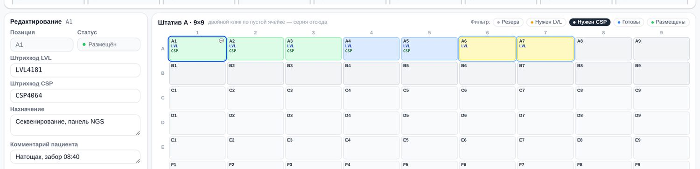
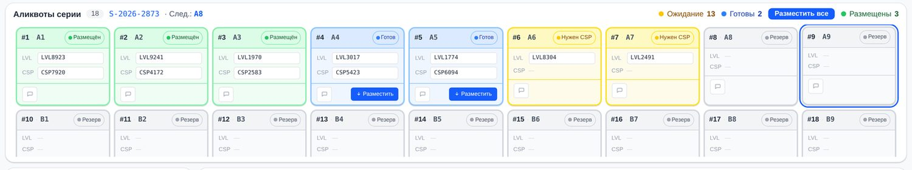
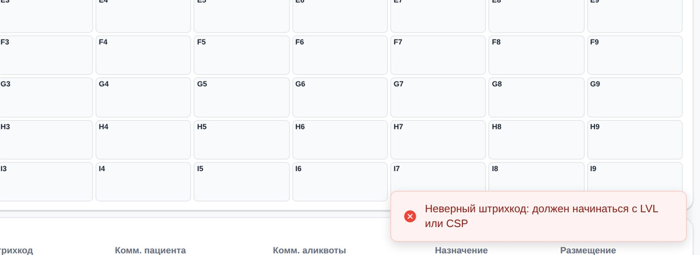

# Станция управления аликвотами

Я спроектировала рабочее место лаборанта биобанка. Лаборант раскладывает аликвоты по штативу в перчатках и со сканером в руках. Станция проверяет каждый код в момент сканирования и засчитывает размещение только после того, как пробирка встала в ячейку.

Продуктовый дизайн · ФИЦ Биомед · 2026 · версия 5

---

**Роль.** Продуктовый дизайнер. Постановка задачи, бизнес-логика, спецификация, интерфейс, интерактивный прототип, анализ рынка, сбор замечаний работников лаборатории.

**Команда.** Работники лаборатории давали замечания по ходу работы. Прототип и разборы я делала вместе с ИИ-ассистентом Claude.

**Сроки.** Пять недель.

**Масштаб.** Одна выгрузка ошибок импорта: 39 290 отклонённых строк по 747 штативам, из них 8 218 ошибок ручного ввода. У каждой аликвоты два штрихкода, за смену лаборант раскладывает несколько штативов.

**Статус.** Интерактивный прототип и спецификация. Работники лаборатории дали замечания, я разложила правки по приоритету. Замера эффекта нет.

**Материалы.** Интерактивный прототип · Спецификация на 41 сценарий · Разбор выгрузки ошибок импорта · Сравнение 11 лабораторных систем · Разбор 33 проблем и решений · Замечания работников лаборатории

---

## Коротко

**Что было.** Раскладку аликвот записывали в таблицу и загружали в базу биобанка файлом. Ошибки находились только при загрузке, когда штатив уже стоял в морозильнике. Одна выгрузка насчитала 39 290 отклонённых строк. 8 218 из них (21 %) это ошибки ручного ввода, их станция ловит у стола. Ещё 29 541 строка повторяла то, что уже было в базе.

**Что я сделала.** Станцию на одном экране: настройки серии, карточки аликвот, штатив, редактор и реестр. Ввод идёт сканером, следующую позицию выбирает система, данные сохраняются сами, модальных окон нет.

**Главное решение.** Два отдельных статуса, «Готов» и «Размещён». Аликвота считается размещённой только после того, как лаборант подтвердил, что пробирка стоит в ячейке.

**Результат.** Работники лаборатории дали замечания, я разложила правки по приоритету. Замера эффекта нет, поэтому цифру экономии я не называю.

---

## Место в системе

Станция входит в медицинскую информационную систему центра. В ней три рабочих места, и станция стоит в конце цепочки. Участник подаёт заявку и заполняет анкету в личном кабинете, врач-модератор проверяет их в своём кабинете. На визите у участника берут кровь, и в биобанке она становится образцом. Лаборант делит образец на аликвоты и раскладывает по штативам. Стадии образца участник потом видит у себя в кабинете.

*Схема системы*

Кабинет участника и кабинет врача описаны отдельными кейсами: [кабинет участника](case:participant-portal) и [кабинет врача-модератора](case:doctor-portal). Вся система описана [в общем кейсе](case:fic-overview). Интеграции между частями пока нет, станция ведёт собственный реестр.

---

## Задача

Биобанк хранит биологические образцы. Пробу делят на порции, аликвоты, и раскладывают по ячейкам штатива. Каждую аликвоту связывают с двумя штрихкодами: LVL на пробирке и CSP на крышке. Пока связь есть, образец можно найти.

Работа началась с выгрузки ошибок импорта. Раскладку записывали в таблицу и загружали в базу биобанка файлом. Проверка шла только при загрузке, на следующий день. В выгрузке было 39 290 отклонённых строк по 747 штативам.

| Причина отказа | Строк |
|---|---|
| Аликвота с таким номером уже существует | 29 541 |
| Указанный штатив не найден | 3 835 |
| Не заполнен ни номер аликвоты, ни lv-код | 2 167 |
| Номер аликвоты повторяется внутри одного файла | 1 469 |
| Ячейка штатива уже занята в этом же файле | 747 |
| Несколько причин сразу | 1 531 |

Самая большая группа, 29 541 строка, повторяла записи, которые уже были в базе с тем же штативом и той же ячейкой. Похоже, файлы с уже внесённой раскладкой загружали повторно [ПРОВЕРИТЬ: почему файлы загружали повторно]. Ошибки ручного ввода дают четыре причины из таблицы: штатив, которого нет в справочнике, пустой код, повтор номера в одном файле, занятая ячейка. Вместе это 8 218 строк, 21 % выгрузки. Ещё 1 531 строка отклонена сразу по нескольким причинам. Ошибку находили, когда штатив уже стоял в морозильнике, и разбирать её приходилось задним числом.

Из этого я вывела два требования, на которых построена вся станция:

- ошибка должна находиться в момент сканирования, пока пробирка в руке;
- статус в системе не должен обгонять то, что физически стоит в штативе.

Ошибки ручного ввода станция закрывает у стола. Штатив лаборант выбирает из списка, коды вводит сканером, свободную позицию выбирает система.

---

## Пользователи и условия работы

У лаборанта в одной руке пробирка, в другой сканер, на руках перчатки. За смену он раскладывает несколько штативов подряд. Работа монотонная и требует точности.

Главное ограничение лаборанты назвали сами: снимать перчатки как можно реже. Перчатки обязательны при работе с биоматериалом, и каждая замена стоит времени, расходников и риска. В перчатках можно отсканировать код и нажать крупную кнопку. Печатать, попадать в мелкие поля и переключать раскладку клавиатуры в перчатках почти нельзя.

Отсюда почти вся механика станции. Ввод идёт сканером. Следующую позицию выбирает система. Данные сохраняются сами. Всё, что можно сделать сразу для нескольких аликвот, делается сразу для нескольких. Клавиатура нужна только для исключений, например правки или комментария. Ради них перчатки снимают, но уже не на каждой пробирке.

В лабораториях два способа раскладки. Одни ведут каждую аликвоту целиком, от пробирки к крышке. Другие сначала сканируют все пробирки, потом все крышки. Станция поддерживает оба способа, переучиваться никому не нужно.

---

## Анализ рынка

Прежде чем проектировать, я разобрала одиннадцать лабораторных систем. Я смотрела, какие функции в них есть и как они устроены: модель данных, хранение, доступ к данным, штрихкоды, интерфейс.

Главное различие в том, вокруг чего построена модель данных. Большинство российских систем устроены как системы клинико-диагностической лаборатории: в центре пациент, от него идут заказы, материал записан как часть заказа. В такой лаборатории образец живёт несколько часов. В биобанке проба хранится годами и проходит через много исследований. Биобанку нужна модель вокруг образца: образец, аликвота, место хранения, срок годности. Такую модель я нашла у немногих систем, например у OpenSpecimen [ПРОВЕРИТЬ: вторая такая система, SENAITE или ЭФИР].

Хранение там, где оно есть, ведут как иерархию мест: хранилище, полка, рэк, ячейка. Её заполняют после раскладки, вручную или загрузкой файла. Момент, когда лаборант у стола связывает два штрихкода с ячейкой, не поддерживает ни одна система. Часть систем работает только как приложение под Windows. В сравнении интерфейсов у Инмедикума записаны задержки в браузере, перегруженный интерфейс и слабая адаптивность, у ЭФИР тоже ограниченная адаптивность.

Вывод: покупать целую систему ради одного экрана нет смысла, нужного экрана в ней всё равно нет. Я проектировала станцию как отдельный инструмент для одной операции, с расчётом, что данные потом уйдут в основную систему.

Похожую механику я искала в складской логистике. На складах и в пунктах выдачи маркетплейсов, например Ozon и Wildberries, у каждой ячейки есть адрес. Система сама называет ячейку, сотрудник сканирует товар и подтверждает, что положил его на место. Неверный штрихкод видно сразу. В лабораторных системах такого направленного размещения нет. Из складов в станцию перешла именно эта механика:

- штатив на экране повторяет штатив на столе, у позиций адреса от A1 до I9;
- следующую позицию выбирает система, лаборант только сканирует;
- размещение подтверждается отдельно, кнопкой «Разместить», а «Разместить все» подтверждает все готовые аликвоты сразу;
- статус каждой позиции виден цветом по всему штативу.

**Отказалась.** Взять готовую складскую систему. В ней уже есть адресное хранение и направленное размещение.

**Выбрала.** Перенести механику в отдельную станцию. Складская система построена вокруг товара и ячейки стеллажа. У аликвоты два штрихкода, и ей нужна модель образца со сроком хранения [ПРОВЕРИТЬ: причина отказа от складской системы].

---

## Решения

Где было несколько разумных вариантов, я выбирала явно. Для части решений я показываю вариант, от которого отказалась, и причину.

### Один экран

Всё находится на одной странице: настройки серии, карточки аликвот, штатив, редактор и реестр. Вкладок и переходов нет. Лаборант постоянно сверяет экран со штативом на столе, и каждое переключение замедляет сверку.

Отсюда же размер ячейки. Я пробовала показывать в ячейке всё: статус текстом, оба полных штрихкода, комментарий. Тогда на экран помещалась сетка 4 × 4. Средний вариант давал 8 × 8, и штатив целиком всё равно не читался. Я оставила в ячейке номер позиции, отметки о том, какие коды уже есть, и значок комментария. Полный код виден в карточке и в редакторе.

### Статусы аликвоты

Статусов шесть: «Пусто», «Резерв», «Нужен LVL», «Нужен CSP», «Готов», «Размещён». В первой версии статусы различались подписями, и картину по штативу приходилось читать по каждой ячейке. Я перевела статус в заливку. Цвета идут по степени готовности. «Пусто» и «Резерв» серые, «Нужен LVL» янтарный, «Нужен CSP» жёлтый, «Готов» голубой, «Размещён» зелёный.

В карточке к цвету добавлена подпись: часть людей плохо различает оттенки, а освещение в лабораториях разное. Фильтр по статусу подсвечивает ячейки прямо в штативе. Так видно, сколько работы осталось и где она лежит.

### «Готов» и «Размещён»

**Отказалась.** Считать аликвоту размещённой сразу после второго скана. Так на каждой пробирке на одно действие меньше.

**Выбрала.** Два статуса. «Готов» значит, что оба штрихкода привязаны. «Размещён» лаборант ставит отдельно, когда пробирка стоит в ячейке.

Отсканированная пробирка может остаться лежать на столе. Если система засчитает её раньше, база разойдётся с тем, что стоит в штативе, а станция нужна как раз для того, чтобы этого не происходило. Чтобы лишний шаг не стоил много работы, я сократила размещение до одного действия. Раньше нужно было выбрать позицию, открыть редактор и нажать кнопку. Теперь кнопка «Разместить» стоит прямо на карточке в статусе «Готов», а «Разместить все» размещает все готовые аликвоты сразу.

### Выбор следующей позиции

Следующую позицию выбирает система по выбранному режиму, а лаборант только сканирует. Номер позиции стоит в строке серии. К этому варианту я пришла с третьей попытки. Сначала позицию выбирал сам лаборант: он тратил время на поиск свободной ячейки и иногда ошибался. Потом система стала подсказывать позицию, но не переводила на неё ввод, и промахи остались.

В пакетном режиме лаборант сначала сканирует все пробирки, потом все крышки. Когда пробирки закончились, экран сообщает: «Все LVL отсканированы. Переход к фазе CSP». Код другого этапа система не принимает и объясняет почему. Этап я сначала хранила отдельно, и после ручной правки кода он расходился с серией. Теперь этап вычисляется из состояния серии, и расхождения нет.

### Три представления одной аликвоты

Одна аликвота видна в трёх местах: в ячейке штатива, в карточке серии и в строке реестра. Сначала они жили отдельно, и можно было выбрать карточку одной позиции, а в штативе видеть подсвеченной другую. Я сделала выделение одним на всю станцию. Выбор в любом из трёх мест подсвечивает аликвоту в двух других и открывает её в редакторе. Лаборант всегда видит, с какой пробиркой работает.

### Модальные окна

**Отказалась.** Обычные окна подтверждения и системные окна браузера alert и confirm.

**Выбрала.** Уведомления в углу экрана. Они держатся 1,8 секунды и ничего не блокируют. Редактор всегда открыт в панели рядом со штативом.

Причина техническая. Сканер подключается к компьютеру как клавиатура, а модальное окно перехватывает ввод. Лаборант продолжает сканировать, не глядя на экран, и коды пропадают. В перчатках и в быстром темпе это замечают не сразу. Вторая причина в перчатках: окно нужно закрыть, а для этого надо попасть курсором в кнопку.

В редакторе нет кнопки «Сохранить»: поле сохраняется, когда лаборант переходит к следующему. На серии из восьмидесяти позиций это восемьдесят нажатий, которых не нужно делать.

### Ошибки и отмена

Я продумала выход из состояний, в которых можно застрять. Отмена серии освобождает неразмещённые позиции, а размещённые оставляет на месте и отвязывает от серии. Удалённая аликвота возвращает позицию в «Резерв», если она внутри серии, и в «Пусто», если снаружи. Штатив можно сбросить целиком, любой штрихкод можно поправить вручную.

Код без префикса LVL или CSP система не принимает и называет причину. Она не принимает код и тогда, когда серия не начата или свободных позиций не хватает. Повтор LVL и повтор CSP я заложила в спецификацию отдельными сценариями, «Дубликат LVL» и «Дубликат CSP». Ещё один сценарий так и называется: «Исправление ошибок оператора».

### Сетка штатива

Штативы в биобанке бывают разного размера, поэтому список штативов и их сетку станция должна брать из справочника. В прототипе три штатива, все 9 × 9, и лаборант выбирает штатив из списка. Раскладка подстраивается под ширину экрана: лаборант видит штатив, карточки серии и реестр одновременно.

### Оформление

Последней я пересобрала прототип в Figma Make и сделала оформление плотнее, чем в Material Design 3: меньше скругления и отступы, тонкие тени, моноширинный шрифт для штрихкодов. Крупные отступы Material Design 3 не давали увидеть всю рабочую зону сразу. Тогда же появились кнопка «Разместить все», поле «Назначение» и старт серии двойным щелчком с любой свободной позиции.

### Терминология

Первая версия говорила «Создать батч», «Размер батча», «Батч завершён». Лаборанты так не говорят, поэтому я везде заменила «батч» на «серию», включая идентификаторы и тексты уведомлений. Сетка сначала называлась стеллажом, хотя стеллажом называют мебель, на которой стоят штативы. Я переименовала её в штатив. От этих слов зависит, поймёт ли лаборант экран без обучения.

---

## Проверка

Замечания давали все работники лаборатории, пока работали со станцией. Я собирала их сама, по ходу работы, без отдельного протокола. Ниже то, что повторялось.

**Карточки и штатив.** Работники просили, чтобы в одну строку помещалось восемь-девять карточек, по числу позиций в ряду штатива, и чтобы шрифт кодов на карточках был крупнее. Тогда карточку можно сопоставить с ячейкой взглядом, без пересчёта.

**Непонятные отказы.** Если те же аликвоты уже внесены в другой штатив, станция не даёт сохранить и не объясняет почему. В замечаниях: «Не понятно почему кнопка сохранить не активна. Можно долго думать, что сломалось». Похожий случай с поиском: открытый штатив не показывает, насколько он заполнен. В обоих случаях человек не видит причину.

**Ввод.** Если вернуться к внесённой аликвоте, чтобы дописать комментарий, продолжить с места остановки нельзя: приходится заново сканировать последнюю позицию. Код, набранный в русской раскладке, не распознаётся, и ошибки нет. Ручной ввод бывает только в исключениях, и ради него лаборант уже снял перчатки.

**Моя ошибка.** Когда я подгоняла раскладку под экран ноутбука, я заменила фиксированную высоту страницы на расчётную, и прокручиваться стала вся страница. Работники лаборатории попросили прокручивать только сетку штатива, чтобы карточки оставались на месте. Сама я этого не заметила.

---

## Результат

Есть интерактивный прототип и спецификация на 41 сценарий. Работники лаборатории дали замечания, я разложила правки по приоритету. Замера эффекта нет [ПРОВЕРИТЬ: был ли запуск станции].

Замерить эффект можно той же выгрузкой ошибок импорта: сравнить число отклонённых строк на штатив до станции и после, по каждой причине отдельно. Пока замера нет, цифру экономии я не называю.

---

## Что не сделано

**Первая очередь.** Прокрутка только сетки штатива, перенос карточек по рядам штатива, крупный шрифт кодов на карточках.

**Вторая очередь, объяснения отказов.** Подсветка и текст для дубликата из другого штатива, сообщение о неверной раскладке клавиатуры.

**Проверка повторов в прототипе.** Повтор LVL и CSP описан в спецификации, в последней найденной версии прототипа его нет [ПРОВЕРИТЬ: есть ли более поздняя версия прототипа]. Повтор номера, который уже есть в базе биобанка, станция увидит только после связи с лабораторной системой.

**Статус в ячейке.** В карточке статус подписан, в ячейке штатива его различают только по цвету.

**Отложено сознательно.** Горячие клавиши, отмена последнего действия, выгрузка реестра в CSV, связь с лабораторной системой. Версия для планшета тоже здесь: в части лабораторий работают с планшета, но раскладку для него придётся делать заново.

---

## Выводы

**Механику стоит искать в соседних отраслях.** Направленное размещение пришло в станцию со складов. В лабораторных системах его нет.

**Термины берутся из речи пользователей.** Замена «батча» на «серию» и «стеллажа» на «штатив» нужна, чтобы лаборант понял экран без обучения.

**Рабочему месту у стола нужна плотная раскладка.** Крупные отступы Material Design 3 не давали увидеть всю рабочую зону сразу.

**Запреты стоит записывать в требования.** Отдельный пункт о том, чего не должно быть, закрыл вопросы заранее: модальные окна, alert и стартовые данные.

**Анализ рынка нужен до проектирования.** Одиннадцать систем показали, что рабочего места для раскладки нет ни у кого, и решение делать свою станцию опирается на это сравнение.

**Механику задают условия работы.** Разделение «Готов» и «Размещён», отказ от модальных окон, автосохранение и действия сразу для нескольких аликвот появились из двух фактов: у лаборанта в руке пробирка, и снимать перчатки ему нельзя.

---

*Прототип собран в Figma Make. Скриншоты показывают прототип на разных этапах работы, данные на них демонстрационные. Прототип и разборы я делала вместе с ИИ-ассистентом Claude: ставила задачи, принимала решения и проверяла результат. Текст кейса подготовлен с помощью ИИ-ассистента по материалам проекта.*
