# Аналитика в голосовых роботах

Раздел «Аналитика» для голосовых роботов MANGO OFFICE. До него у клиентов была только статистика по каждому скрипту, и отчёты они собирали из выгрузок сами. Я спроектировала раздел от первого наброска до итогового макета: дашборд для руководства, таблицу и графики для работы над сценарием, сравнение периодов и роботов.

MANGO OFFICE · голосовые роботы · 2025–2026 · задачи `ROBOTS-4899` и `ROBOTS-5445`

---

**Роль.** Продуктовый дизайнер: макеты раздела от первого наброска до итогового макета на восемь сценариев. Макет я обсуждала с командой на двух встречах. Позже, для этого кейса, я вместе с ИИ-ассистентом Claude дорисовала недостающие по требованиям экраны и платную вкладку. UX-аудит макетов провёл ассистент по моему запросу.

**Команда.** Требования и конкурентный анализ подготовил UX-исследователь, встречи вёл представитель продуктовой команды. Разработчики бэкенда, фронтенда и тестирования оценивали задачи и предлагали решения.

**Сроки.** Продуктовый разбор задачи, две встречи команды с макетом, требования, итоговый макет и варианты дашборда. Позже дорисовано шесть экранов и проведён аудит.

**Масштаб.** Семь метрик с формулами, пять фильтров, сравнение периодов и роботов. В итоговом макете восемь сценариев и два варианта группировки дашборда.

**Статус.** Спроектировано. Что вошло в релиз, по архиву не видно. Дорисованные экраны в работу не уходили.

---

## Коротко

**Что было.** В продукте была только статистика: история работы каждого скрипта без показателей. Клиенты выгружали данные и сами собирали отчёты, и в выгрузку, как в случае с Озоном, помещалась не вся информация.

**Что я сделала.** Макет раздела на восемь сценариев. В нём дашборд, таблица и настраиваемые графики, сравнение периодов и роботов, фильтры. Кнопку «Добавить график» придумала я. Требования и конкурентный анализ подготовил UX-исследователь.

**Главное решение.** Отдельной платной услугой раздел не стал: на продуктовом разборе ведущий счёл, что показателей на старте мало. Базовые показатели получают все клиенты с роботом, платной будет вкладка с подробным набором метрик. На первом этапе команда вкладку отложила.

**Результат.** Требования и итоговый макет готовы. Цель MVP записана в цифрах: 30 % активных клиентов открывают дашборд каждую неделю. Замеров после запуска в архиве нет. Платную вкладку я дорисовала для этого кейса, в работу она не уходила.

---

## Место в продукте

«Роботы» объединяют пять сущностей MANGO OFFICE: голосовой робот, чат-бот, робот-администратор, AI-робот и AI-ассистент. Раздел аналитики сделан для голосовых роботов и стоит в меню отдельным пунктом. Рядом остаётся «Статистика», история работы каждого скрипта: кто звонил, что выбрал, чем закончился разговор. Аналитика собирает из этих событий показатели по роботам за период.

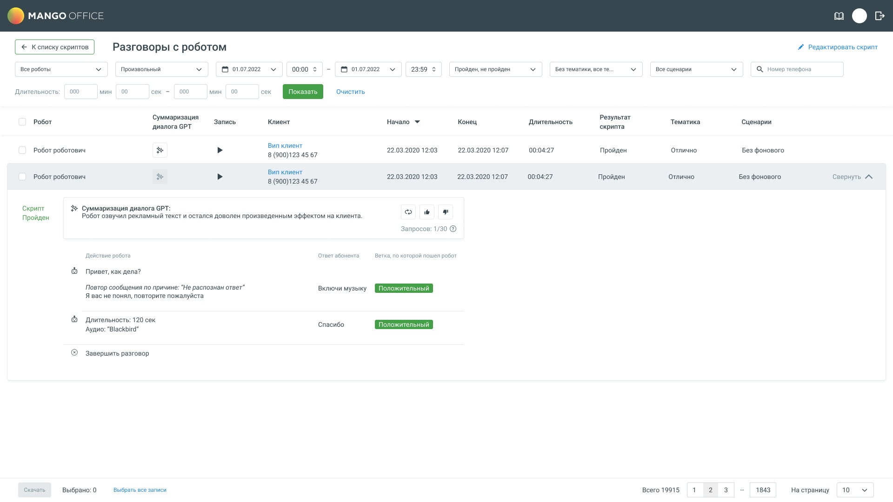

*Схема продукта*

---

## Задача

О проблеме команда знала со слов клиентов, которые делали выгрузки, главный пример Озон. На встрече её описали так. Клиенты выгружают статистику, чтобы получить хоть какую-то аналитику, и в выгрузку помещается не всё. Не каждый может сам сделать из неё выводы, и клиенты без ресурсов на это судят о роботе по ощущению.

Постановка задачи в макете отвергает три альтернативы. Ручные выгрузки уже есть и не дают наглядности. Интеграция с BI-системами слишком сложна для большинства клиентов. Отчёты по почте не дают анализировать данные.

В требованиях у пользователя две задачи: улучшать сценарии по ключевым метрикам и показывать результаты руководству. Поэтому сверху в разделе дашборд для отчёта, ниже таблица и настраиваемый график для работы. Цели MVP записаны в макете в цифрах:

- 30 % активных клиентов пользуются дашбордом не реже раза в неделю к концу квартала;
- 60 % активных клиентов хотя бы раз за квартал открыли дашборд и применили фильтр;
- среднее время работы с дашбордом не меньше 2 минут за визит.

---

## Пользователи

Главный пользователь отвечает за робота в компании-клиенте. Он смотрит показатели, чтобы поправить сценарий, и показывает результаты руководству. По словам ведущего встречи, такой человек заходит либо почти каждый день, либо раз в месяц.

Масштаб ведущий назвал на встрече по данным внутренней системы отчётов: около 600 активных клиентов, 235–252 тысячи звонков роботов в месяц, в среднем 416 звонков на клиента. Он оговорился, что это среднее, «даже не медианное». Документа с этими числами в архиве нет.

---

## Ограничения

Почти каждое решение в разделе выросло из того, какие данные платформа умеет собрать.

| Ограничение | Откуда известно | Что из него следует |
|---|---|---|
| Признака «успешный звонок» в скрипте нет | встреча команды | автоматизированными считаются все звонки без перевода на оператора, в том числе с ошибкой скрипта |
| Входящий и исходящий звонок система не различает | встреча команды | фильтр «Тип звонка» из требований в макет не вошёл |
| Звонок, который не дошёл до робота, платформа не видит | продуктовый разбор | дозваниваемость не посчитать без отдельного сервиса, который слушает события коммутатора |
| Данные пишет новый сервис на ClickHouse с момента выхода функции | встречи команды | за прошлые периоды данных нет, нужна заглушка |
| У крупных клиентов по сто тысяч звонков в месяц и больше | встреча команды | отчёт строится по кнопке, построение можно остановить |
| Статистика собирается по роботам | встреча команды | фильтра по скрипту нет |
| В дизайн-системе MDS нет графиков и диаграмм | продуктовый разбор, встреча команды | графики берутся из библиотеки Highcharts |

Ошибки в работе робота участники разбора решили клиентам пока не показывать. У Озона их несколько тысяч в день, и причину каждой с ходу не объяснить. Довод на разборе: «если мы покажем Озону там 3000 ошибок в день, то он спросит, а что за ошибки?». Метрику оставили для расширенной аналитики.

---

## Конкурентный анализ

UX-исследователь разобрал восемь прямых конкурентов, четыре отчёта MANGO OFFICE для операторов и сервисы Dashbot, Botanalytics и Яндекс Метрику.

| Конкурент | Графики по роботам | Доля без оператора | Нераспознанные фразы | Шаги сценария | Сравнение с прошлым периодом | Выгрузка |
|---|---|---|---|---|---|---|
| Just AI, JAICP | да | да | да | да, метрики в блоках сценария | да, «+4%» | XLSX, письма раз в неделю |
| Just AI, Aimylogic | да | — | да | результаты в блоках сценария | да | XLSX |
| Naumen Erudite | — | да, значение задаёт заказчик | «неклассифицированные реплики» | сценарии, пройденные до конца | — | сводный отчёт |
| Vocamate AI | — | — | — | да, ветки диалога | — | рассылка отчётов |
| Voximplant Kit | только по операторам | — | — | — | да | XLSX, CSV |
| Twin24 | общие круговые диаграммы | — | — | — | — | Excel |
| Скорозвон | нет | — | — | — | — | CSV, XLSX |
| Alto AI | нет | — | — | — | — | XLSX |
| TC Exolve | нет | — | — | — | — | API |

«—» значит, что в разборе об этом не сказано.

- **Три конкурента из восьми графиков не дают совсем.** У Скорозвона, Alto AI и TC Exolve аналитика сводится к выгрузке или API. У Twin24 есть общие круговые диаграммы, но, по наблюдению исследователя, графики там предлагают строить по выгрузке в Excel самим. Статистика MANGO OFFICE до раздела работала так же, поэтому дашборд уже отличает продукт.
- **Сравнение с прошлым периодом есть у Just AI и Voximplant Kit.** В макете есть сравнение периодов с изменением в процентах в карточках.
- **Нераспознанные фразы и шаги сценария есть у Just AI, Naumen Erudite, Vocamate AI и Dashbot.** В базовую вкладку они не вошли. Для этого кейса я положила их в расширенную.

---

## Ход задачи

### Охват раздела

На разборе страницу задумывали общей для звонков, чатов и запусков робота-администратора. В итоговом макете раздел только для голосовых роботов. Участник встречи попросил сказать это в заголовке, иначе клиент с голосовым роботом и чат-ботом нажмёт «Сравнить роботов» и не найдёт там чат-бота. Так появился заголовок «Аналитика по голосовым роботам». Почему от общей страницы перешли к голосовым роботам, в архиве не записано.

### Состав метрик

Первая постановка описывала MVP с тремя метриками: всего звонков, процент переводов, средняя длительность. Ведущий на встрече сказал, что её писали в прошлом квартале под другие условия. UX-исследователь собрал требования заново, и метрик стало семь. Оценки выросли: фронтенд и тестирование с 5 до 8, сбор метрик на бэкенде с 3 до 5.

В первом наброске метрик было больше, в трёх группах: «Звонки», «Эффективность и качество диалога» и «Экономическая эффективность». Среди них прерванные сценарии, глубина прохождения скрипта, FCR, повторные обращения, расход за период. Метрики качества диалога и экономики в итоговый макет не вошли, потому что команда ещё не знала, как их считать. Вопрос на полях «тут нужно сравнение периодов?» стал отдельным сценарием.

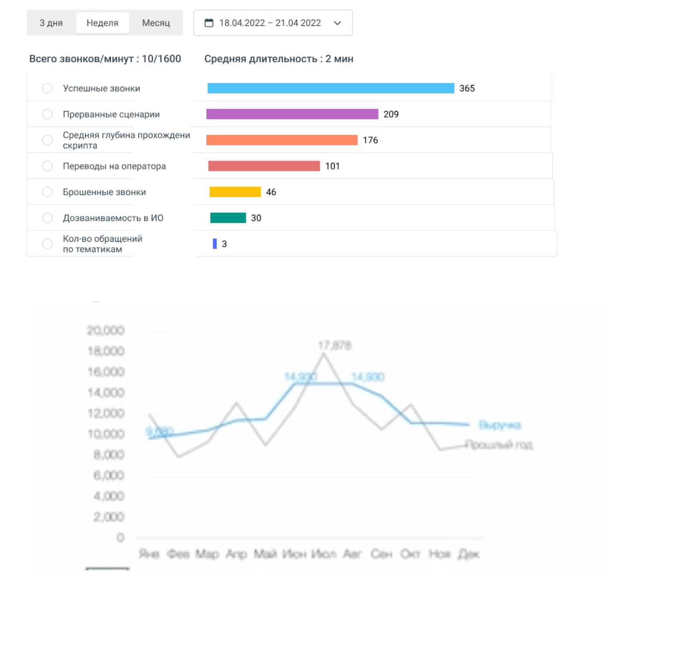

---

## Решения

### Платная вкладка

Сначала раздел задумывали отдельной платной услугой.

**Отказались:** продавать аналитику целиком. Так раздел сразу приносил бы деньги. Но показателей, которые платформа может посчитать на старте, мало, и ведущий разбора сказал: «Но если у нас показателей будет так немного, то отдельной услуги здесь смысла вообще просто нет».

**Выбрали:** базовые показатели для всех клиентов с роботом и платный подробный набор метрик позже. Список для него ведущий взял у МТС и дополнил по похожим продуктам. Цена решения: базовая вкладка денег не приносит.

В требованиях граница платного проведена вкладками «Базовая аналитика» и «Расширенная аналитика». В других фичах продукта о монетизации договаривались позже и ставили баннер поверх готового экрана, а вкладка предупреждает заранее. На первом этапе команда вкладки отложила, в итоговом макете их нет. Для этого кейса я их дорисовала.

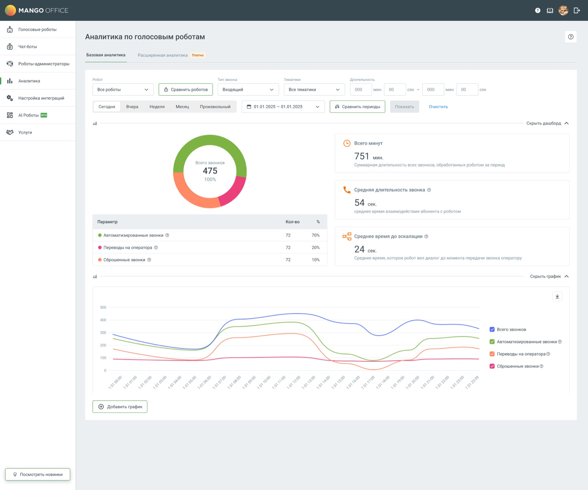

### Набор по умолчанию

Страница открывается с готовым отчётом по всем роботам за сегодня. После входа в «Роботы» человек попадает сразу сюда. Почему аналитика стала стартовым экраном, в архиве не записано.

**Отказались:** пустая страница, где человек сам добавляет блоки. Её предлагали на разборе и на встрече, потому что такая страница не грузит лишнего. Но человек, который не разобрался, увидит пустой экран и, скорее всего, уйдёт: «делать страницу, на которой тебе нужно что-то настроить, чтобы тебе что-то выгрузилось, это не очень user-friendly».

**Выбрали:** набор минимум по умолчанию и детализацию через фильтры. Блоки можно скрыть. Цена: у крупного клиента первая загрузка будет долгой даже за один день.

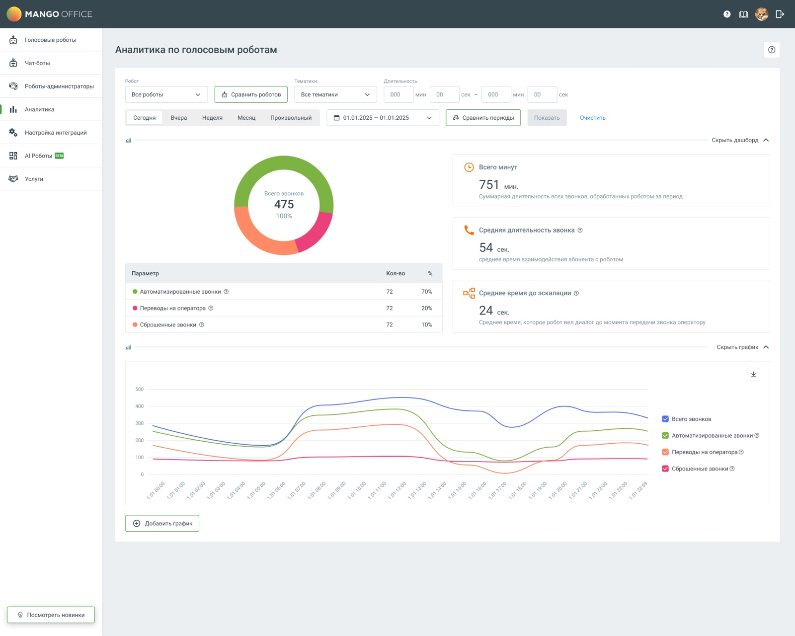

### Кнопка «Показать»

Отчёт строится по кнопке «Показать», она становится активной после смены фильтра или дат.

**Отказались:** перестраивать отчёт после каждого изменения. Так человек видит результат без лишнего нажатия.

**Выбрали:** кнопку. Разработчик напомнил, что у крупных клиентов по сто тысяч звонков в месяц, и пересчёт на каждый клик даёт «Очень большой шанс что-нибудь перегрузить». Так же уже работала статистика. Цена: после смены фильтров на экране старые данные, пока человек не нажмёт кнопку.

Кнопку «Остановить построение отчета» предложил участник встречи, потому что в статистике люди, не дождавшись отчёта, обновляли страницу. В требованиях кнопка «Показать» называется «Сформировать».

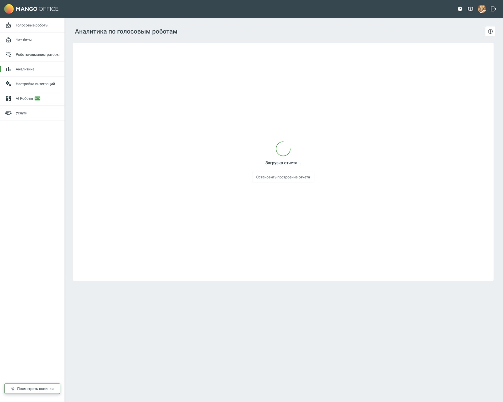

### Метрики

В требованиях у каждой из семи метрик записана формула. В макете знак вопроса у метрики открывает подсказку: у звонков какие звонки считаются, у временных показателей формула.

| Метрика | Что считается |
|---|---|
| Всего звонков | Общее количество звонков, обработанных роботом за период |
| Автоматизированные звонки | Количество и процент звонков без привлечения оператора |
| Переводы на оператора | Количество и процент звонков, завершившихся переводом |
| Сброшенные звонки | Количество и процент звонков, сброшенных клиентом в первые Х секунд |

| Временной показатель | Формула |
|---|---|
| Всего минут | Суммарная длительность всех звонков |
| Средняя длительность звонка | Всего минут ÷ Всего звонков |
| Среднее время до эскалации | Сумма времени переведённых звонков ÷ Количество переведённых |

**Переводы.** К ним на встрече отнесли и перевод на внешний номер. Даже если там тоже робот, первый робот с задачей не справился.

**Сброшенные звонки.** Сначала сброшенным считали любой звонок, где клиент положил трубку. Но клиент может пройти почти весь скрипт, получить ответ и сбросить в конце, и такой звонок по смыслу успешный. Поэтому на встрече договорились считать сброшенным только звонок, который клиент завершил в первые Х секунд после начала диалога. Сколько секунд, не решили, ведущий склонялся к десяти.

**Автоматизированные звонки.** Сброшенные в первые Х секунд из них исключены. Иначе показатель рос бы за счёт людей, которые просто бросили трубку, и первая же сверка с выгрузкой клиента показала бы расхождение. Название выбирали долго: прежнее «Успешные звонки» участники сочли ещё менее понятным. Слова «автоматизированный» в продукте раньше не было, и название договорились показать редактору.

### Фильтры

| Фильтр | Опции | По умолчанию | Обязательный | В итоговом макете |
|---|---|---|---|---|
| По роботу | Все роботы, выборочно | Все роботы | да | есть |
| Тип звонка | Входящий, исходящий | Входящий | да | нет |
| Длительность | От ММ:СС до ММ:СС | не заполнено | нет | есть |
| Период | Сегодня, вчера, текущая неделя, текущий месяц, произвольный | Сегодня | да | есть |
| Тематики | Все, без тематик, выборочно | Все тематики | да | есть |

**Отказались:** фильтр по скрипту, о нём спросил участник встречи. Без него отчёт менее информативен.

**Выбрали:** робота как главную сущность отчёта, потому что статистика собирается по роботам. Скрипт могут поменять, у него бывают версии, один скрипт может стоять на двух роботах, и отчёт пришлось бы собирать из кусков. Срезы по скриптам отложили в расширенную аналитику.

**Период.** Команда сравнила вкладки с готовыми периодами, выпадающий список и календарь, как в Яндекс Метрике, и оставила вкладки. Довод ведущего: в календаре до готового периода на одно нажатие больше, а места это почти не освобождает.

### Сравнение периодов

Сравнение встроено в отчёт. Кнопка «Сравнить периоды» заменяет переключатель периода полями «Период 1» и «Период 2», и второй период подставляется по первому: для «сегодня» вчера, для текущей недели предыдущая.

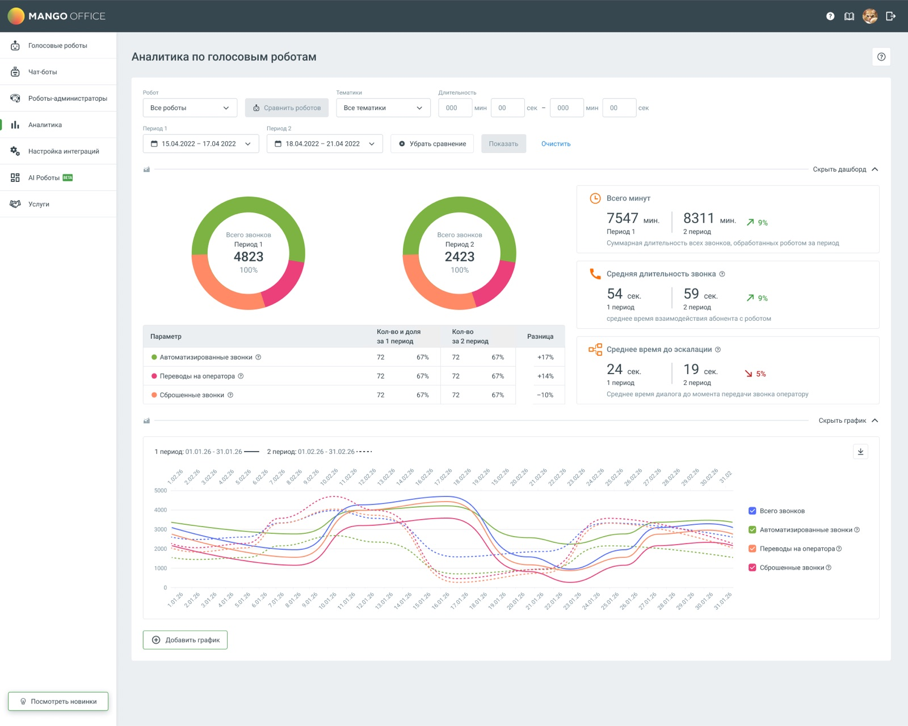

В итоговом макете автоподстановка не нарисована, для кейса я её дорисовала.

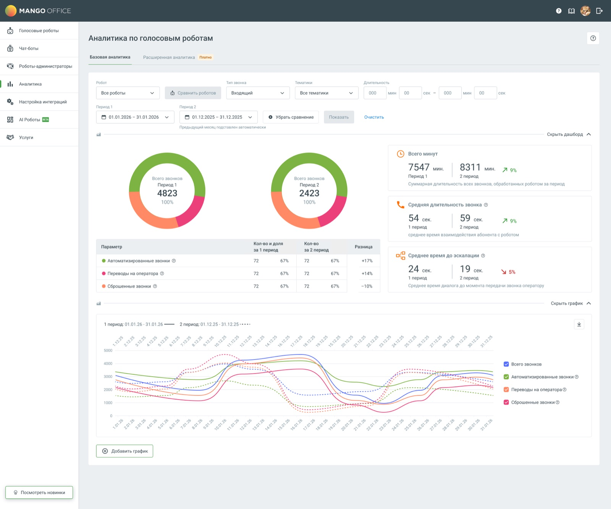

Периоды на графике различаются линией, сплошной и пунктирной, а цвет остаётся за метрикой. Иначе четыре метрики дали бы восемь цветов. Подсказка при наведении показывает точки обоих периодов.

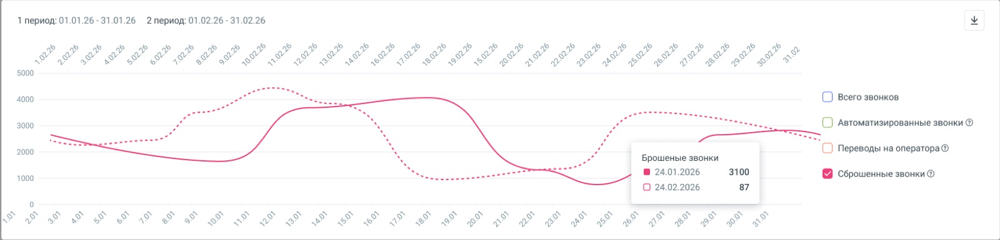

### Сравнение роботов

Кнопка «Сравнить роботов» неактивна, если на аккаунте один робот. Этот случай разобрали на встрече, и неактивная кнопка вошла в требования. Активная кнопка привела бы в пустое состояние с просьбой выбрать второго робота, которого нет.

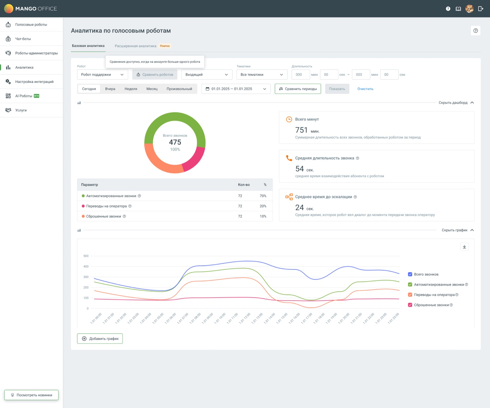

**Отказались:** сравнивать много роботов сразу. Это гибче, но на малом месте получается много мелких данных, в них легко запутаться. Ведущий не смог назвать сценарий, где клиенту нужно сравнить три робота с одним.

**Выбрали:** одного робота с одним, как в сравнении периодов. Если клиенты попросят больше, к этому вернутся.

Экран устроен так же, как сравнение периодов, только столбец в таблице называется «Изменение». Пока сравниваются роботы, сравнение периодов недоступно, и наоборот.

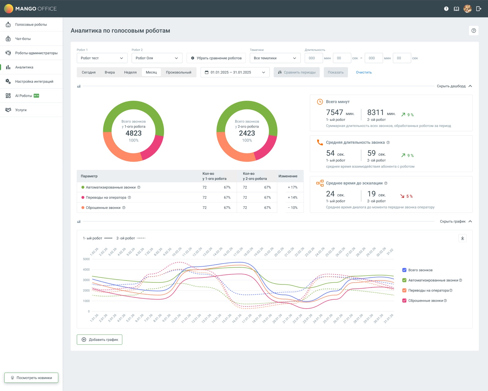

Если после нажатия «Показать» робот не выбран, поле подсвечивается красным.

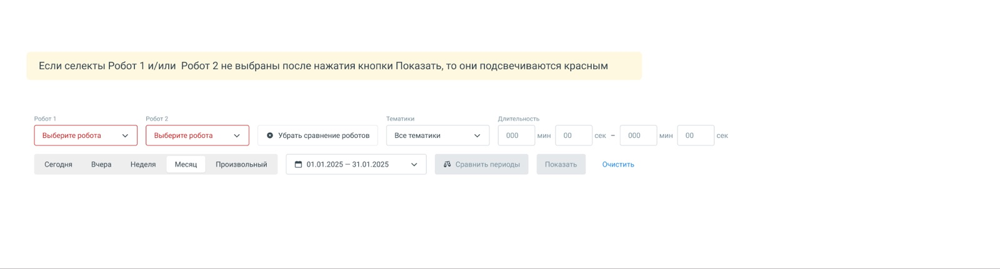

### Несколько графиков

Кнопку «Добавить график» придумала я. Ведущий на встрече спросил, зачем она, если есть сравнение периодов. Я объяснила, что на первом графике человек снимает лишние метрики, на втором отмечает нужные и сравнивает их рядом. При сравнении линий станет вдвое больше: «Это потом будет по периодам видно, зачем это нужно, когда станет не 4, а 8 линий».

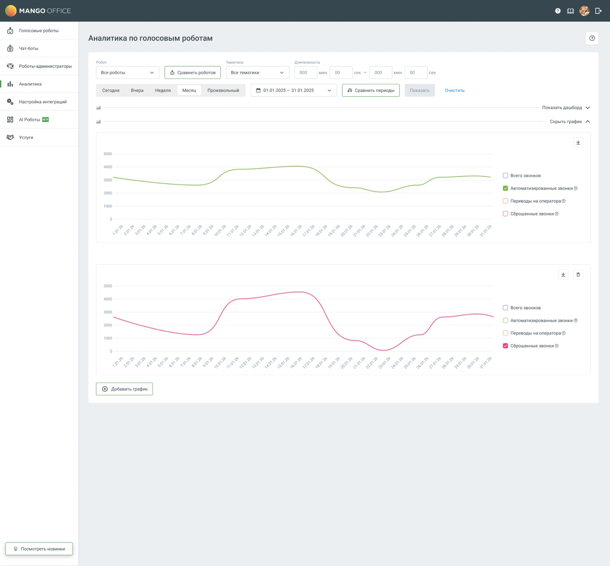

Корзина есть только у второго графика, один график остаётся всегда. Перед удалением раздел спрашивает подтверждение.

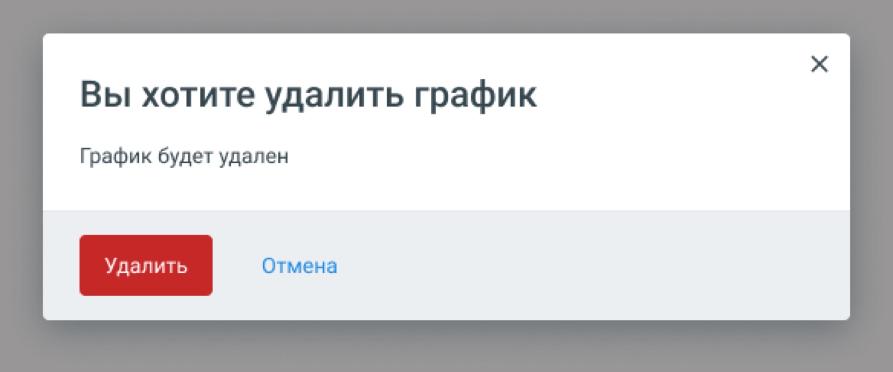

### Нет данных

Если данных за период нет, отчёт показывает заглушку с подсказкой, что поменять. Пустой график клиент прочитает как поломку. Данные пишутся с момента выхода функции, и за старые даты человек тоже увидит заглушку.

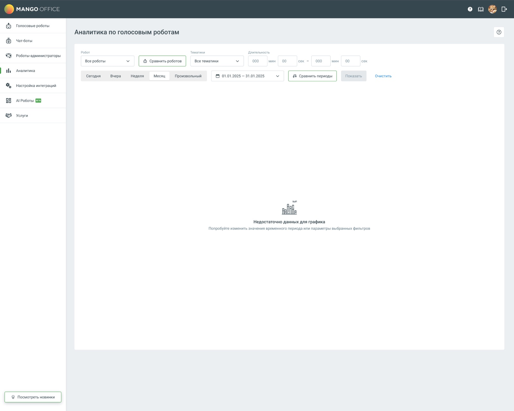

### Группировка дашборда

При сравнении итоговый макет показывает две круговые диаграммы, по одной на период. Вариант со столбцами я нарисовала в двух группировках, по метрикам и по периодам.

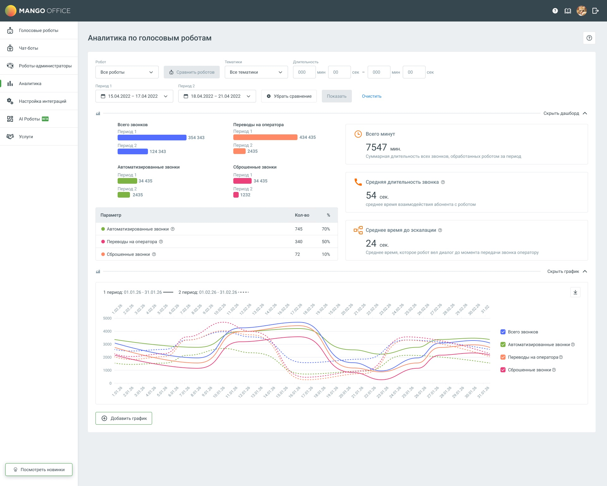

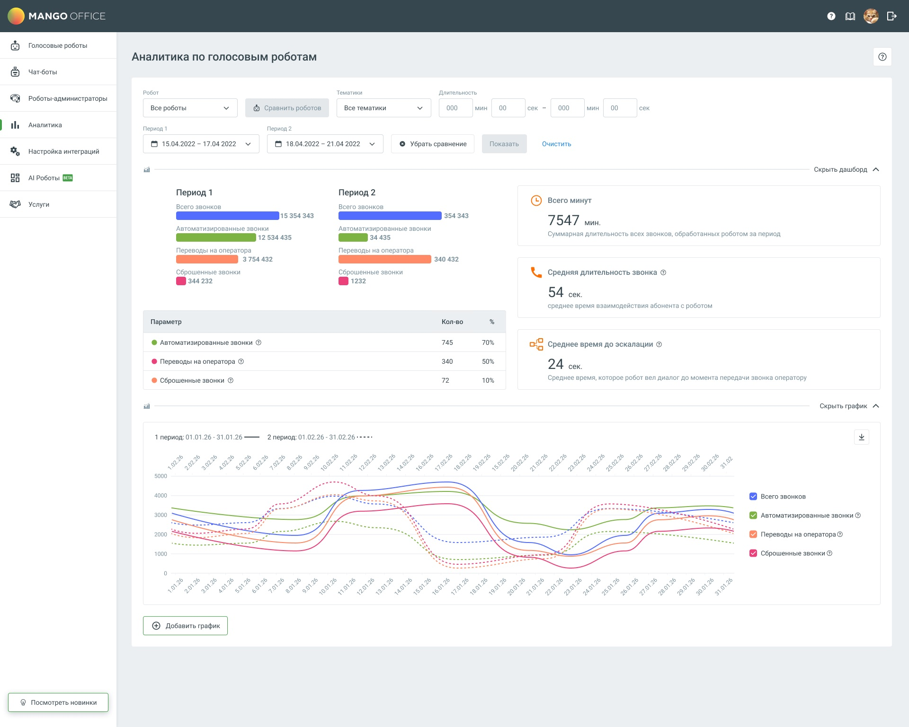

Аудит отметил, что в группировке по периодам у каждого периода свой масштаб, и 15 354 343 и 354 343 звонков выглядят одной длины. Какой вариант итоговый, в архиве не записано.

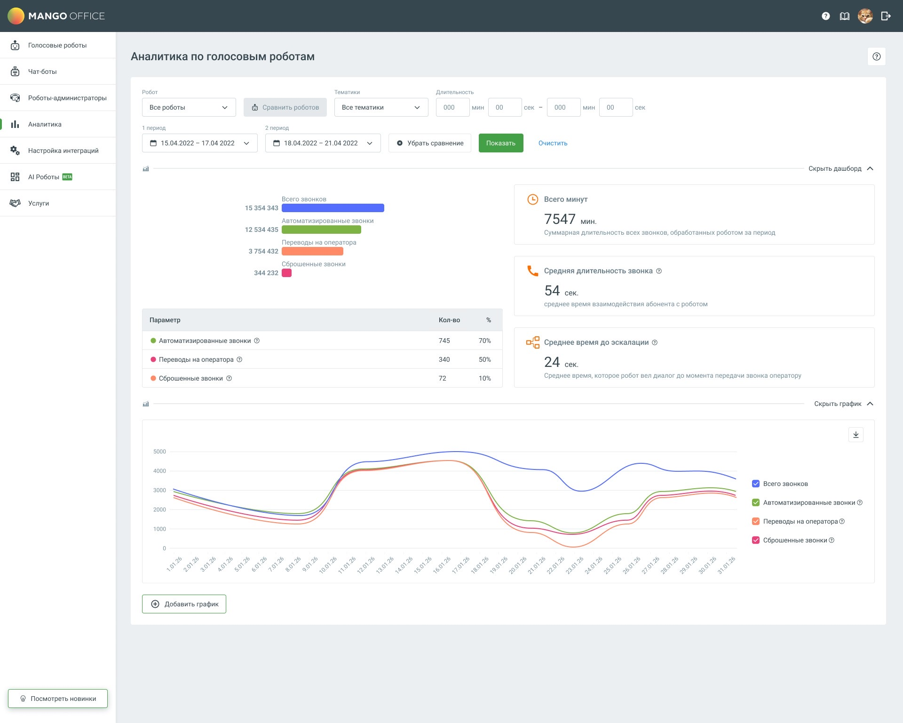

### Расширенная аналитика

В требованиях о платной вкладке одна строка: «будет реализовано позже». Метрики для неё на встречах не зафиксировали. Я дорисовала вкладку для этого кейса вместе с ИИ-ассистентом Claude, в работу эти экраны не уходили. Цены в архиве нет, поэтому на экранах «Х ₽».

Состав собран из материалов проекта. Определение «Решено с первого звонка» появилось при дорисовке, в наброске стоит только «FCR, %». Ошибок робота и срезов по скриптам, отложенных сюда на встречах, на экранах нет.

| Блок | Откуда |
|---|---|
| Прохождение скрипта по блокам | первый набросок, ветки диалога у Vocamate AI, компонент «Дашборд_funnel» в макете |
| Качество диалога: нераспознанные ответы, решено с первого звонка, повторные звонки, прерванные сценарии | первый набросок, коэффициент возврата у Dashbot |
| Нераспознанные фразы, которые можно добавить в скрипт | метки фраз у Just AI, Dashbot |
| Тематики обращений и доля звонков без оператора | первый набросок, Naumen Erudite |
| Экономия по ставке оператора | первый набросок |

Перед сборкой ассистент по моему запросу разобрал, как платные функции показывают другие продукты.

**Отказалась:** замок на вкладке и переход на страницу тарифов. Так проще сделать, и платное отделено жёстко. Но человек уходит с экрана и не видит, за что платит.

**Выбрала:** открытую вкладку с примером данных и карточкой поверх: что войдёт, сколько стоит, кнопка «Подключить». Так делает, например, Typeform. Цена решения: пример данных нужно поддерживать, чтобы он не расходился с настоящими метриками.

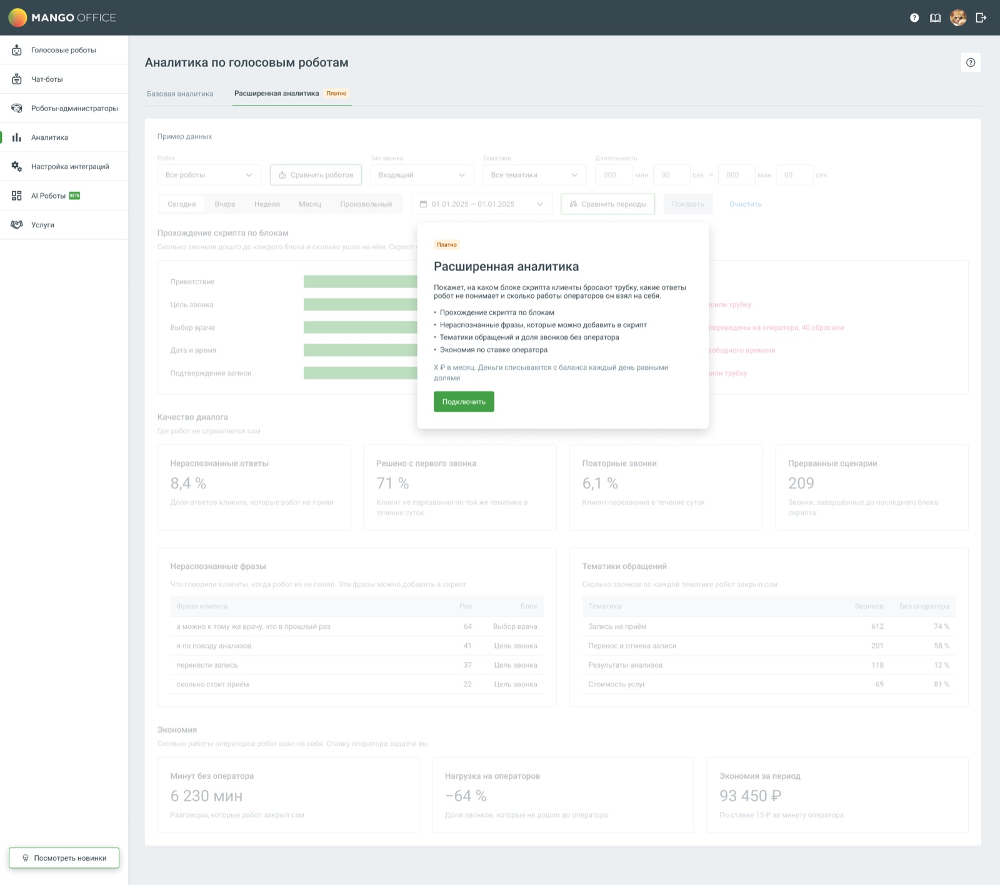

Деньги списываются с баланса каждый день равными долями, так же как плата за робота.

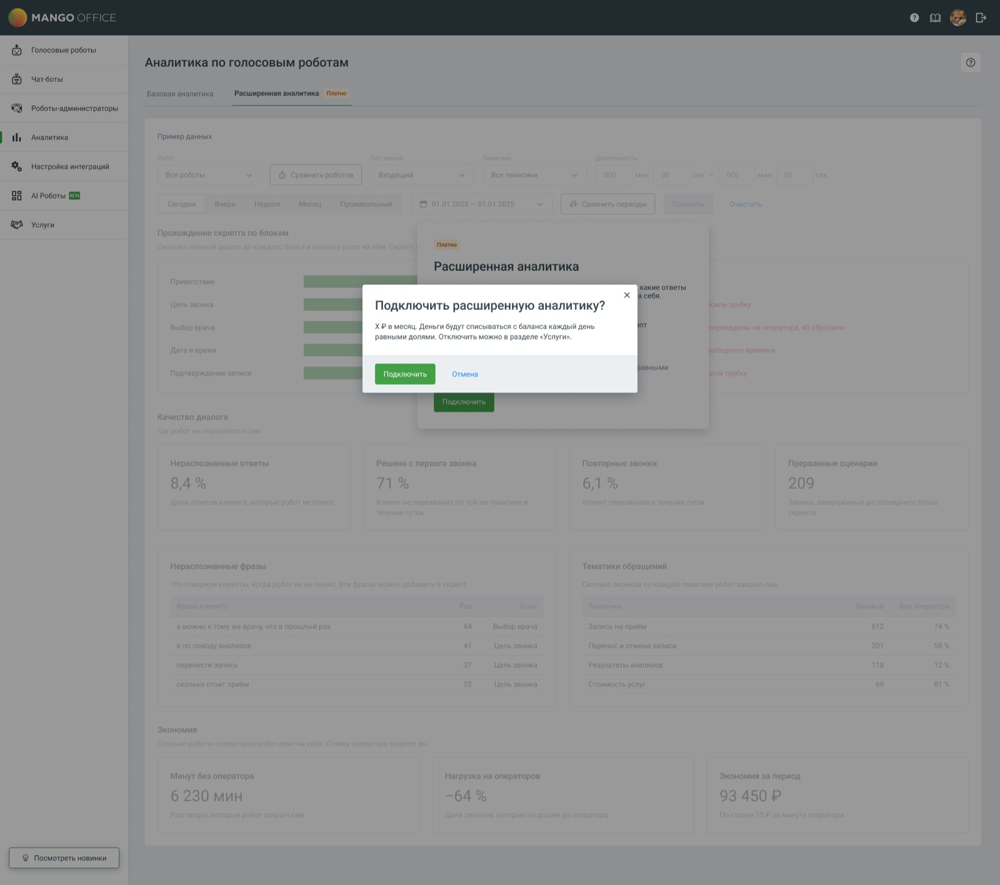

После подключения человек остаётся на той же вкладке и видит свои данные.

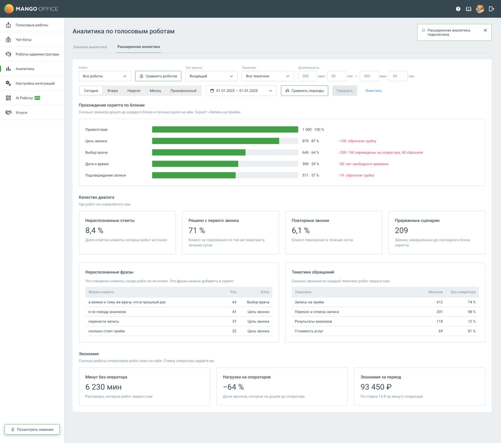

---

## Проверка

Исследований с клиентами об аналитике не было.

Позже ассистент по моему запросу провёл экспертный UX-аудит по эвристикам Нильсена и WCAG 2.2 AA. Аудит шёл по трём макетам сравнения из архива, итоговый макет он не видел. В итоговом макете есть столбец «Разница», оба значения в карточках, построение отчёта и заглушка. Аудит нашёл 27 проблем. Проблем серьёзности 4, когда основной сценарий не проходится, нет. Серьёзности 3 восемь, пять из них про режим сравнения. Каждая находка аудита это гипотеза для теста с клиентами.

Главное из аудита:

- **Состояния не нарисованы.** Ошибки и признака, что данные устарели после смены фильтров, в макетах нет.
- **От числа нельзя перейти к звонкам.** Увидев рост переводов, человек ищет эти звонки в «Статистике» вручную.
- **Цвета и тексты не сведены.** «Переводы на оператора» в таблице одного цвета, на графике другого. Контраст подписей 3,35:1 при норме 4,5:1.

Сильными сторонами аудит назвал формулы рядом с числами и сравнение одной кнопкой. Обновление по кнопке, сравнение одного робота с одним и отказ от фильтра по скрипту аудит предложил проверить на тесте до переделок.

---

## Результат

Готовы требования и итоговый макет на восемь сценариев: дашборд за период, скрытие дашборда и графиков, второй график, смена периода, сравнение периодов, сравнение роботов, заглушка, удаление графика. Часть экранов нарисована и для ширины 1440.

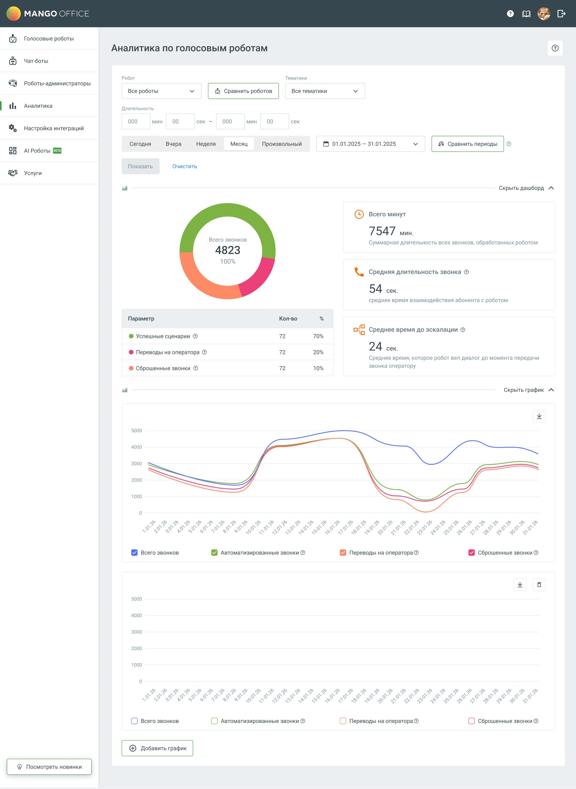

Платную вкладку я дорисовала для этого кейса, в работу она не уходила. Для кейса дорисованы и три экрана по требованиям, которых не было в макете.

Действия в разделе уходят в Яндекс Метрику, так что данные для замера целей MVP будут. Как раздел используют после запуска, в архиве нет. Долю клиентов с дашбордом стоит считать по аккаунтам. Команда рассказала на встрече, что по NLU Метрика насчитала больше сотни пользователей при сорока с небольшим аккаунтах, потому что в один аккаунт ходят несколько человек из компании.

---

## Выводы

**Метрике нужны точное определение и формула рядом с числом.** Формула среднего времени до эскалации неочевидна. Без исключения сброшенных из автоматизированных первая сверка с выгрузкой клиента покажет расхождение.

**Набор метрик решают данные, которые платформа уже умеет собрать.** Дозваниваемость, успешность и тип звонка выпали из MVP, потому что их нет в событиях платформы. Ошибки отложили: команда не могла объяснить их клиенту. Сейчас я бы начинала макет со списка доступных событий.

**Границу платного стоит закладывать в структуру раздела.** Вкладка есть в требованиях, на первом этапе команда её отложила. Ведущий отказался продавать раздел целиком, увидев, как мало в нём показателей.

**Неактивная кнопка лучше пустого состояния, когда заранее известно, что сравнивать не с чем.** Вопрос про одного робота задали на встрече, и он сразу ушёл в требования.

**Два признака на одном графике стоит разводить разными способами.** Цвет обозначает метрику, стиль линии обозначает период или робота, и цветов не становится вдвое больше.

**Названия метрик стоит закрепить словарём до макета.** Одна метрика называется «Сброшенные звонки», «Брошенные звонки» и «Брошеные звонки», в подписи к сценарию двух графиков осталось «Успешные сценарии» из первого наброска. Столбец сравнения называется «Разница» у периодов и «Изменение» у роботов. Сейчас я бы завела словарь метрик вместе с требованиями и показала его редактору до встреч.
