# Кабинет врача-модератора

Рабочее место врача и координатора клинического исследования. Здесь проверяют заявки и анкеты, которые участник отправляет из своего кабинета. Врач и координатор пишут замечания к конкретным полям, решают о приёме и ведут запись на визит. Я спроектировала рабочее место от модели ролей до интерфейса и прототипа, запрашивала конкурентный анализ и аудиты и решала, что из них идёт в продукт.

Продуктовый дизайн рабочих мест · ФИЦ Биомед · 2026 · версия 8

---

**Роль.** Продуктовый дизайнер рабочих мест и дизайн-аналитик. Постановка задачи, модель ролей и прав, продуктовая логика, интерфейс, прототип, конкурентный анализ, аудиты, перевод на дизайн-систему.

**Команда.** Разработчики. Требования к работе врача и координатора я собирала сама у врачей и модераторов центра, им же показывала прототип. Прототип, разборы и аудиты я делала вместе с ИИ-ассистентом Claude.

**Сроки.** 83 версии прототипа за 24 дня. За это время семь аудитов, четыре конкурентных анализа и продуктовый цикл с двумя документами требований к продукту (PRD).

**Масштаб.** Пять исследований, у каждого своя анкета и свой состав проверяющих. В прототипе анкета пока одна общая. По модели кабинета участника около 4000 участников и до 44 000 проверок врачами за двухлетний цикл.

**Статус.** Рабочий прототип, версия 83. Сервера нет, данные демонстрационные. Запуска не было, время проверки не измеряли. Прототип я показывала врачам и координаторам центра. Копия на React лежит в публичном репозитории.

**Материалы.** Интерактивный прототип · Конкурентный анализ 16 систем · Разбор ролей по 14 источникам · Семь аудитов · Документы продуктового цикла и два PRD · База знаний по логике кабинета · Копия на React

---

## Коротко

**Что было.** Врач читал ответы участников в таблице выгрузки Яндекс Форм и писал замечания письмами. Участник после отправки не видел ни статуса, ни ответа врача.

**Что я сделала.** Спроектировала рабочее место врача и координатора: очереди по визитам протокола, карточку проверки с замечаниями к полям, окна решения и две линии проверки. Собрала прототип вместе с ИИ-ассистентом, запросила конкурентный анализ и семь аудитов и выбрала, что из них идёт в прототип. Вместе с ассистентом перевела кабинет на общую дизайн-систему.

**Главная находка.** У человека в кабинете одна роль, и он её не переключает. Назначение на исследование решает, где человек работает, и из назначений выводится режим отбора. У координатора и врача разные каналы сообщений, поэтому замечание уходит участнику, а заметка остаётся врачу.

**Результат.** Рабочий прототип, база знаний по логике кабинета и два PRD. Прототип я показывала врачам и координаторам центра. Запуска не было, время проверки не измеряли. Вместо метрик есть модель кабинета участника: каждая минута, сэкономленная на проверке анкеты, даёт от 210 до 380 часов за цикл.

---

## Место в системе

Кабинет врача входит в медицинскую информационную систему центра из трёх рабочих мест. Участник подаёт заявку и заполняет анкету в своём кабинете. Врач и координатор проверяют их здесь и возвращают решение. Потом участник записывается на визит и сдаёт кровь. В биобанке лаборант делит её на порции для хранения, аликвоты, и стадии образца участник видит у себя в кабинете.

Процесс задаёт кабинет участника. Из четырёх шагов врач и координатор подтверждают три: первый шаг, анкету и запись на визит. Четвёртый шаг, результаты, ведёт лаборатория. Первый шаг и запись кабинеты пока описывают по-разному, об этом ниже, в разделе «Стык с кабинетом участника».

*Схема системы*

Кабинет участника и станция аликвот описаны отдельными кейсами: [кабинет участника](case:participant-portal) и [станция аликвот](case:aliquot-station). Кабинет участника и станция вместе описаны в [общем кейсе](case:fic-overview). Интеграции между частями пока нет.

---

## Задача

До кабинета врач читал ответы участников сплошным списком в таблице выгрузки и искал ошибки глазами. Вопросы к участнику решали письмами.

По модели кабинета участника за двухлетний цикл врачи проверяют до 44 000 шагов без учёта возвратов. Каждая минута, сэкономленная на проверке анкеты, даёт от 210 до 380 часов за цикл.

Мне нужно было спроектировать рабочее место, где проверяют всё, что участник отправляет из своего кабинета. Это заявка с документами, анкета первого визита, анкеты повторных визитов и запись на визит. У рабочего места четыре цели:
- человек на смене видит всё, что ждёт его действия, и понимает, когда разобрал всё;
- замечание привязано к полю и уходит участнику в то же поле;
- решение о приёме остаётся за врачом, координатор снимает с него рутину;
- коллега, назначенный на чужое исследование, может его проверить: критерий показывает правило протокола, история пишет, кто и почему решил.

Прототип нужен был и для сбора требований. Когда требования видны на экране, их проще собирать. Поэтому этапы, для которых данных ещё нет, ассистент по моему запросу собрал примерным решением и подписал прямо на экране.

Задача росла по ходу работы. Исследований стало пять, у каждого своя анкета и свои проверяющие. Главному модератору понадобилась общая таблица всех участников. Потом появилась вторая роль, координатор, который смотрит заявки раньше врача.

---

## Пользователи

**Врач-модератор.** Решает о приёме и пригодности, подтверждает анкеты, смотрит отказы координатора. Работает за компьютером, телефон для него вспомогательный. Если координатора на исследовании нет, врач проверяет всё сам.

**Координатор.** Первая линия. Отсекает очевидное, возвращает участнику то, что можно исправить, и передаёт врачу остальное. Ведёт запись на визит, переносы и звонки.

**Руководитель исследования.** Врач, который назначает и снимает людей на своём исследовании и решает, видит ли координатор медицинские разделы анкеты.

**Главный модератор.** Нужен центру, чтобы видеть участников всех исследований. В прототипе этой роли и её экрана пока нет.

**Участник.** Видит только решение и замечания, адресованные ему. Работа двух ролей для него один этап: заявка на проверке.

Как устроена работа врачей и координаторов, я выясняла у них сама и им же показывала прототип [ДОБАВИТЬ: сколько было разговоров и показов]. Состав ролей в прототипе смоделирован. Нагрузку врача никто не измерял, об этом ниже, в разделе «Продуктовый цикл».

---

## Ограничения

**Процесс задан кабинетом участника.** Шаги, их названия и порядок взяты оттуда. Врач и координатор подтверждают отбор, анкету и запись, результаты ведёт лаборатория.

**Ответственность за отбор у врача.** По международному стандарту клинических исследований ICH E6(R3) и руководству американского регулятора FDA исследователь отвечает и за задачи, которые делегировал. Поэтому медицинское решение принимает только врач, и решение координатора остаётся видимым врачу.

**Медицинские данные и журнал решений.** Сведения о здоровье по 152-ФЗ, ст. 10, относятся к специальной категории персональных данных. Доступ координатора к медицинским разделам анкеты задаёт руководитель исследования. История заявки хранит, кто, когда и с какой причиной принял решение: такой журнал действий требует 21 CFR Part 11, § 11.10(e). Применимы ли правила надлежащей клинической практики к наблюдательным исследованиям центра, должны ответить юристы.

**Норматива срока проверки и плана набора нет.** Строка очереди пишет, сколько ждёт заявка, без красного цвета и слова «просрочено». Придумывать норматив я не стала.

**Согласия уже проверены.** Кабинет участника не отправит заявку без двух согласий. Поэтому критерия «согласие» в автопроверке нет.

**Решение только по присланному.** Возвращённая заявка лежит у участника, и решать по ней нельзя, пока он не исправит и не отправит её снова. Кнопок решения у такой заявки нет, панель пишет почему.

**Интеграций нет.** Связи с кабинетом участника, календарём водителя и клиник и с ИНВИТРО нет. Эти этапы собраны примерным решением, и экран пишет об этом: «Примерное решение: календаря водителя и связи с ИНВИТРО ещё нет, данные на экране смоделированы».

**Сервера нет.** Данные демонстрационные. Действия участника имитирует демо-панель, на кадрах она скрыта.

**Состав ролей меняется.** У одного исследования есть координатор и врач, у другого только врач, и после ротации кадров это может поменяться.

---

## Конкурентный анализ

До пересборки интерфейса я запросила разбор систем, где проверяющий разбирает анкеты по нескольким программам, а прошедший первый этап подаёт на второй. Я искала общую механику, отрасль могла быть любой. Источники нашёл и пересказал ИИ-ассистент по моему запросу, а что идёт в прототип, отбирала я.

Ассистент подробно разобрал 16 систем в трёх группах и ещё семь коротко. Выводы сделаны по справкам и открытым инструкциям, из двух инструкций он вынул 57 кадров интерфейса. В живых кабинетах этих систем мы не работали.

| Группа | Примеры | Что я взяла |
|---|---|---|
| Конкурсы фондов | Submittable, SurveyMonkey Apply, Reviewr | документ слева и данные справа; сквозной выбор исследования |
| Та же механика в других отраслях | Greenhouse, Slate Reader, OpenReview, Cayuse IRB, Moderation API | раздел только из того, что ждёт действия; отмена решения; клавиатура; этап не двигают назад вручную |
| Российские сервисы | ЕЦПЭ Главгосэкспертизы, Навигатор дополнительного образования, платформа Росмолодёжи, Хантфлоу | сортировка «сначала ждущие»; двухуровневый фильтр; наборы этапов; «Отложить» |

Из сводки в 27 паттернов двенадцать дошли до прототипа. Один из них, отметку «Смотрит», я потом убрала. Ещё семь я взяла и отложила, например нитку замечаний «закрыто / висит» и вопрос заявителю без смены статуса.

Часть того, что есть почти у всех, ассистент предложил не брать, и я согласилась: назначение и распределение заявок, обезличенную проверку, баллы и рубрики, пакетные действия, сохранённые виды, сроки и напоминания. Для пяти исследований и нескольких врачей эти функции пока не нужны. Пакетное одобрение к тому же позволяет пропустить несоответствие, которое кабинет сам посчитал.

Двух вещей не нашлось ни в одной из разобранных систем. Посчитанный критерий стоит рядом с ручным переключателем, и врач может одобрить заявку при несоответствии с обязательной причиной. И окно решения пишет, что прочитает участник. Остальные системы пишут только, что станет с заявкой.

Потом я попросила посмотреть Ozon, Wildberries и то, как CRM ведут лидов через воронку продаж. Обработка анкет и слежение за тем, пришёл ли человек на приём и сдал ли кровь, похожи на воронку. Справка Ozon и Wildberries в рабочей сессии не открылась, поэтому каждая строка разбора помечена «проверено», «со слов» или «мнение». Из 13 строк разбора четыре предлагали поменять модель данных: уровень замечания, «Отклонить», сроки по шагу и пересмотр решения. В прототипе из них есть «Отклонить» и пересмотр отказа координатора, уровня замечания нет.

Wildberries, по сторонним разборам, возвращает карточку товара со свободным текстом на всю карточку, и на это жалуются продавцы. Для меня это стало доводом за замечание к конкретному полю. Канбан воронки я не взяла. Он подходит, когда сделок много у многих людей, а здесь один врач и смена. Балл полноты по образцу контент-рейтинга Ozon тоже не взяла. Медицинские критерии бинарны, и сумма баллов для них ничего не добавляет.

Воронка помогла назвать и то, чего в продажах нет. Сделка либо движется вперёд, либо проиграна. У нас есть третий исход, брак пробы: участник без своей вины возвращается на шаг назад и записывается снова.

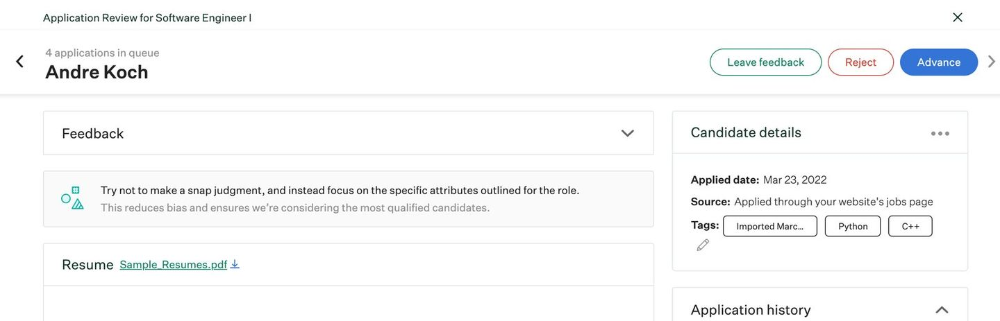
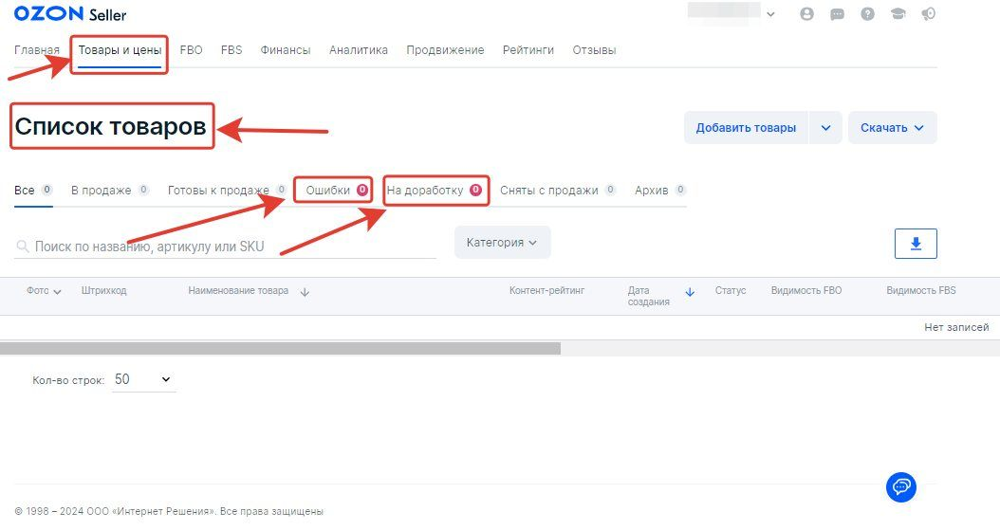

---

## Главная находка

У человека в кабинете одна роль, и он её не переключает. Назначение на исследование решает, где человек работает, и из назначений выводится режим отбора. У координатора и врача разные каналы сообщений: замечание уходит участнику, заметка остаётся врачу.

Пришла я к этому не сразу. Координатор появился, когда кабинет уже работал на одного врача. По моей постановке координатор первым смотрит заявку. Если есть вопросы, он пишет участнику, если всё хорошо, передаёт врачу, и врач смотрит заявку после него. Сначала я попросила продумать переключение между ролями, и ассистент поставил в шапку переключатель «Координатор · Врач». Он был в прототипе две версии.

Дальше я уточнила, как люди работают на самом деле, и записала правило так: «координатор не может стать врачом, но врач может стать координатором». Врач, который работает за координатора, сам просматривает анкеты с самого начала, и ему нужен тот же интерфейс, что был до ролей. Состав ролей у исследования тоже меняется: у диабета есть координатор и врач, у моногенных только врач.

Чтобы проверить модель, я попросила ассистента разобрать 14 источников: 11 систем, два регламента и практику предскрининга. В клинических системах доступ задают на пересечении человека и исследования. Так устроены журнал делегирования в Veeva SiteVault, права на площадку в Castor EDC и группы доступа в REDCap. Сообщение наружу и заметку внутри там разделяют, например запрос на уточнение и внутренняя заметка в Medidata Rave, публичный ответ и внутренняя заметка в Zendesk. Надзор по ICH E6(R3) остаётся у исследователя.

**Отказалась.** Переключатель ролей в шапке. С ним один человек быстро переходит из роли в роль, и с этой идеи я начала. Но координатор не может стать врачом. Врачу, который подменяет координатора, переключение тоже не нужно. Переключатель давал права, которых у людей нет.

**Выбрала.** Одну роль у человека и назначения на исследование. В разделе «Исследования» руководитель назначает на своё исследование координаторов и врачей. Если координатор назначен, отбор идёт в две линии, «Координатор, затем врач». Если нет, «Врач проверяет сам», и врач работает в том же интерфейсе, что до появления ролей.

Отдельного переключателя режима у исследования тоже нет: так предложил ассистент, и я согласилась. Если хранить режим и список людей порознь, они разойдутся, и заявки останутся у координатора, которого нет. Режим выводится из назначений: сняли последнего координатора, и его заявки переходят к врачу.

Замечания у координатора идут по двум каналам. Когда координатор возвращает заявку, его замечания уходят участнику в те же поля. Когда передаёт врачу, замечания становятся заметками врачу, и участник их не видит. С одним полем замечания координатора ушли бы участнику в тот момент, когда врач вернёт заявку.

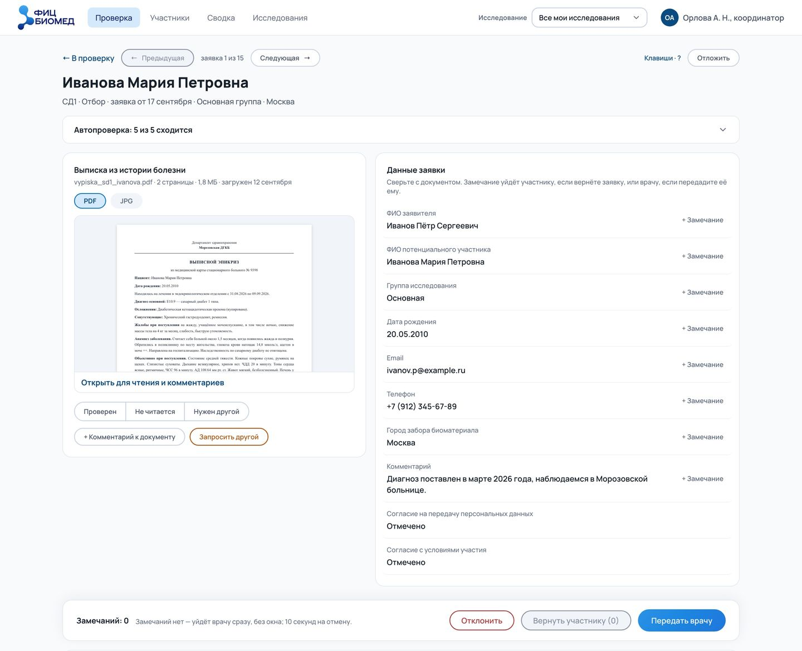
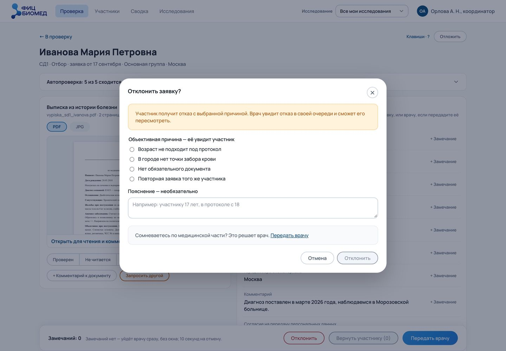

У координатора три решения: отклонить, вернуть участнику и передать врачу. Отклоняет он только по объективной причине из списка. Для заявки причин четыре: возраст не подходит под протокол, в городе нет точки забора крови, нет обязательного документа, повторная заявка. Если сомнение медицинское, окно отказа предлагает передать заявку врачу. Отказ по явному несоответствию входит в компетенцию координатора. Он сам решает по причине, отправить отказ участнику сразу или передать заявку врачу.

Аудит предлагал двойной ключ: отказ координатора ждёт врача или уходит участнику через срок. Я оставила решение координатору, но отказ всё равно попадает в очередь врача. Врач видит причину рядом с фактом автопроверки и может пересмотреть отказ. Цена решения в том, что врач видит отказ уже после участника. Это первое, что нужно проверить на врачах.

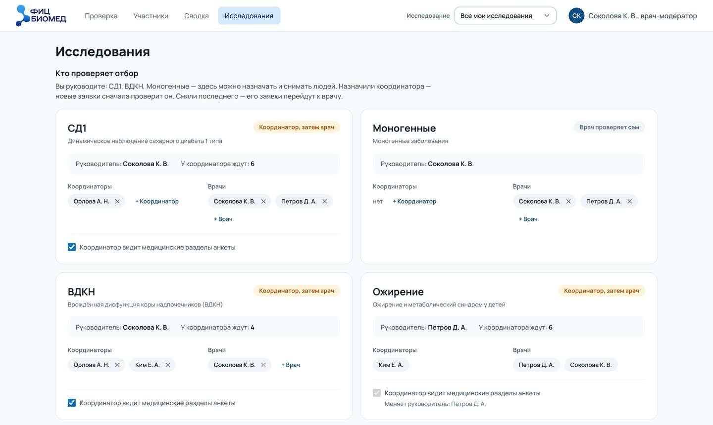
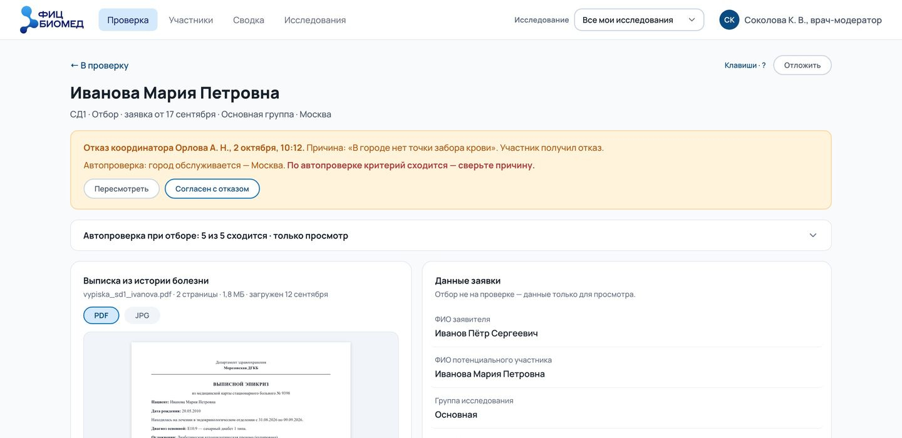

---

## Решения

Где было несколько разумных вариантов, я выбирала явно. Ниже три темы: карточка проверки, окно решения и очереди.

### Карточка проверки

Наверху карточки навигация по очереди и строка о заявке: исследование, этап, дата, группа, город. Ниже автопроверка. Пока критерии сходятся, она свёрнута в строку «5 из 5 сходится». Если автопроверка не может решить, блок раскрывается сам и показывает только спорные критерии. У критерия есть факт и правило протокола: коллега, который проверяет чужое исследование, не обязан помнить протокол наизусть.

Ниже две колонки, документ слева и данные заявки справа. В каждой строке данных есть «+ Замечание». Замечание уходит участнику в то же поле его анкеты, и у участника рядом с ним кнопка «К полю». Как замечание выглядит на стороне участника, показано в [кейсе кабинета участника](case:participant-portal).

Так карточка выглядела не сразу. В первых версиях она открывалась выводами: шесть критериев с метками «Сходится» и «Проверьте» и двенадцать кнопок «Соответствует / Нет». Данные заявки шли ниже экрана, документ в самом низу. Я сочла такую карточку непонятной, и по моему запросу ассистент пересобрал её от данных. Ручной переключатель остался только у спорных критериев.

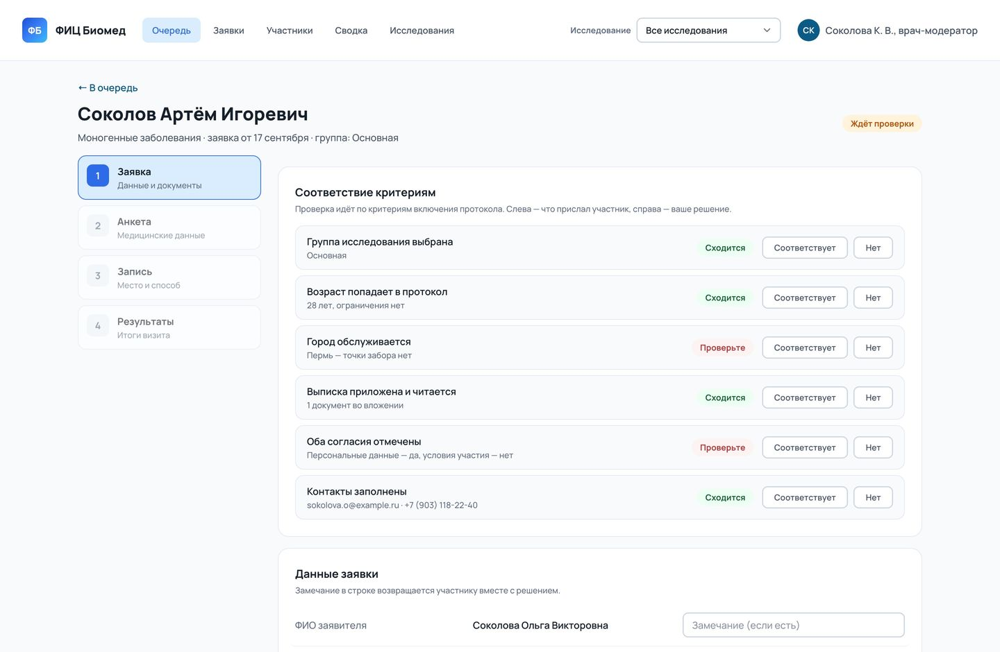
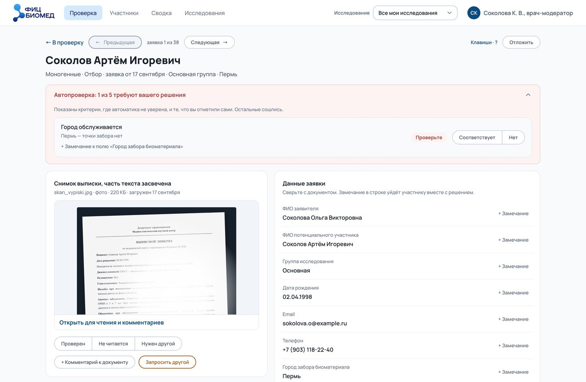

Документ участника обычно выписка из истории болезни на листе А4, часто фото листа. Врачу нужно читать её и сразу писать комментарии.

**Отказалась.** Документ только в колонке рядом с полями. Документ и данные видны одновременно, сверять можно без переходов.

**Выбрала.** Миниатюру в колонке и окно чтения на 90 % экрана. В колонке лист А4 не прочесть. В окне есть масштаб и поворот, справа данные заявки для сверки, отметки «Проверен · Не читается · Нужен другой» и комментарии к документу. Цена в лишнем действии: чтобы прочитать документ, окно нужно открыть.

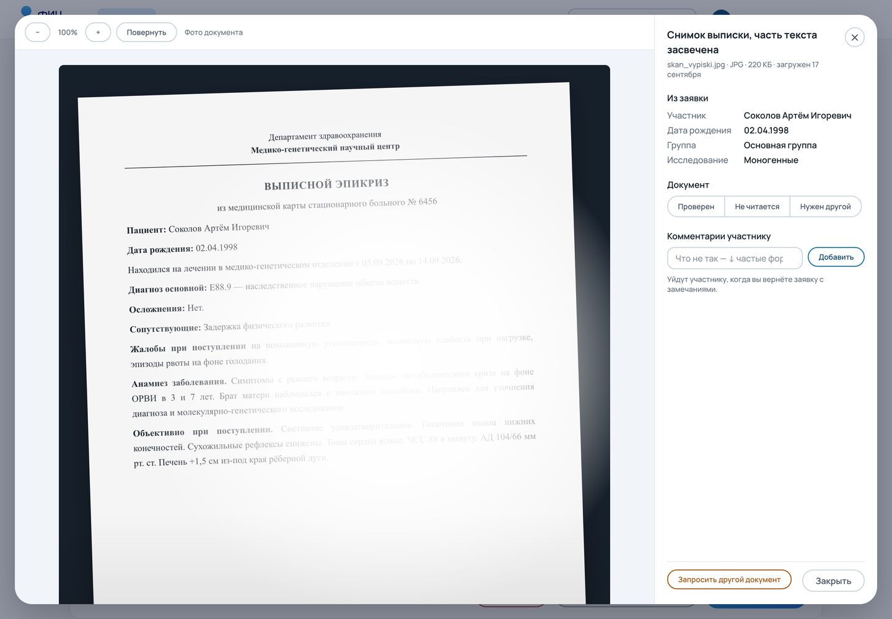

Анкета у исследования одна на все визиты, ответы разные. Поэтому на повторном визите у изменившегося ответа синяя черта, метка «изменилось» и серым то, что было на прошлом визите, а у раздела число изменений.

### Окно решения

Окно решения пишет, что получит участник. При возврате окно пишет «Участник увидит заявку с вашими замечаниями в тех же полях и сможет исправить их и отправить снова», при отказе «Участник получит отказ с вашей причиной, заявка закроется».

**Отказалась.** Окно подтверждения на каждом решении. Оно защищает от случайного нажатия.

**Выбрала.** Чистое решение проходит без окна. Если всё сходится и замечаний нет, заявка одобряется сразу, и 10 секунд решение можно отменить. По замыслу уведомление участнику уходит после этих 10 секунд, в прототипе об этом говорит текст уведомления на экране. Окно появляется, когда ему есть что сказать: при несоответствиях, возврате, запросе документа и отказе. Аудит 2 предупредил, что окно на каждой заявке врач перестаёт читать.

Несоответствие кабинет сам не отсеивает. Жёсткий отсев автопроверкой экономил бы врачу время, но решение о приёме по протоколу за врачом. Врач может одобрить заявку, даже если критерий не сошёлся. Окно перечисляет несоответствия со ссылками к месту и требует причину, а история сохраняет решение вместе с причиной. Для регулируемого исследования это журнал решений, по которому аудитор видит и что решено, и почему. Там же окно пишет номер, под которым участник будет принят: номер появляется только при приёме.

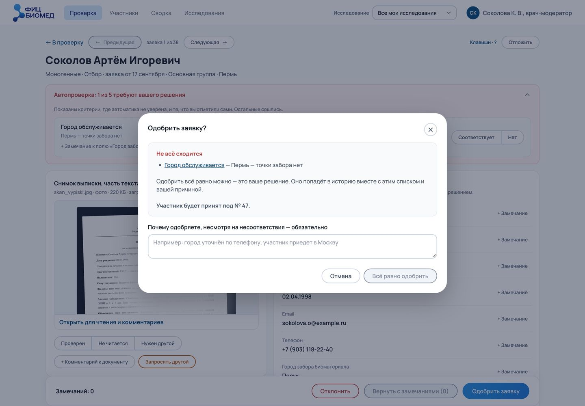

Сначала у врача было четыре действия, включая «Запросить документ». Сразу после первой сборки я убрала из панели «Отклонить»: врачу нужно одобрить или вернуть с замечаниями, а запрос документа живёт у самого документа. Позже разбор Ozon показал, что статус «Отклонена» в данных есть, а действия, которое его ставит, нет. Отклонение вернулось вместе с ролями, сначала у координатора, потом у врача. Причина отказа обязательна, её видит участник.

### Очереди

Раздел «Проверка» показывает только то, что ждёт действия этого человека. Пустая очередь значит, что на сегодня всё. Заявки, которые ждут участника, и принятые участники живут в разделе «Участники». Пока возвращённая заявка лежит рядом с той, что ждёт проверки, на вопрос «я всё разобрал?» ответить нечем.

Сначала очереди делились по типу работы, на отбор, анкеты и визиты. Так разводился разный темп: заявка с документами и критериями против повторной анкеты на два исправленных поля. Я перестроила очереди по визитам протокола, «Отбор» и «Визит 1…N»: врач работает по визитам. Разный темп остался виден по меткам: повторная заявка помечена, и есть фильтр «Только повторные».

Через несколько версий до первой строки очереди набралось шесть уровней выбора: раздел, исследование, режим, визит, этап и фильтр. Самую старую заявку нельзя было найти, не пройдя все шесть уровней. Это показал аудит страницы, который я запросила. Следующий аудит, о фокусе внимания, нашёл в одном списке 11 синих кнопок «Проверить» и 11 синих кружков при строках около 100 пикселей. По моему решению у «Проверить» убрали рамку, она появляется при наведении и фокусе. Строки сжались до 64 пикселей, нажимается вся строка.

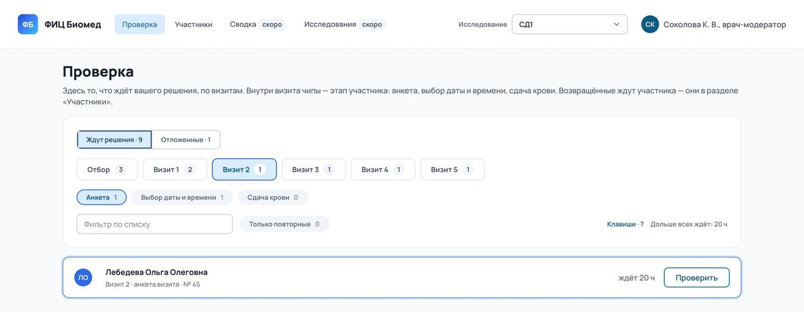
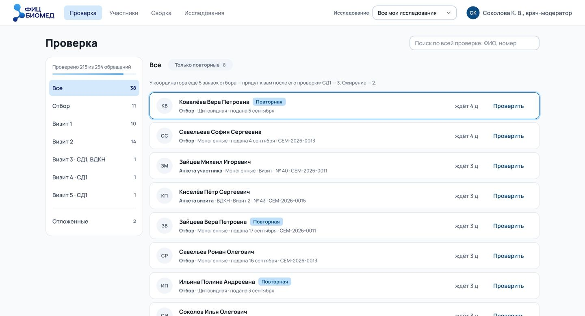

Потом в строке заголовка собрались четыре вещи сразу, и отложенные заявки снова оказались не на месте. Я попросила посмотреть мировые практики и предложить разметку. Ассистент разобрал 10 продуктов с очередями, среди них Gmail, Zendesk, Jira Service Management, Front и Linear. Три варианта разметки он по моему запросу собрал в одном файле, чтобы сравнивать их на одних данных.

**Отказалась.** Вкладки в ряд с «Отложенными» последней вкладкой (вариант Б) и «Отложенные» ссылкой у заголовка (вариант В). Вкладки привычны, ссылка не отнимает место у очередей. Но у диабета семь вкладок плюс отложенные, и на «Всех исследованиях» ряд переносился на вторую строку. Ссылка у заголовка читалась как пояснение.

**Выбрала.** Колонку очередей слева (вариант А). У каждой очереди своё число, «Отложенные» последним пунктом той же колонки за чертой, общий прогресс сверху. Так держат очереди Gmail, Zendesk и Jira Service Management. Вариант А стоит в прототипе основным по моему решению, Б и В оставлены для сравнения. Цена в ширине: колонка занимает место, и на узком экране она становится списком.

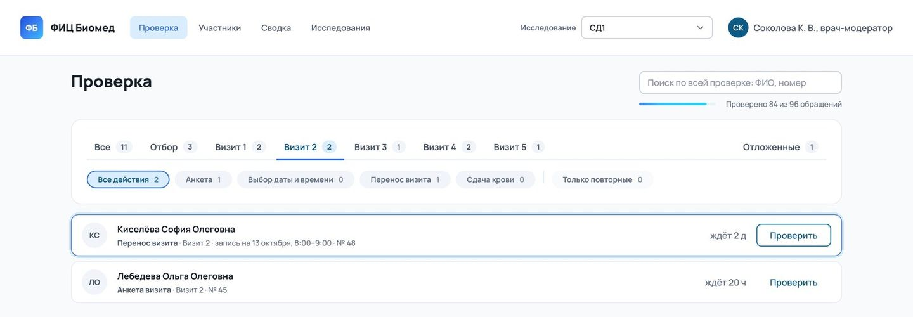
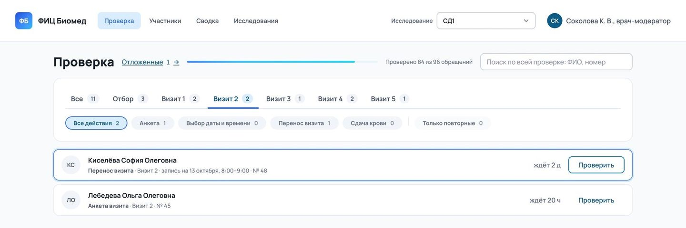

«Отложить» убирает заявку из очереди без срока, участник этого не видит. Вернуть отложенную заявку в очередь можно только вручную, а в карточке написано, когда и почему её отложили.

---

## Аудиты

Семь аудитов прототипа я запросила по ходу работы, готовил их ИИ-ассистент. Каждый начинался с моего запроса и лежит отдельным файлом. Во время аудита прототип не менялся. Правки шли после моего решения отдельными версиями, и у каждого аудита записано, что по нему сделано.

| Аудит | О чём | Пунктов | Главное |
|---|---|---|---|
| 1 | логика, UX и вёрстка | 33 | одобренная отложенная заявка оставалась отложенной, у принятого участника можно было запросить документ |
| 2 | мировые практики и нормы: Нильсен, WCAG 2.2, ICH E6, 21 CFR Part 11, 152-ФЗ | 37 | окно только при несоответствиях, уведомление после окна отмены |
| 3 | шаги визита | 13 | шаги придуманы без кабинета участника |
| 4 | страница «Проверка» | 15 | шесть уровней выбора до первой строки |
| 5 | фокус внимания | 7 | два столбца одинаковых синих акцентов |
| 6 | полный аудит варианта А, 16 путей врача и координатора | 39 | пять вопросов к процессу, 35 пунктов исправлены |
| 7 | после перевода на дизайн-систему | 10 | «выбрано» тремя способами, кольцо фокуса вокруг всего окна |

Самые серьёзные ошибки шли от процесса, который ассистент не сверил с соседним продуктом. По аудиту ассистент свёл две полосы визитов в одну полосу шагов, и вместе с дублем ушёл второй уровень этапов. Ассистент достроил его догадкой по документам модератора и не открыл кабинет участника. Появился ряд «Анкета → Запись → Результаты» с придуманными пояснениями. Запись на визит, которую в кабинете участника подтверждает врач, при этом выпала из его работы. Я заметила, что получается не то, и запросила аудит. Он сравнил версии с кодом кабинета участника. Этапы стали метками «Анкета · Выбор даты и времени · Сдача крови». Процесс ассистент по моему запросу записал отдельным документом и читает его до любой правки про шаги.

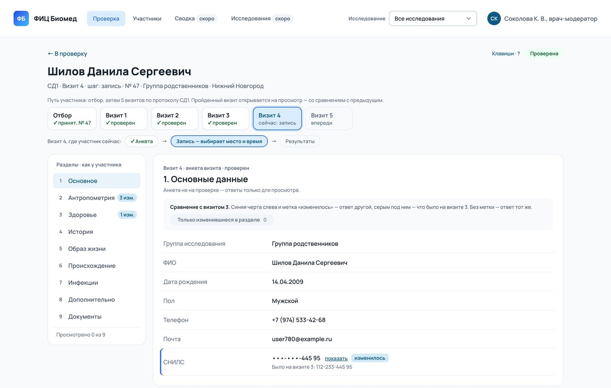
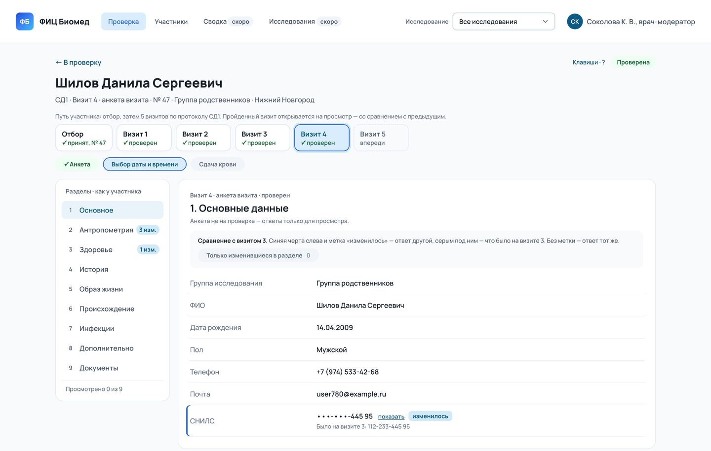

Второй случай другого рода. Аудит предложил защиту, которую кабинет участника уже даёт: сделать согласие жёстким критерием. Кабинет участника не отправит заявку без двух согласий. Заявки без согласия лежали только в демо-данных. Аудит принял ошибку демо-данных за риск продукта. Я ответила, что без согласий анкета на проверку не попадает, и ассистент убрал критерий. С тех пор у него правило: демо-данные правдоподобные, а находку аудита он проверяет по пути данных целиком, включая соседний кабинет.

Готовые наборы состояний, на которых держался аудит 6, через несколько версий перестали открывать этапы записи. Это поймал следующий аудит, и ассистент обновил наборы вместе с демо-данными.

---

## Продуктовый цикл

На готовом прототипе я запустила продуктовый цикл по директивам: бриф, конкуренты, глубокое исследование, UX-аудит, персоны, интервью, приоритизация и два PRD, по текущему прототипу и как будто с нуля. Пятнадцать документов готовил ИИ-ассистент по моему запросу.

Интервью в цикле симулированы. Людей в них нет, ответы модели служат гипотезами для настоящих интервью.

Главное, что дал цикл, это две модели проекта, которые жили в решениях без проверки. Первая модель говорит, что врач проверяет сорок заявок подряд за смену. Модель появилась в предложениях ассистента, замера под ней нет [ПРОВЕРИТЬ: откуда «сорок заявок за смену»]. В симуляции врач проверяет урывками между приёмами, и ему важно вернуться туда, где он остановился. Вторая модель говорит, что координатору нужны медицинские разделы анкеты. В симуляции они ему не нужны. Оценку «пять-семь минут на заявку» глубокое исследование тоже не подтвердило. Единственный найденный замер даёт 15–20 минут на кандидата у координатора без готовой формы, уверенность низкая.

В списке 59 функций, 32 из них обязательные, и 23 обязательные в прототипе уже есть. UX-аудит готового прототипа внутри цикла нашёл 14 проблем, блокирующих нет, четыре серьёзные: выбывание участника одним нажатием без окна, отказ координатора до врача, пустая «Сводка» и статус «У координатора» у исследований без координатора. Конкурентом по умолчанию цикл назвал REDCap. Если кабинет не сделать, проверку соберут в REDCap.

---

## Прототип

Первую сборку ассистент сделал по моему запросу, дальше я вела прототип вместе с ним. Я ставила задачи, принимала решения и проверяла результат. Это один HTML-файл на обычном JavaScript без зависимостей. Каждая из 83 версий лежит отдельным файлом с записью в журнале, и к любой можно вернуться.

Смоделированные этапы подписаны на экране, демо-панель показывает, что можно сделать за участника, а варианты разметки переключаются в одном файле.

Когда прототип вырос, ассистент по моему запросу разложил шаблон в 4800 строк на 29 файлов стилей и 90 модулей логики. Старую и новую версии он прогнал рядом на одних и тех же действиях, 36 прогонов по 200 шагов, и расхождений не нашёл.

Потом по моему запросу ассистент заменил числа в стилях переменными дизайн-системы с теми же именами, что в Figma: 663 замены в 43 модулях. Сверка вида на четырёх ширинах сравнила 15 172 элемента и расхождений не нашла. Чтобы убедиться, что сверка ловит ошибки, ассистент нарочно сдвинул один отступ, и сверка поймала его во всех 36 прогонах. Настоящую ошибку поймала сверка шаг в шаг: замена текста в разметке молча перестала срабатывать, и отступ отметок стал 16 пикселей при нужных 8.

Для публичного репозитория ассистент по моему запросу перенёс прототип на React. Перенос нашёл три ошибки исходного прототипа. Ошибку с фокусом в окне решения ассистент по моему запросу исправил и в HTML, две другие там пока остаются.

Ошибки ассистента я превращала в правила для него. Процесс брать из кабинета участника. Прототип не меняется вслед за кабинетом участника без моего слова. Править только модули, собранный файл не трогать. Цвет, отступы и кегли писать только переменными.

---

## Дизайн-система

Кабинет врача стоит на той же дизайн-системе, что и кабинет участника. Систему я собрала с нуля вместе с прототипом кабинета участника, и кабинет врача стал вторым продуктом на ней. При первой сборке ассистент не придумал заново ни одного значения: шрифты, палитра и поля анкеты пришли из кабинета участника, ни один цвет не задан числом. Скрипт проверяет контраст 21 пары цветов. Подсказка в поле (3,10) норму для текста не проходит и записана исключением, как в кабинете участника. Неактивную кнопку (2,83) WCAG от нормы контраста освобождает. У остальных пар минимум 4,57 при норме 4,5.

Значения у кабинетов хранятся копиями, правила общие. Сначала кабинет врача читал значения прямо из кабинета участника, и я быстро от этого отказалась: правка в одном кабинете молча меняла бы вид другого. Теперь у каждого прототипа свои копии палитры, шрифтов и полей анкеты, и правки переносятся отдельной командой, когда я скажу. С правилами наоборот. Копия правил в папке модератора быстро отстала от оригинала на 32 строки. По предложению ассистента правила теперь лежат одной копией для обоих кабинетов.

Когда дизайн-система перешла на форму Material 3, ассистент по моему запросу перевёл на неё и кабинет врача: кнопки с полным скруглением, поля со скруглением 12, окна 28, шапка с логотипом. Аудит после перевода нашёл 10 проблем, все закрыты в следующих двух версиях. Восемь спорных мест ассистент вынес мне с вариантами и причинами, решения по ним приняла я. Где кабинет врача отступает от системы, это записано исключением с причиной. Главное исключение: у панелей скругление 16, по системе 28. Рабочее место плотное, и при 28 скругление срезает углы строк в таблицах.

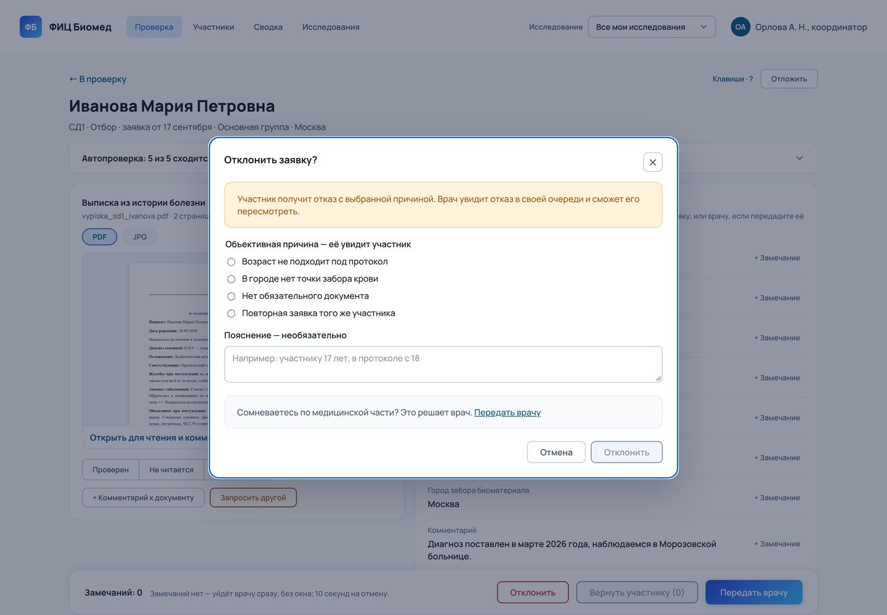
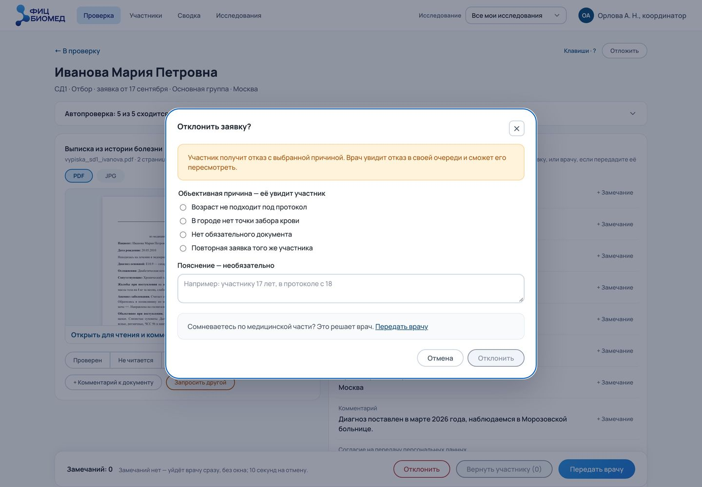

Кабинет врача первым перешёл на переменные отступов, кеглей, начертаний, радиусов и трёх теней, часть значений осталась числом. До этого в коде переменные были только у цвета и части радиусов. На телефоне цели касания не меньше 44 пикселей, шрифт в полях ввода 16 пикселей.

---

## Стык с кабинетом участника

Кабинеты описывают один процесс, но собраны независимо, и интеграции между ними нет. Сверка двух прототипов, которую по моему запросу сделал ассистент, показала пять мест, где они расходятся. Свести их нужно до разработки. Врач и участник говорят по телефону, и шаги, сроки и номера у них должны называться одинаково.

| Что | Кабинет участника | Кабинет врача |
|---|---|---|
| Первый шаг | подписание двух согласий; ФИО, дата рождения и контакты идут в анкете, выписка в её разделе «Документы» | отбор: форма из десяти полей и документы по форме подачи заявки центра |
| Анкета моногенных | своя, из трёх разделов | анкета диабета из девяти разделов |
| Запись на визит | место визита и способ записи: через специалиста центра или через лечащего врача | три маршрута по техническому заданию центра: «тёплая» кровь с выездом водителя, «замороженная» через ИНВИТРО, по согласованию с координатором |
| Перенос записи | специалист сам связывается и предлагает новое время | сначала время предлагает участник, врач или координатор согласует его или предлагает другое |
| Отказ, неявка, номер | отказ и неявку участник видит в своём кабинете; номер у участника только номер заявки | отказ с причиной, задача «связаться» после неявки, номер участника появляется при приёме |

Как устроены эти шаги со стороны участника, описано в [кейсе кабинета участника](case:participant-portal).

---

## Проверка

Прототип я показывала врачам и координаторам центра.

**ДОБАВИТЬ: точные цитаты врачей и координаторов с показов прототипа.** Кто сказал (роль), что именно и что после этого изменилось в кабинете.

Замеров не было: время проверки одной заявки не измеряли.

Кроме показов, решения проверялись так:
- логику прототипа проверяют автопроверки без браузера, только для ролей их 40;
- семь аудитов, правки по ним после моего решения;
- сверки шаг в шаг при переделках устройства и стилей, с проверкой порчей;
- симулированные интервью продуктового цикла как источник гипотез.

Автопроверки ловят ошибки поведения и не говорят, понятен ли экран людям. Поэтому на следующих показах врачам и координаторам первым делом стоит проверить пять вещей.

- Устраивает ли врача видеть отказ координатора уже после участника, особенно отказ по документам.
- Возвращается ли врач, который проверяет урывками между приёмами, туда же, где остановился, вместе с черновиком замечания.
- Хватает ли 10 секунд на отмену решения, если врача отвлекли.
- Нужны ли координатору медицинские разделы анкеты.
- Сколько заявок и анкет приходится на смену и сколько длится проверка одной. Это нужно измерить на первых сменах.

Метод и участники проверки [ДОБАВИТЬ: план исследования с врачами и координаторами].

---

## Результат

Запуска не было, поэтому фактических цифр нет. О скорости работы врача я ничего не утверждаю: время проверки не измеряли.

Есть рабочий прототип: очереди, карточка проверки с замечаниями к полям, решения с отменой, две линии проверки, назначения в «Исследованиях», запись на визит и таблица участников. Есть база знаний по логике кабинета и два PRD.

Модель эффекта взята из кабинета участника. Если все 4000 участников придут в наблюдение при диабете, за двухлетний цикл врачи проверят до 44 000 шагов без учёта возвратов. Каждая минута, сэкономленная на проверке анкеты, даёт от 210 до 380 часов за цикл. Разброс зависит от распределения участников между исследованиями и от числа возвратов.

Что мерить после запуска:
- медианное время от отправки шага участником до решения врача или координатора;
- долю заявок, которые координатор вернул или отклонил сам;
- время до решения врача в исследованиях с координатором и без;
- долю повторных возвратов; цель по ней, как в кабинете участника, ставится по первым двум месяцам после запуска;
- время проверки одной анкеты, его нужно сначала измерить на первых сменах.

Целевые значения в PRD, кроме подтверждения записи за 24 часа из технического задания центра, пока предложения.

---

## Что не сделано

**Замеры нагрузки.** Время проверки не измеряли. Модели «сорок заявок подряд» и «пять-семь минут на заявку» остаются допущениями.

**Отказ координатора до врача.** Врач видит отказ уже после участника. Аудит готового прототипа отметил это как серьёзную проблему. Решение нужно отдельно проверить с врачами.

**Выбывание одним нажатием.** «Участник выбывает» стоит рядом с «Не дозвонился» и срабатывает без окна. Это нашёл аудит, правки ещё нет.

**Сводка.** Раздел для главного модератора пока заглушка. Что в нём нужно, должен сказать центр.

**Две ошибки из переноса на React.** В HTML-прототипе обработчики двух действий привязаны к общему атрибуту и могут сработать на соседнем элементе. В копии на React это исправлено.

**Интеграции.** Связи с кабинетом участника, календарём водителя и ИНВИТРО нет. Эти этапы в прототипе смоделированы и подписаны.

---

## Выводы

**Роль закреплять за человеком, доступ давать назначением на исследование.** Это я сделала бы иначе. Переключатель ролей был в прототипе две версии, а вопрос о том, как врач работает за координатора, занял бы одну реплику. С него и стоило начать.

**Сначала сверить процесс с соседним продуктом, потом рисовать.** Ассистент придумал шаги визита без кабинета участника, а аудит предложил защиту согласием там, где кабинет участника её уже даёт. Ошибку в шагах нашёл аудит, который я запросила. Лишнюю защиту я сняла, когда сверила её с кабинетом участника.

**Окно подтверждения ставить там, где ему есть что сказать.** Окно, которое появляется на каждой заявке, врач перестаёт читать. Чистое решение проходит с отменой, а окно появляется при несоответствиях и пишет, что получит участник.

**Конкурентный анализ начинать с вопроса к своему экрану.** Общий обзор дал 27 паттернов, и их пришлось отбирать по правилу «снимает путаницу на нашем экране». Разборы очередей и ролей начинались с конкретной путаницы и сразу давали решения.

**Модель нагрузки проверять у людей до решений.** Допущение «сорок заявок подряд за смену» предложил ассистент, и оно стояло за решениями об очереди без замера. Его стоило сразу уточнить у врачей, с которыми я собирала требования. Это я тоже сделала бы иначе.

*Прототип собран в Claude на HTML, CSS и JavaScript, кадры сняты с его версий, большая часть с версии 83. Демо-панель на кадрах скрыта. Данные участников и сотрудников вымышленные, состав ролей смоделирован, интервью продуктового цикла симулированы. Кадры Greenhouse и Ozon Seller взяты из открытых инструкций этих сервисов. Прототип, разборы и аудиты я делала вместе с ИИ-ассистентом Claude: ставила задачи, принимала решения и проверяла результат. Текст кейса подготовлен с помощью ИИ-ассистента по материалам проекта.*
