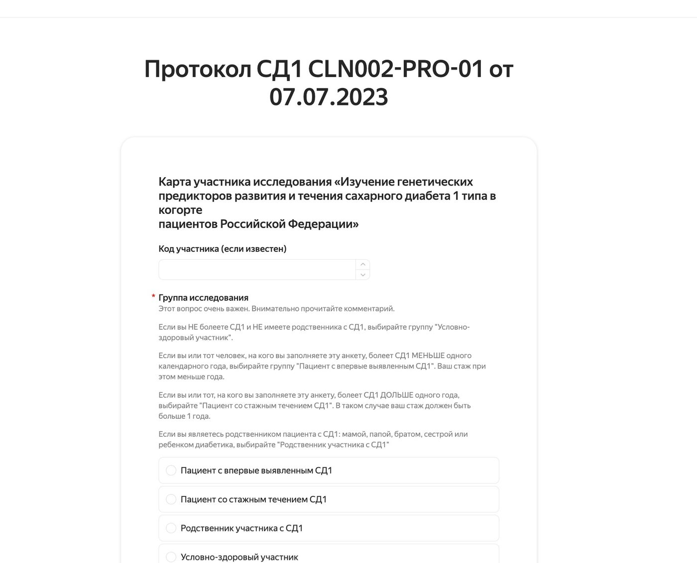
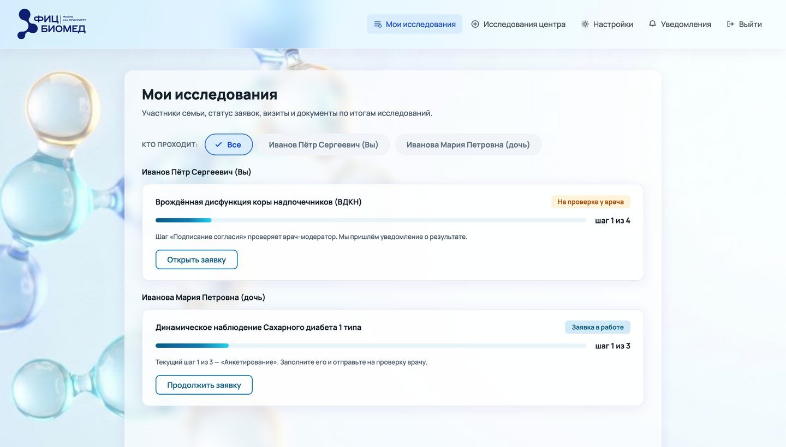
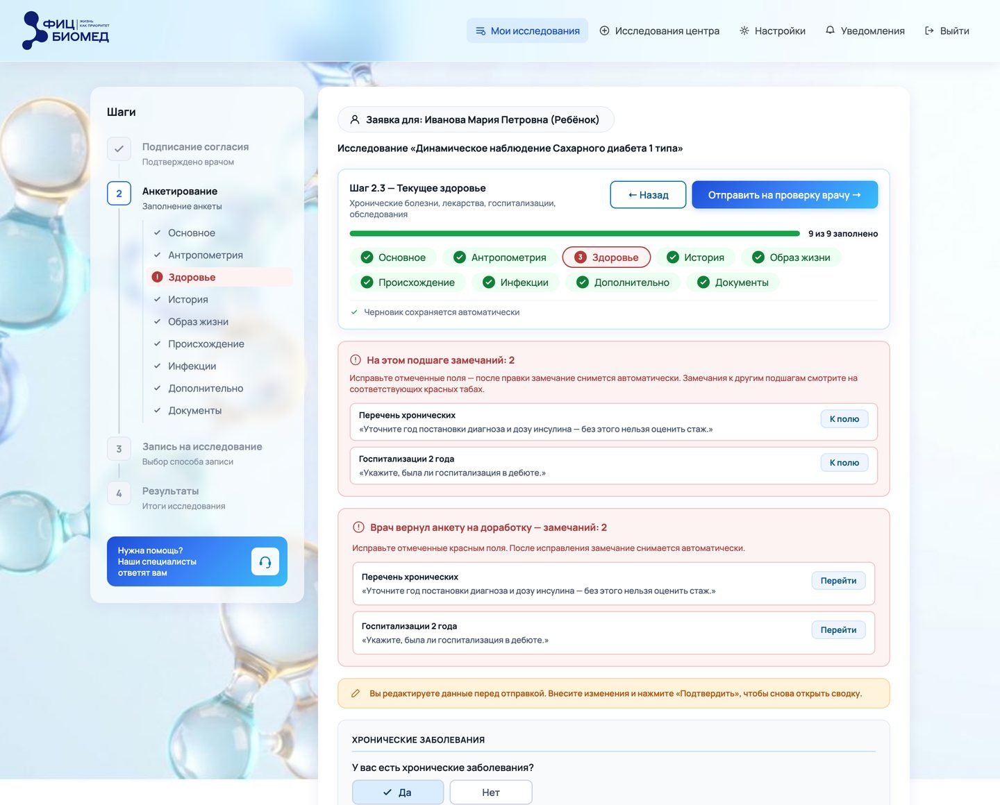
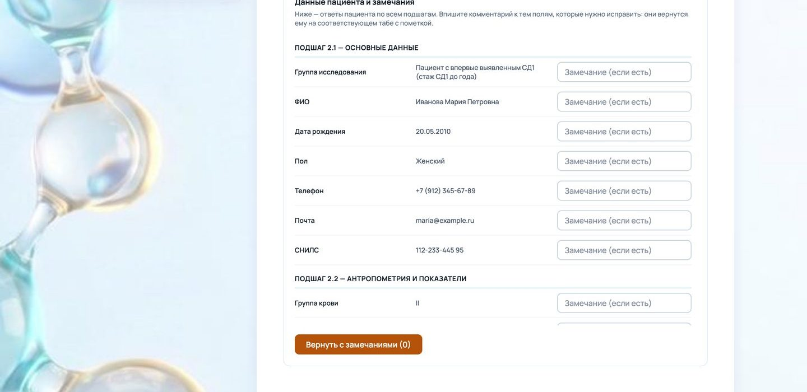
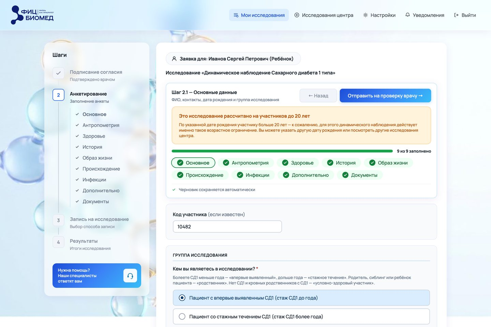
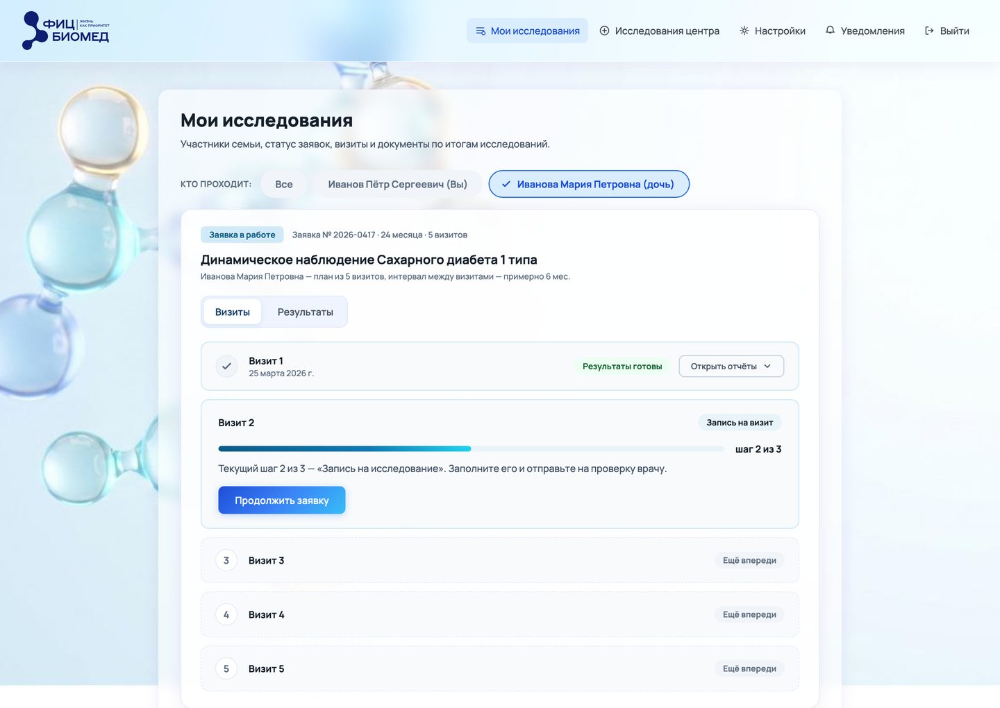
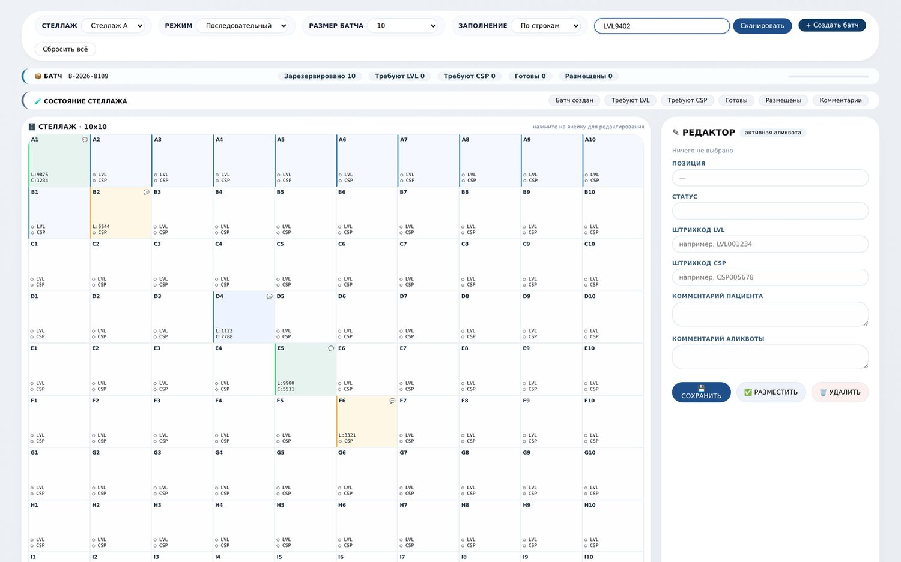
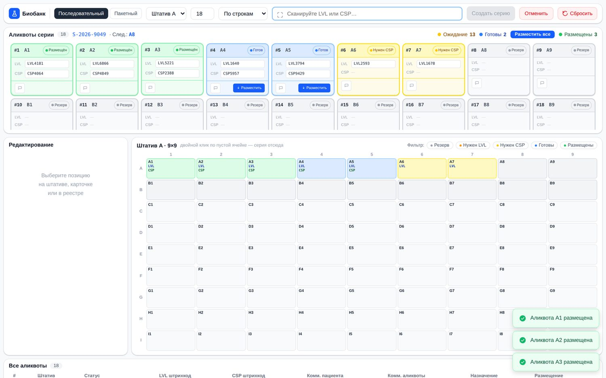
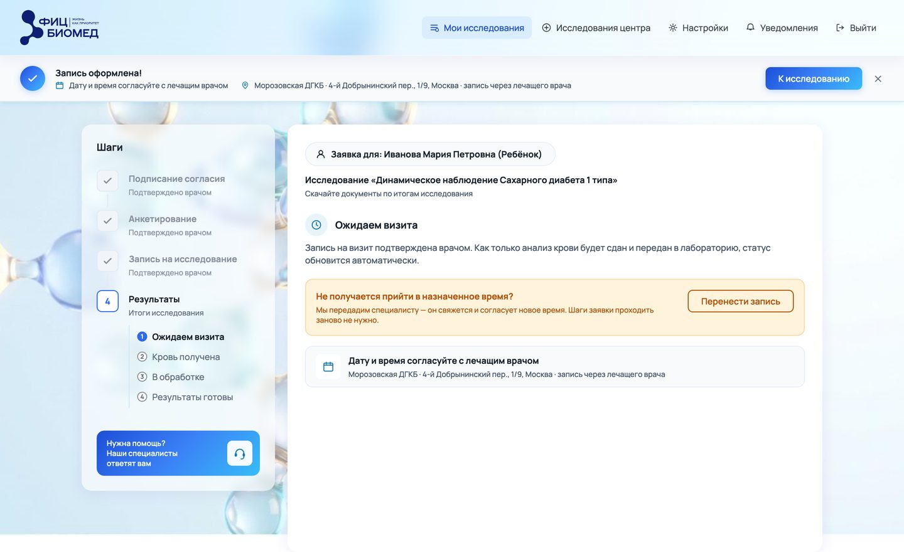
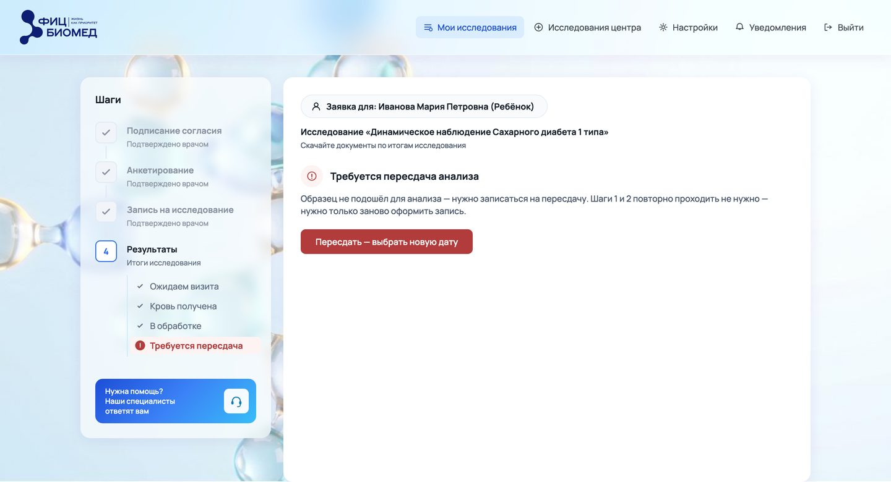

# Кабинет участника и станция биобанка

Два рабочих места одной медицинской информационной системы. В кабинете человек проходит клиническое исследование: подаёт заявку, заполняет анкету, сдаёт кровь и следит за своим образцом. На станции лаборант делит этот образец на аликвоты и раскладывает по штативам. Я проектировала оба рабочих места. Главное правило для обоих: статус на экране меняется только после реального события.

Продуктовый дизайн и дизайн-аналитика · ФИЦ Биомед · 2026 · общий кейс

---

**Роль.** Продуктовый дизайнер и дизайн-аналитик. Постановка задач, пользовательские пути, продуктовая логика, интерфейс, прототипы, дизайн-система, анализ рынка, проверка решений на людях.

**Команда.** Клинические и юридические требования задавали врачи центра и руководители проекта. Решения проверяли участники исследований, врачи-модераторы и лаборанты биобанка.

**Сроки.** Станция аликвот: пять недель. Кабинет участника: четыре итерации прототипа до утверждения.

**Масштаб.** Около 4000 участников, три исследования, скоро пять, до 20 000 визитов за двухлетний цикл. В биобанке одна выгрузка ошибок импорта содержала 39 290 отклонённых строк по 747 штативам.

**Статус.** Оба рабочих места пока в прототипах. Прототип кабинета утверждён, станция прошла замечания лаборантов. Запуска ещё не было, интеграции между частями системы нет.

**Материалы.** Отдельные кейсы трёх рабочих мест · Интерактивный прототип кабинета · Дизайн-система в Figma

---

## Коротко

**Что было.** Данные для исследований собирали через Яндекс Формы. Одна анкета на сто с лишним полей, без статусов и без ответа врача. В биобанке связь между пробиркой, ячейкой штатива и записью в базе держалась на внимании лаборанта. Одна выгрузка ошибок насчитала 39 290 отклонённых строк, три четверти из них дубликаты.

**Что я сделала.** Кабинет, где семья ведёт несколько заявок сразу, анкета разбита на девять разделов, а замечание врача ведёт прямо к полю. Станцию раскладки, где ввод идёт сканером, следующую ячейку выбирает система, а статус «Размещён» появляется только после того, как пробирка встала в штатив.

**Главная находка.** Приложение кабинета вело одну заявку на всех, хотя на экране был переключатель участников. После этой находки я сначала переделала модель данных и только потом вернулась к экранам.

**Результат.** Утверждённый прототип кабинета. Второй продукт, кабинет врача, собран на той же дизайн-системе. Станция прошла замечания лаборантов и получила очередь правок. Запуска ещё не было, поэтому вместо метрик я посчитала модель эффекта: минута, сэкономленная врачу на одной анкете, даёт около 330 часов за цикл.

---

## Место в системе

В медицинской информационной системе центра три рабочих места. Участник подаёт заявку и заполняет анкету в личном кабинете. Врач-модератор проверяет их в своём кабинете и возвращает решение участнику. На визите у участника берут кровь, в биобанке лаборант делит её на аликвоты и раскладывает по штативам. Стадии образца участник видит у себя в кабинете.

*Схема системы*

Кабинет участника и станцию аликвот я описываю вместе, потому что они работают с одним и тем же образцом. Участнику важно знать, что его кровь не потерялась и когда ждать результат. Лаборанту важно, чтобы база совпадала с тем, что лежит в морозильнике. Ошибки у обоих экранов похожи: система показывает то, чего ещё не произошло, или не сообщает то, что уже знает.

У каждого рабочего места есть и отдельный кейс: [кабинет участника](case:participant-portal), [станция аликвот](case:aliquot-station), [кабинет врача](case:doctor-portal). Интеграции между частями пока нет. Центр ещё выбирает лабораторную систему, поэтому стадии образца в прототипе кабинета переключаются вручную.

---

## Задача

### Кабинет участника

До кабинета сбор данных жил в Яндекс Формах. Перед первым вопросом анкеты стояли четыре абзаца о том, к какой группе исследования себя отнести. Дальше шли сто с лишним полей на одной странице.

После отправки человек не получал ни подтверждения, ни статуса, ни ответа врача. Вопросы решали перепиской по почте. Врач читал ответы сплошным списком в таблице выгрузки и искал ошибки глазами.

### Биобанк

Работа над станцией началась с выгрузки ошибок импорта в базу биобанка. В ней было 39 290 отклонённых строк по 747 штативам. Такой объём опечатками не объяснить, ошибка была в самом процессе.

| Причина отказа | Строк |
|---|---|
| Аликвота с таким номером уже существует | 29 541 |
| Указанный штатив не найден | 3 835 |
| Не заполнен ни номер аликвоты, ни lv-код | 2 167 |
| Номер аликвоты повторяется внутри одного файла | 1 469 |
| Ячейка штатива уже занята в этом же файле | 747 |

Три четверти отказов оказались дубликатами. Лаборант связывал пробирку, ячейку и запись вручную, а система проверяла связь только при загрузке файла, на следующий день. К этому времени штатив уже стоял в морозильнике. Если связь теряется совсем, пробирка становится неопознанным биоматериалом, и выясняется это через месяцы.

Из этого я вывела два требования к станции:

- дубликат должен находиться в момент сканирования;
- статус в системе не должен обгонять то, что физически лежит на столе.

---

## Пользователи и ограничения

### Участник

Участник выбирает исследование, подписывает согласие, заполняет медицинскую анкету, приходит сдать кровь и получает результаты. Каждый шаг проверяет врач. Исследования длинные: у наблюдения при диабете 1 типа пять визитов за два года с интервалом в полгода. За это время человек забывает, где остановился, что сдавал и что от него ждут. Половина участников дети, их заявки ведёт родитель.

Отсюда главное требование к экрану «Мои исследования»: человек, который заходит раз в полгода, за несколько секунд понимает, на каком он шаге и что от него нужно.

### Лаборант

У лаборанта в одной руке пробирка, в другой сканер, на руках перчатки. За смену он раскладывает несколько штативов подряд. Главное ограничение лаборанты назвали сами: снимать перчатки как можно реже. В перчатках можно отсканировать код и нажать крупную кнопку, а печатать и попадать в мелкие поля почти нельзя.

Поэтому ввод идёт сканером, следующую позицию выбирает система, данные сохраняются сами. Клавиатура нужна только для исключений, например правки или комментария. Станция поддерживает оба способа раскладки, которые есть в лабораториях: пробу целиком, от пробирки к крышке, и сначала все пробирки, потом все крышки.

### Ограничения

Клинические и юридические требования задавали врачи и руководители проекта. Я проектировала внутри них.

**Протокол исследования.** Пять визитов, интервал шесть месяцев или три при повышенных антителах, участие до 20 лет. Интерфейс показывает протокол точно, без упрощений.

**Согласие и представительство.** Согласие даёт конкретный человек на конкретное исследование. Доверенности и представительство взрослых в первую версию не вошли. На встрече с заказчиком договорились, что регистрация другого взрослого работает как приглашение: человек сам заводит профиль и сам получает результаты.

**Единый номер пациента.** Отчёты уходят участникам автоматически по номеру пациента. Второй номер у того же человека сломает автоматическую рассылку. Из-за этого я отказалась от идеи переводить ребёнка в собственный кабинет, когда он становится совершеннолетним.

**Скан бумажного согласия.** Заказчик просил добавить его загрузку, я отказалась. Появился бы второй способ оформить согласие в обход основного, и его было бы сложнее контролировать.

---

## Анализ рынка

### Сервисы для участника

Прежде чем проектировать семью в кабинете, я разобрала сервисы, с которыми человек уже сталкивался. Готового образца не нашлось.

| Группа | Примеры | Семья | Процесс исследования |
|---|---|---|---|
| Кабинеты лабораторий | Хеликс, Инвитро | есть, у Хеликса до девяти человек в аккаунте | нет согласия, анкеты и проверки врачом |
| Государственные сервисы | Госуслуги, ЕМИАС | доступ к медкарте ребёнка до 15 лет, в Москве до 18 | есть доступ к карте, участия в исследовании нет |
| Платформы клинических исследований | MyVeeva for Patients, Castor, Viedoc | нет, один участник равен одному аккаунту | согласие очно и удалённо, визиты с уведомлениями |

Семью и процесс исследования в одном аккаунте не совмещает никто. Я заранее заложила на эту часть больше всего времени, и основная сложность проекта действительно оказалась там.

### Лабораторные системы

Одиннадцать лабораторных систем я разобрала один раз, и этот разбор понадобился обоим рабочим местам. Я сравнивала лицензию и стоимость, API и доступ к базе, модель данных, хранение, генерацию штрихкодов, сроки внедрения и поддержку.

Большинство российских систем устроены как системы клинико-диагностической лаборатории: в центре пациент, от него идут заказы, материал записан как часть заказа. Биобанку нужна модель вокруг образца: образец, аликвота, место хранения, срок годности. Таких систем нашлось две, обе открытые: OpenSpecimen и SENAITE.

**Для станции.** Хранение во всех системах устроено как справочник, который заполняют после раскладки, вручную или загрузкой файла. Момент, когда лаборант у стола связывает два штрихкода с ячейкой, не поддерживает ни одна система. Поэтому я проектировала станцию как отдельный инструмент для одной операции, с расчётом, что данные потом уйдут в основную систему.

**Для кабинета.** Стадии образца кабинет получает от лабораторной системы. У части систем нет API, у одной доступ к базе есть только у её специалистов. С такой системой кабинет не сможет показать стадию «в обработке», и участник увидит только «сдал» и «готово». Я рекомендовала центру записать требования к интеграции до покупки.

---

## Главная находка

Когда я разбирала ролевую модель кабинета, выяснилось, что приложение ведёт только одну заявку одновременно. Одну на всех участников: исследование, шаг и данные хранились в общих полях.

При этом на экране был переключатель «Все / Себе / Ребёнок». Человек начинал заявку на себя, доходил до середины анкеты, переключался на ребёнка, и всё введённое исчезало без предупреждения. Это пятнадцать минут медицинских данных.

Находка поменяла план. До неё я собиралась дорабатывать экраны. После неё первой задачей стала модель данных. Календарь визитов, лабораторные статусы и согласия к тому времени уже были сделаны на старой модели, и каждый пришлось пересмотреть. Шесть мест, где сбрасывалось состояние, я искала по одному. Сейчас заявки хранятся по паре «участник и исследование», и переключение ничего не стирает.

Из этого я вынесла правило. Если элемент навигации обещает структуру, в первую же неделю нужно проверить, есть ли она в данных.

---

## Решения в кабинете участника

### Анкета

В анкете от 65 до 100 полей, в зависимости от возраста участника. Я разбила их на девять разделов по смыслу. Вложенные вопросы появляются по мере ответов, прогресс считает разделы, которые действительно заполнены, черновик сохраняется при каждом изменении.

**Отказалась.** Проверять раздел по кнопке «Далее» и подсвечивать пустые поля красным. Так данные сразу полные. Но многие листают анкету, чтобы посмотреть, что их ждёт, и красный цвет наказывал бы их за просмотр.

**Выбрала.** Кнопка «Далее» ничего не проверяет. Все обязательные поля проверяются один раз, при отправке, и проверка знает их все. Раньше она знала только 17, и анкета уходила врачу с пустыми ответами «да / нет».

У решения есть цена: об ошибках человек узнаёт позже. Зато красный цвет на экране означает только ошибку.

### Замечания врача

Раньше при возврате анкеты человек получал общий список замечаний над формой. Теперь раздел с замечаниями подсвечивается красным и показывает их число. У каждого замечания есть кнопка «К полю»: она открывает раздел, прокручивает страницу до поля и подсвечивает его. Когда человек исправляет поле, замечание снимается само.

На экране врача ответы сгруппированы по тем же девяти разделам, и врач пишет замечание в той же строке, где стоит ответ. Идею предложили врачи-модераторы, когда я расспрашивала их о работе. Сама я до неё не додумалась.

### Возрастное ограничение

Наблюдение при диабете рассчитано на участников до 20 лет. Если человек старше, он не ошибся: он указал свою настоящую дату рождения. Поэтому вместо красной ошибки он видит жёлтую плашку с объяснением и подсказкой, что можно сделать дальше. Отсюда правило для всей системы: красный цвет означает ошибку или опасное действие, жёлтый означает особенность процесса.

### План визитов

**Отказалась.** Показывать прогноз дат всех будущих визитов. Выглядит заботливо, календарь сразу заполнен.

**Выбрала.** Будущие визиты показаны без дат, с пометкой «Ещё впереди». Запись открывается за месяц до ориентировочной даты, и кабинет присылает уведомление.

Дату визита, который ещё никто не назначил, человек воспринимает как обещание. Он планирует под неё, а потом записывается на другой день.

### Согласие на повторных визитах

Сначала согласие подписывали на каждом визите. Потом мы с командой пересмотрели решение: теперь согласие подписывают один раз, на первом визите. У повторного визита стало три шага вместо четырёх. При 4000 участников и пяти визитах это 16 000 подписаний и столько же проверок врачом, которых больше не будет. Анкета осталась на каждом визите, но её поля заполнены ответами с прошлого раза.

---

## Решения на станции аликвот

### «Готов» и «Размещён»

**Отказалась.** Считать аликвоту размещённой сразу после второго скана. Так на каждой пробирке на одно действие меньше.

**Выбрала.** Два статуса. «Готов» значит, что оба штрихкода привязаны. «Размещён» лаборант ставит отдельно, когда пробирка стоит в ячейке.

Отсканированная пробирка может остаться лежать на столе. Если система засчитает её раньше, база разойдётся с тем, что стоит в штативе.

### Модальные окна

**Отказалась.** Обычные окна подтверждения и системные alert и confirm.

**Выбрала.** Уведомления в углу экрана, которые держатся 1,8 секунды и ничего не блокируют. Редактор всегда открыт в панели рядом со штативом и сохраняет данные сам.

Сканер подключается к компьютеру как клавиатура, а модальное окно перехватывает ввод. Лаборант продолжает сканировать, не глядя на экран, и коды пропадают. Кроме того, окно нужно закрыть, а в перчатках трудно попасть курсором в кнопку.

### Выбор следующей позиции

Рабочий вариант получился с третьей попытки. Сначала позицию выбирал сам лаборант и иногда ошибался. Потом система стала подсказывать позицию, но не переводила на неё ввод, и промахи остались. Сейчас система сама определяет следующую позицию по выбранному режиму, а лаборант только сканирует. Штрихкод другого этапа система не принимает и объясняет почему.

### Сетка штатива

Штативы в биобанке бывают разного размера. Когда лаборант выбирает штатив, станция показывает его сетку. В прототипе выбран штатив на 9 на 9 позиций. Раскладка подстраивается под ширину экрана и обходится без вертикальной прокрутки, поэтому лаборант видит штатив, карточки серии и реестр одновременно.

### Терминология

Первая версия говорила «Создать батч» и «Размер батча». Лаборанты так не говорят, поэтому я везде заменила «батч» на «серию». Сетка сначала называлась стеллажом, хотя стеллаж это мебель, на которой стоят штативы. Я переименовала её в штатив.

### Оформление

В конце работы я пересобрала прототип в Figma Make на React и собрала его в один HTML-файл, который открывается двойным щелчком. Оформление стало плотнее: скругления 8–14 пикселей вместо 20–40, тонкие тени, моноширинный шрифт для штрихкодов. Последние пять версий ушли на то, чтобы рабочая зона поместилась на экран ноутбука.

---

## Стадии образца

Стадии образца связывают два рабочих места. Участник видит их у себя в кабинете, а появляются они в лаборатории и биобанке.

Раньше на последнем шаге кабинета было одно состояние, «результаты готовы». Я сделала пять стадий: ожидаем визита, кровь получена, в обработке, результаты готовы или требуется пересдача. Стадии показаны в левой панели, в том же компоненте, что и разделы анкеты.

Пересдача оказалась единственной стадией, которая требует от человека действия. Я сделала красной всю плашку визита и поменяла кнопку. Теперь кнопка «Пересдать — выбрать новую дату» сразу открывает запись. Номер визита при этом не меняется, это тот же визит по протоколу.

В обоих рабочих местах действует одно правило: статус меняется только после реального события. На станции это разделение «Готов» и «Размещён», в кабинете это стадии «кровь получена» и «в обработке».

Второе общее правило: система должна объяснять, почему она что-то не делает. В кабинете переключатель молча стирал анкету. На станции, если те же аликвоты уже внесены в другой штатив, сохранить нельзя, и причина не видна. В замечаниях работников лаборатории: «Не понятно почему кнопка сохранить не активна. Можно долго думать, что сломалось».

---

## Проверка решений

**Кабинет.** После почти каждой итерации я проводила интервью с участниками и модерируемые юзабилити-тесты прототипа. Отдельно разговаривала с врачами-модераторами. После каждой правки я проходила сценарии вручную. За проект я записала 47 проблем с решениями. Перед утверждением прототипа я заново прошла 22 сценария и нашла ещё 29 расхождений: 26 исправила, три оказались ошибкой моей проверки.

**Станция.** Замечания лаборантов я собирала по ходу работы над прототипом. Повторялось у разных людей:

- ряд карточек должен совпадать с рядом штатива, чтобы сопоставлять их взглядом;
- поле с количеством аликвот заставляет пересчитывать пробирки заранее, нужен вариант «—»;
- штрихкод в русской раскладке не распознаётся и не вызывает ошибку;
- после моей правки под экран ноутбука прокручивалась вся страница, а нужно прокручивать только сетку штатива.

---

## Дизайн-система

Дизайн-систему кабинета я собрала из прототипа: значения снимала с реальной вёрстки, поэтому макет в Figma и прототип совпадают. 31 тень свелась к восьми, у текста одного размера было до девяти значений межстрочного интервала, осталось три. Контраст доведён до уровня AA. Систему с прототипом сверяет скрипт.

Позже на той же системе понадобилось собрать второй продукт, кабинет врача-модератора. Его экраны собрались из готовых компонентов. Станция аликвот делалась раньше и на своих компонентах.

---

## Результат

Запуска ещё не было, поэтому фактических цифр нет. Я посчитала модель эффекта.

**Объём.** 4000 участников, два года, пять визитов. За цикл это около 20 000 визитов, столько же анкет и до 64 000 проверок шагов врачами.

**Время врача.** Одна минута, сэкономленная на проверке анкеты, даёт около 330 часов за цикл. Десять минут дают около 3300 часов, это больше полутора годовых ставок.

**Удержание.** Полуторагодовые исследования завершают около 73 процентов участников, результаты с удержанием ниже 80 процентов считаются слабыми. Наше исследование длится два года.

| Метрика | Цель | Что это даёт при 4000 участников |
|---|---|---|
| Дошли до последнего визита | 81 % при отраслевых 73 % | на 340 человек больше с полным набором данных |
| Переход между соседними визитами | 95 % на каждом из четырёх | те самые 81 % на последнем визите |
| Анкета начата и отправлена врачу | 90 % | 2000 брошенных анкет вместо 5000 |
| Заявки, возвращённые повторно | не больше 10 % | на один круг переписки меньше у 1750 заявок |

**Биобанк.** 29 541 строка из выгрузки отклонена как дубликат. Проверку повторов я заложила в спецификацию станции отдельными сценариями, «Дубликат LVL» и «Дубликат CSP». В прототипе её пока нет. Замера тоже нет, поэтому цифру экономии я не называю.

---

## Что не сделано

**Доступность кабинета.** Фокус уходит из модального окна на страницу, всплывающие уведомления не озвучиваются скринридером, названия пройденных шагов дают контраст 3,1 при норме 4,5.

**Интеграция.** Стадии образца в кабинете переключаются вручную, станция пишет данные в собственный реестр. Связать их можно будет, когда центр выберет лабораторную систему.

**Правки станции.** После теста я разложила их по приоритету. Первыми идут прокрутка только сетки, перенос карточек по рядам штатива, крупный шрифт штрихкодов и вариант «—» в размере серии. Вторыми объяснения отказов. Горячие клавиши, выгрузка в CSV и версия для планшета отложены.

**Проверка повторов в прототипе станции.** Повтор LVL и CSP описан в спецификации, в последней найденной версии прототипа его нет [ПРОВЕРИТЬ: есть ли более поздняя версия прототипа]. Повтор номера, который уже есть в базе биобанка, станция увидит только после связи с лабораторной системой.

**Вопросы для клиники и юристов.** Что происходит, когда ребёнок становится совершеннолетним. Сохраняется ли у родителя доступ к данным взрослого участника. Что делать с историей при удалении профиля. Кто в семье распоряжается общим научным отчётом. Все четыре записаны в реестр с вариантами ответа.

---

## Выводы

**Проверять модель данных в первую неделю.** Если бы многопользовательский сценарий кабинета проверили сразу, половина следующей работы обошлась бы дешевле.

**Показывать только то, что есть на самом деле.** Прогресс считает заполненные поля, у будущих визитов нет выдуманных дат, «Размещён» ставится только после подтверждения.

**Объяснять отказы.** Неактивная кнопка без объяснения и молча стёртые данные одинаково мешают работе.

**Учитывать условия работы.** Перчатки и сканер определили почти всю механику станции.

**Один анализ рынка может пригодиться двум продуктам.** Сравнение лабораторных систем помогло решить, делать ли станцию, и показало, какие стадии образца сможет показывать кабинет.

---

*Прототип кабинета сделан на HTML, CSS и JavaScript, скриншоты сняты с утверждённой версии. Прототип станции собран в Figma Make на React и скомпилирован в один HTML-файл, скриншоты показывают его в середине и в конце работы. Прототипы и разборы я делала вместе с ИИ-ассистентом Claude: ставила задачи, принимала решения и проверяла результат. Текст кейса подготовлен с помощью ИИ-ассистента по материалам проекта. Данные на скриншотах вымышленные. Отраслевые цифры по удержанию взяты из открытых публикаций о клинических исследованиях, целевые значения мои.*
