# Кабинет участника клинических исследований

Личный кабинет медицинского центра, через который человек проходит клиническое исследование от заявки до результатов, а родитель ведёт заявки за себя и за детей. До кабинета данные собирали анкетой в Яндекс Формах, и после отправки человек ничего не узнавал о своей заявке. Я вела продукт от анализа рынка и постановки задачи до прототипа, дизайн-системы и модели эффекта.

Продуктовый дизайн полного цикла · ФИЦ Биомед · 2026 · версия 13

---

**Роль.** Продуктовый дизайнер полного цикла и дизайн-аналитик. Анализ рынка и постановка задач, пользовательские пути, продуктовая логика, интерфейс, прототип, дизайн-система, сопровождение разработки и приёмка.

**Команда.** Разработчики. Клинические и юридические требования задавали врачи центра и руководители проекта, я их выясняла и записывала. Решения кабинета я проверяла на интервью и юзабилити-тестах с участниками и обсуждала с врачами-модераторами. Прототип, разборы и аудиты я делала вместе с ИИ-ассистентом Claude.

**Сроки.** Четыре итерации прототипа до утверждения, затем доработка вида по аудитам.

**Масштаб.** Около 4000 участников, половина из них — дети. Три исследования, скоро пять. За два года до 20 000 визитов, до 64 000 шагов участников и до 44 000 проверок врача.

**Статус.** Прототип утверждён. Дизайн-система в Figma, флоу наблюдения при диабете для компьютера и телефона собраны на её компонентах. Запуска ещё не было, интеграции с лабораторной системой нет.

**Материалы.** Интерактивный прототип · Дизайн-система и флоу в Figma · Анализ рынка и разбор 11 лабораторных систем · Разборы до утверждения и аудиты вида · Приоритизация и состав первой версии · Модель эффекта

---

## Коротко

**Что было.** Данные для исследований собирали через Яндекс Формы. Анкета больше чем на сто вопросов, без статусов и без ответа врача, вопросы решали перепиской по почте. Центру при этом нужны данные каждого участника до последнего визита, потому что наблюдение оценивает динамику.

**Что я сделала.** Разобрала рынок и поставила задачу из трёх частей. Спроектировала путь из четырёх шагов с проверкой врачом, анкету с замечаниями врача к конкретному полю, заявки всей семьи в одном аккаунте и план визитов на два года. Собрала прототип и дизайн-систему, общую для кабинета участника и кабинета врача. Определила состав первой версии и посчитала модель эффекта.

**Главная находка.** Семью и процесс исследования в одном аккаунте не совмещает ни один из разобранных сервисов. В прототипе был переключатель участников, а данные хранились одной заявкой на всех, и при переключении на ребёнка введённое в анкету пропадало. Я перестроила модель данных на пару «участник и исследование» и только потом вернулась к экранам.

**Результат.** Прототип утверждён, дизайн-система одна на два кабинета. Запуска не было, поэтому замеров нет. По модели эффекта кабинет добавляет около 70 человек с полным набором данных на 4000 участников наблюдения при диабете, разброс от 17 до 156. Каждая минута, сэкономленная врачу на проверке анкеты, даёт 210–380 часов за цикл.

---

## Место в системе

Кабинет участника входит в медицинскую информационную систему центра из трёх рабочих мест. Здесь человек подаёт заявку и заполняет анкету. Врач-модератор проверяет их в своём кабинете и возвращает решение сюда же. На визите у участника берут кровь, в биобанке лаборант делит её на аликвоты, и стадии образца участник видит у себя в кабинете.

*Схема системы*

Другие части описаны отдельными кейсами: [кабинет врача-модератора](case:doctor-portal), [станция управления аликвотами](case:aliquot-station) и [кабинет участника и станция биобанка](case:fic-overview). Интеграции между частями пока нет. Центр ещё выбирает лабораторную систему, поэтому стадии образца в прототипе переключаются вручную. Первый шаг, запись на визит и перенос кабинет участника и кабинет врача пока описывают по-разному, команде нужно свести их до разработки.

---

## Задача

Центру нужен полный набор данных по каждому участнику до последнего визита. Наблюдательное исследование оценивает динамику, поэтому данные участника, который ушёл на середине, почти бесполезны. Старый процесс этого не обеспечивал.

Центр набирает людей в три исследования: наблюдение при сахарном диабете 1 типа, поиск наследственных причин моногенных заболеваний и врождённая дисфункция коры надпочечников (ВДКН). Участник выбирает исследование, подписывает согласие, заполняет медицинскую анкету, приходит сдать кровь и получает результаты. Согласие, анкету и запись на визит проверяет врач.

Когда я пришла в проект, всё это жило в Яндекс Формах. В подсказке к первому обязательному вопросу, выбору группы исследования, стояли четыре абзаца пояснений. Дальше шли больше ста вопросов на четырёх страницах.

После отправки человек не получал ни подтверждения, ни статуса, ни ответа врача. Вопросы решали перепиской по почте. Врач читал ответы сплошным списком в таблице выгрузки и искал ошибки глазами. Чисел о старом процессе, сколько анкет возвращали и сколько людей уходило, у меня нет.

Я сформулировала задачу из трёх частей и каждой дала метрику:
- человек, который заходит раз в полгода, сразу понимает, на каком он шаге и что от него нужно (метрика: доля начатых анкет, отправленных врачу)
- врач проверяет анкету и оставляет замечания в интерфейсе, без писем (метрики: доля повторных возвратов и время проверки)
- центр получает полный набор данных по каждому участнику (метрика: доля дошедших до последнего визита)

Третья часть для центра главная, на ней построена модель эффекта.

---

## Пользователи

**Участник или родитель участника.** Заходит редко. За полгода между визитами человек забывает, где остановился, что сдавал и что от него ждут, поэтому интерфейс должен объяснять себя заново при каждом входе. Половина участников — дети, их заявки ведёт родитель, за себя и за каждого ребёнка отдельно.

**Врач-модератор.** Проверяет согласие, анкету и запись каждой заявки. При нашем масштабе это десятки тысяч проверок за цикл, поэтому каждая минута на проверке анкеты умножается на десятки тысяч.

**Центр.** Ведёт исследование по протоколу. Ему нужны полные данные, собранные вовремя.

---

## Ограничения

Клинические и юридические требования задавали врачи и руководители проекта. Я проектировала внутри них.

**Протокол исследования.** У наблюдения при диабете пять визитов за два года, интервал шесть месяцев или три при повышенных антителах, участие до 20 лет. У исследования ВДКН три визита, у моногенного один. Поэтому число визитов и интервал задаются параметрами исследования. Интервал три месяца в прототипе пока не включён.

**Анкеты.** У каждого исследования своя анкета, и врачи меняют её под требования исследования. Поэтому путь заявки у всех исследований общий, а анкета, число визитов и состав отчётов задаются параметрами. Когда я сверила пути двух исследований, шаги согласия и записи совпали полностью.

**Согласие и представительство.** Согласие даёт конкретный человек на конкретное исследование. Доверенности и представительство взрослых в первую версию не вошли. На тестировании интерфейса сотрудники центра рассказали, что жёны часто записывают мужей, а ещё дедушек и бабушек, хотя законными представителями они не являются. Доверенности при этом никто не проверяет, поэтому мы договорились, что другой взрослый регистрируется сам: сам заводит профиль и сам получает результаты. Один из сотрудников предложил загрузку скана бумажного согласия. Остальные были против: это чужие персональные данные, путь становится длиннее, сканы нужно хранить. Я поддержала отказ, потому что появился бы второй путь в обход основного. [УТОЧНИТЬ АКТУАЛЬНОСТЬ]

**Единый номер пациента.** Отчёты участникам будут уходить по номеру пациента. Второй номер сломал бы рассылку. Поэтому я отказалась переводить ребёнка в собственный кабинет, когда он становится совершеннолетним.

**Запись на визит.** Участник выбирает, где сдать кровь: в клинике центра или в лаборатории Инвитро. В клинику можно записаться через специалиста центра или через лечащего врача, в лабораторию только через специалиста. Дату и время согласует специалист, так решила клиника.

**Лабораторная система не выбрана.** Стадии образца пока переключаются вручную. Если внедрение затянется, ручные статусы должны работать как штатный режим.

---

## Анализ рынка

До проектирования я разобрала сервисы, с которыми участник уже сталкивался, и лабораторные системы, из которых кабинет будет получать стадии образца.

Готового образца для кабинета не нашлось. Каждая из трёх групп сервисов решает только свою часть задачи.

| Группа | Примеры | Что умеют | Чего нет | Что я взяла в кабинет |
|---|---|---|---|---|
| Кабинеты лабораторий | Хеликс, Инвитро | у Хеликса профили близких в одном кабинете ([App Store](https://apps.apple.com/ru/app/%D1%85%D0%B5%D0%BB%D0%B8%D0%BA%D1%81-%D0%BC%D0%B5%D0%B4%D0%B8%D1%86%D0%B8%D0%BD%D1%81%D0%BA%D0%B8%D0%B5-%D0%B0%D0%BD%D0%B0%D0%BB%D0%B8%D0%B7%D1%8B/id528584562)); результаты можно посмотреть, скачать и отправить врачу | согласия, анкеты и проверки врачом | ожидание «прикрепил родственника, вижу его результаты»; другой взрослый регистрируется сам, это строже, чем у Хеликса |
| Государственные сервисы | Госуслуги, ЕМИАС | родитель видит электронную медкарту ребёнка, собственный доступ к медкарте даётся с 15 лет ([mos.ru](https://www.mos.ru/news/item/96769073/), [mos.ru](https://www.mos.ru/news/item/96854073/)) | участия в исследовании | возрастные границы; открытый вопрос о доступе родителя после совершеннолетия |
| Платформы клинических исследований | MyVeeva for Patients, Castor, Viedoc | согласие очно и удалённо, визиты с уведомлениями, дневники и опросники | семьи: один участник равен одному аккаунту | согласие внутри пути, визит как объект с уведомлениями |

Семью и процесс исследования в одном аккаунте не совмещает никто. Поэтому семейная модель стала самой сложной частью проекта, её не у кого было подсмотреть. Я заранее заложила на неё больше всего времени.

Одиннадцать лабораторных систем я сравнила по лицензии, клиенту, доступу к данным и единице учёта. Что из этого следует для кабинета:
- у части систем нет программного интерфейса для обмена данными, тогда стадии «в обработке» взяться неоткуда, и участник увидит «сдал» и «готово» с несколькими днями пустоты между ними
- в части систем в центре учёта образец, а в кабинете визит, и между ними понадобится слой сопоставления
- когда центр выберет систему и сколько займёт внедрение, неизвестно, поэтому ручные статусы образца я проектировала как штатный режим
- у пяти систем из одиннадцати клиент работает под Windows, у врача будет два рабочих места, поэтому экран проверки анкеты должен обходиться без лабораторной системы
- доработки почти во всех коммерческих системах делает только разработчик системы и за деньги, поэтому я рекомендовала центру записать требования к интеграции до покупки

---

## Главная находка

Самой сложной частью продукта оказалась семья в одном аккаунте, и образца для неё на рынке не было. Когда я разбирала ролевую модель прототипа, выяснилось, что он ведёт одну заявку на всех участников семьи. Исследование, шаг и данные хранились в общих полях.

При этом на экране был переключатель «Все / Себе / Ребёнок». Человек начинал заявку на себя, доходил до середины анкеты, переключался на ребёнка, и всё введённое исчезало без предупреждения.

Находка поменяла план. До неё я собиралась дорабатывать экраны, анкету и визиты. После неё первой задачей стала модель данных. Теперь заявки хранятся по паре «участник и исследование», и при переключении кабинет сохраняет текущую заявку целиком. Календарь визитов, лабораторные статусы и согласия к тому времени были сделаны на старой модели, и мы с ИИ-ассистентом пересмотрели каждый из них.

Та же ошибка находилась и позже. Например, возрастная блокировка прилипала к следующему участнику. Самые тяжёлые сбои кабинета сводились к одному: логику писали для одного участника и применяли к нескольким.

Чтобы ошибка не вернулась, я завела контрольную метрику. Потеря данных при переключении участника должна оставаться нулевой. Решения о семье ниже выросли из этой находки.

---

## Решения

Ниже три главных решения подробно и несколько коротко. Где было несколько вариантов, я записывала их и выбирала явно.

### Семья

Все заявки семьи стоят на одном экране «Мои исследования» и сгруппированы по людям. У каждой заявки свой номер. Когда участников двое и больше, появляются кнопки «Кто проходит», ими можно оставить на экране одного человека.

**Отказалась.** Переключатель «Все / Себе / Ребёнок». Он компактный. Но тот, кто заходит раз в полгода, сначала хочет понять, сколько у него всего открыто, а переключатель прячет ответ. Вместе с переключателем заявок он давал два уровня скрытого состояния.

**Выбрала.** Один экран со всеми заявками семьи, сгруппированными по людям. Цена решения в том, что в большой семье экран становится длинным.

Первая версия складывала остальные заявки в блок «Другие заявки». Прогон сценариев показал, что свои заявки назывались там «другими», семья целиком не была видна и номер был у всех один. Этот блок я убрала.

Участника добавляют прямо в момент подачи заявки, в окне «Кого вы записываете?», без перехода в настройки. Данные просят тогда, когда человек уже выбрал исследование. Так же «для кого» спрашивают медицинские сервисы при добавлении родственника, например Teladoc. Анкета участника заполняется из его профиля, а ребёнка можно записать, не заводя профиль родителя как участника. Если у кого-то в семье уже есть заявка на это исследование, рядом с именем стоит «В процессе» или «Завершено».

Сначала я рассматривала кнопку, которая сама решает, куда вести. Я отказалась от неё, потому что в разных семьях она вела бы себя по-разному, и выбрала окно, которое открывается при каждой подаче заявки и сразу показывает, кто из семьи уже участвует.

Согласия в настройках разнесены по участникам. Отзыв согласия подтверждается в строке участника, без окна поверх экрана. Такое окно потеряло бы связь с тем, чьё согласие отзывают.

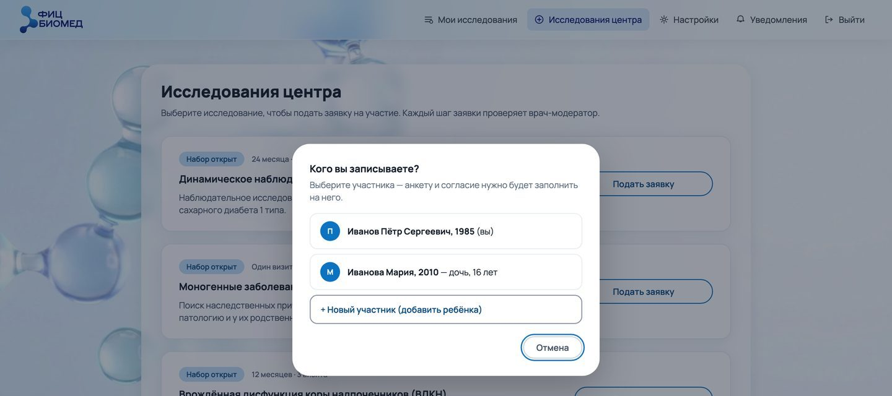
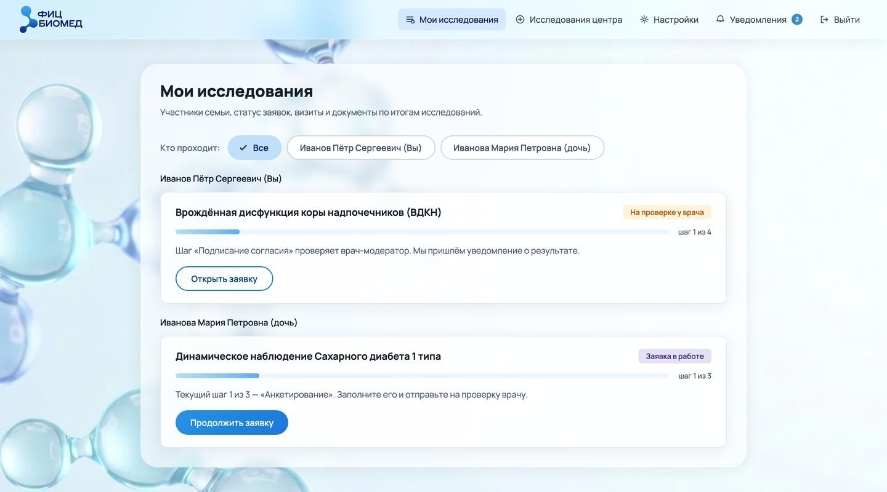

### Анкета

Путь заявки разбит на четыре шага: согласие, анкета, запись на визит, результаты. Слева всегда виден список шагов, у каждого шага свой цвет состояния. Когда шаг ушёл на проверку, экран сообщает, что заявка у врача и проверка обычно занимает до одного рабочего дня. Когда врач примет решение, придёт уведомление.

Анкета — самая объёмная часть пути. В ней рост и вес, хронические болезни, лекарства, госпитализации, образ жизни, происхождение и наследственность. Я разбила анкету на разделы по смыслу, в наблюдении при диабете их девять. Вложенные вопросы появляются по ответу. Например, ответ «была госпитализация» открывает поля для даты, причины и больницы. Вопросы зависят от возраста, индекс массы тела считается сам, черновик сохраняется при каждом изменении. Прогресс считает разделы, которые действительно заполнены. Ответ «нет» засчитывается, пропущенный ответ не засчитывается.

**Отказалась.** Проверять раздел по кнопке «Далее» и подсвечивать пустые поля красным. Так данные сразу полные. Такая проверка стояла в одной из версий, и я её сняла. Я исходила из того, что анкету листают, чтобы посмотреть объём, и красный за пропуск отмечал бы ошибку там, где её нет.

**Выбрала.** Кнопка «Далее» ничего не проверяет и нажимается всегда. Пока в разделе есть пустые поля, это второстепенная кнопка с обводкой, как «Назад». Когда раздел заполнен, она становится главной кнопкой. Все обязательные поля проверяются один раз, при отправке, и проверка охватывает их все. Раньше она охватывала только 17, и анкета уходила врачу с пустыми ответами «да / нет».

Цена решения в том, что об ошибках человек узнаёт позже, при отправке. Зато красным на экране отмечена только ошибка, пустое поле красным не отмечается.

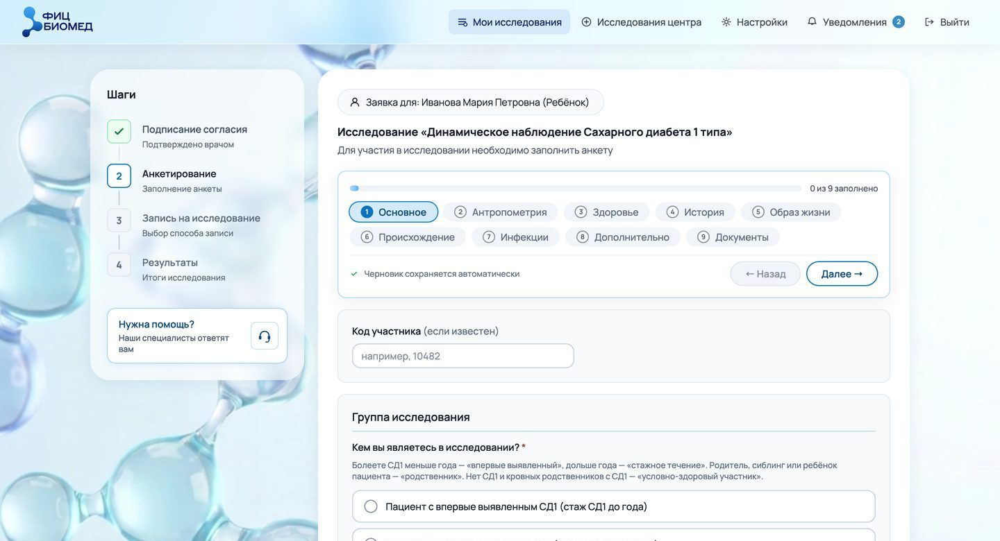
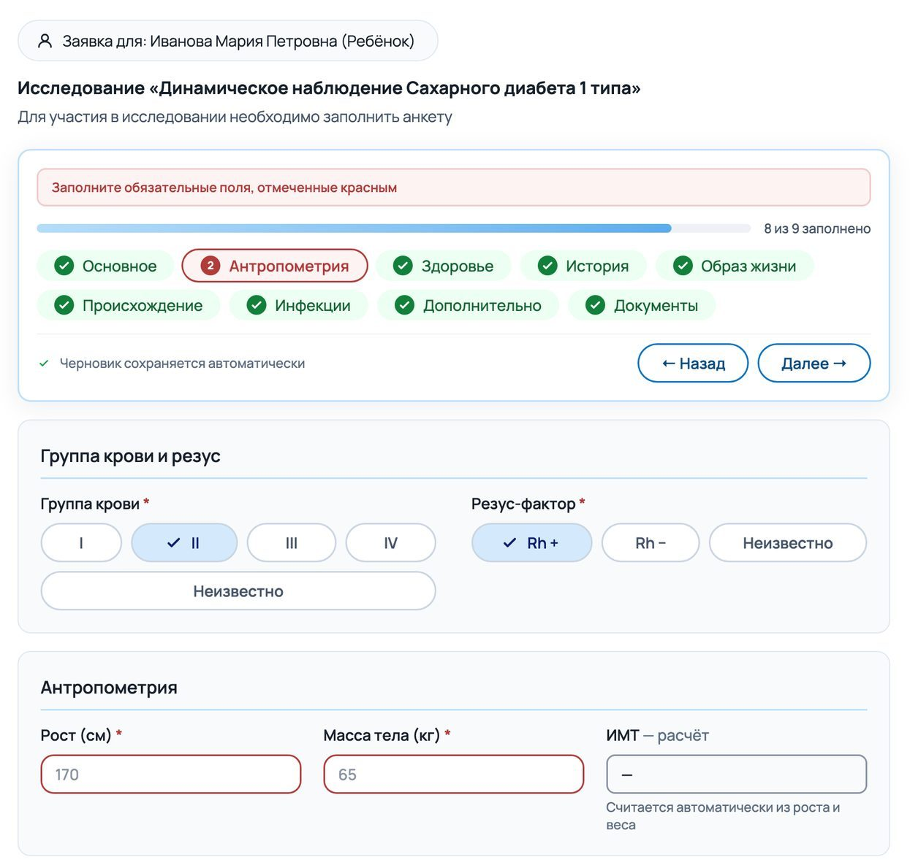

Когда врач возвращает анкету, раздел с замечаниями подсвечивается и показывает их число. У каждого замечания есть кнопка «К полю». Она открывает раздел, прокручивает страницу до поля и подсвечивает его. Когда человек исправляет поле, замечание снимается само.

Экран врача я тоже переделала. Ответы участника сгруппированы по тем же разделам, и врач пишет замечание в той же строке, где стоит ответ. Замечание привязано к полю и само попадает в нужный раздел у участника. Идею предложили врачи-модераторы, когда я расспрашивала их о работе. Сама я до неё не дошла, список замечаний над формой казался мне нормальным. На втором кадре ниже экран врача из прототипа кабинета участника. Рабочее место врача целиком описано в отдельном кейсе, ссылка на него стоит под схемой системы.

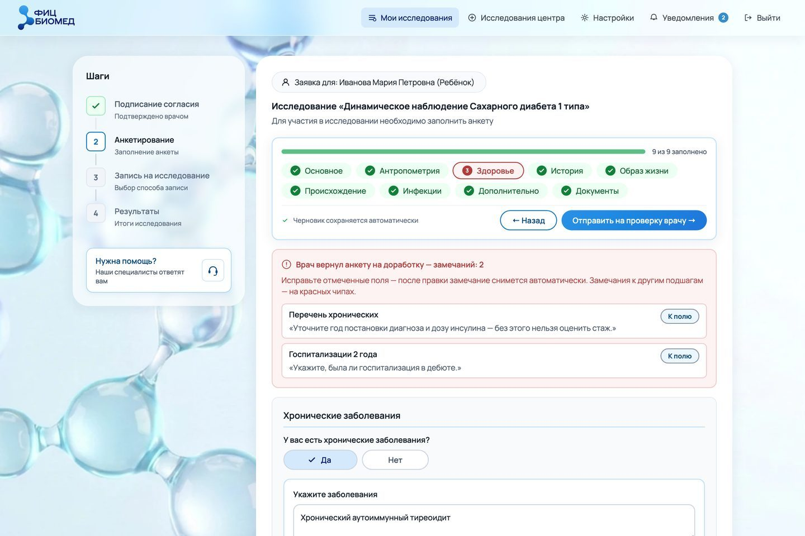
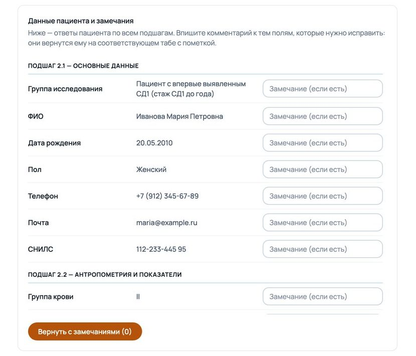

### План визитов

План визитов собран в одну карточку. Наверху исследование, номер заявки и статус, ниже вертикальный список визитов. Текущий визит развёрнут. Прошлые раскрываются на месте, с результатами и документами. Сначала календарь визитов был отдельным экраном, потом я свела его с карточкой заявки.

**Отказалась.** Показывать прогноз дат всех будущих визитов. Календарь сразу заполнен, человек видит весь план на два года.

**Выбрала.** Будущие визиты показаны без дат, с пометкой «Ещё впереди». Ориентировочная дата есть только у следующего визита, и она подписана словом «ориентировочно». Запись открывается за месяц до неё, и кабинет присылает уведомление.

Я исходила из того, что дату визита, который ещё никто не назначал, человек примет за назначенную. Он спланирует под неё день, а потом запишется на другой. Цена решения в том, что на экране меньше информации. Заодно ушла ошибка: расчёт прогнозных дат на неверных данных останавливал весь кабинет.

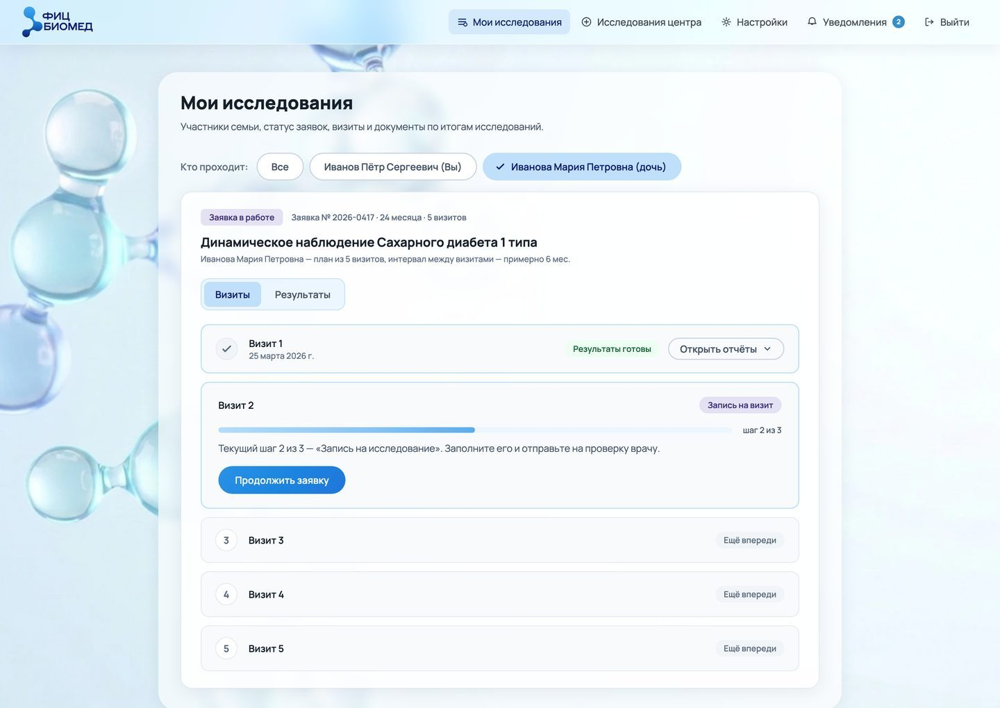
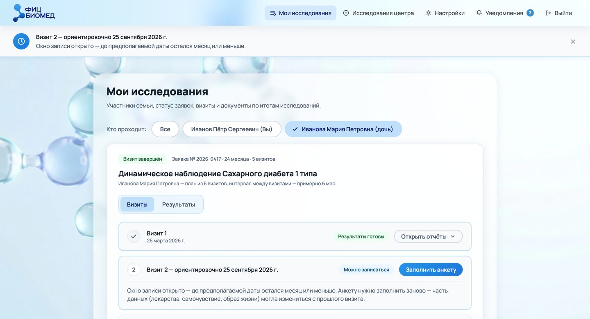

### Возраст

Наблюдение при диабете рассчитано на участников до 20 лет. На тестировании интерфейса сотрудники центра попросили спрашивать дату рождения первой, а отказ давать мягко, со ссылкой на другие исследования, чтобы врачи не отклоняли уже заполненные заявки. Прогон сценариев показал то же с другой стороны: возрастной отсев срабатывал после согласия и проверки врачом, и человек проходил два шага зря.

Теперь возраст проверяется в окне «Кого вы записываете?», когда участника выбирают или добавляют. Текст объясняет причину и подсказывает, что можно указать другую дату рождения или посмотреть другие исследования. На анкете тот же возраст не даёт отправить заявку.

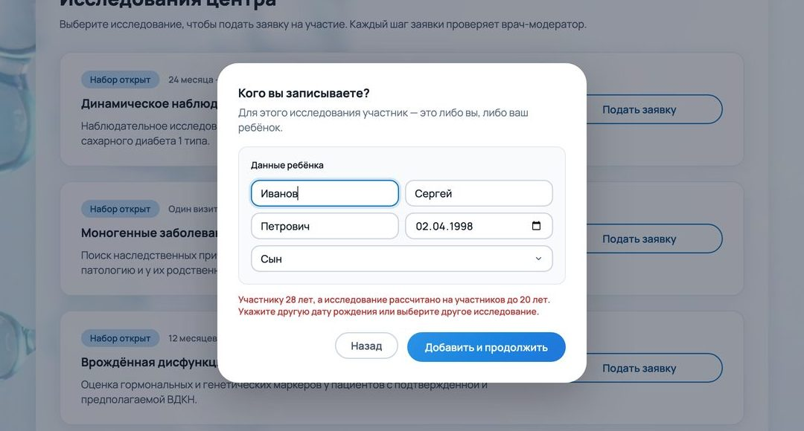

### Согласие на повторных визитах

Сначала согласие подписывали на каждом визите. Потом мы с командой пересмотрели решение. Теперь согласие подписывают один раз, на первом визите, и оно действует всё исследование. У повторного визита три шага вместо четырёх. При 4000 участников и четырёх повторных визитах это до 16 000 подписаний и столько же проверок врачом, которых не будет. Правило зависит от номера визита, поэтому в исследовании ВДКН оно сработает так же. [УТОЧНИТЬ АКТУАЛЬНОСТЬ]

Анкета осталась на каждом визите. За полгода данные меняются, и врач их перепроверяет. Чтобы участник не вводил всё заново, поля заполнены ответами прошлого визита.

### Стадии образца

Между сдачей крови и результатом проходит несколько этапов, а исход бывает двух видов. На тестировании интерфейса сотрудники центра рассказали, что участники боятся, что их кровь потеряли. Я сделала пять стадий: ожидаем визита, кровь получена, в обработке, результаты готовы или требуется пересдача. У результатов и у пересдачи свои уведомления.

Сначала я показала стадии отдельным рядом внутри шага. Потом перенесла их в левую панель, в тот же компонент, что и разделы анкеты. Второй способ показать одно и то же заставил бы человека разбираться заново.

Пересдача — единственная стадия, которая требует от человека действия. Она отмечена красным, а кнопка «Пересдать — выбрать новую дату» сразу открывает запись. Номер визита не меняется, по протоколу это тот же визит.

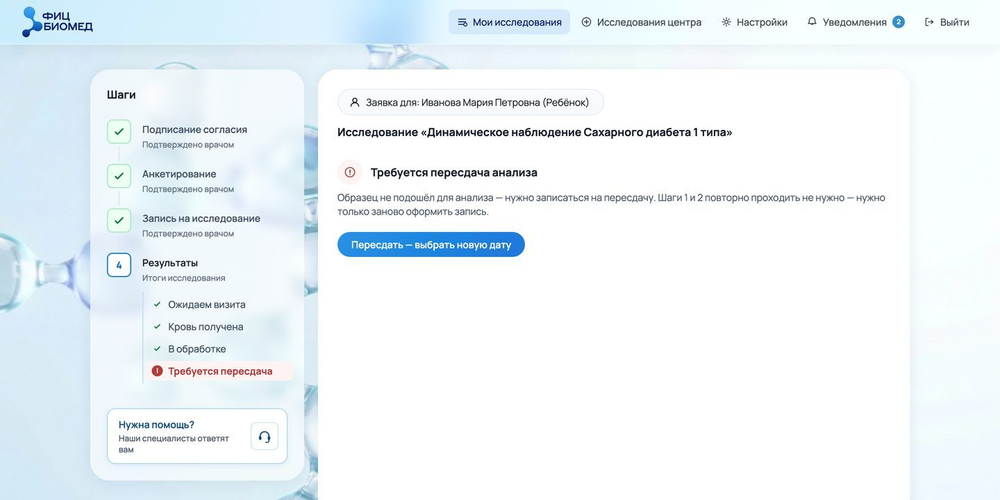

### Оформление

Кабинет оформлен матовым стеклом в фирменной сине-голубой гамме центра, поверх фона с молекулами. Стекло я выбрала ещё в первом прототипе, чтобы длинные медицинские формы не выглядели как бланк. Тоновый градиент есть только у главной кнопки, форму скруглений и кнопок я взяла из Material 3.

---

## Прототип и дизайн-система

Прототип рос от одного экрана к одной заявке, потом к семье и к исследованию на два года.

| Что | В первых версиях | Перед утверждением |
|---|---|---|
| Точка входа | сразу каталог исследований | вход, затем «Мои исследования» |
| Кто участник | всегда владелец аккаунта | выбор «я или мой ребёнок», добавление участника прямо в окне |
| Анкета | одна длинная форма | девять разделов, свободный переход, счётчик «N из 9 заполнено», вопросы по возрасту |
| Возврат от врача | общий баннер со списком замечаний | замечание у поля, кнопка «К полю», снимается само после исправления |
| Запись на визит | выпадающий список из 15 мест | способ записи и карточка клиники |
| После сдачи крови | «Результаты готовы» | пять стадий образца и пересдача |
| Повторные визиты | не поддерживались | план визитов, прошлые визиты с документами, запись за месяц |
| Согласие | одно на аккаунт | своё на каждую заявку, отзыв в два шага |

Прототип я собрала в Claude и вела вместе с ИИ-ассистентом. Я ставила задачи, принимала решения и проверяла результат. Кабинет в прототипе работает целиком: семья, анкеты трёх исследований, возвраты врача, визиты и стадии образца. Решения врача и лаборатории имитирует демо-панель, на кадрах она скрыта.

Каждую правку я вела отдельной версией, прежние не менялись. После правок ассистент проверял код, прогонял логику без браузера и снимал кадры, я смотрела их глазами. На телефоне список шагов становится горизонтальным, навигация уходит в нижнюю панель, кнопки встают в столбик. Разбор мобильной вёрстки нашёл 16 поломок в состояниях мастера, которые прежние проверки не открывали.

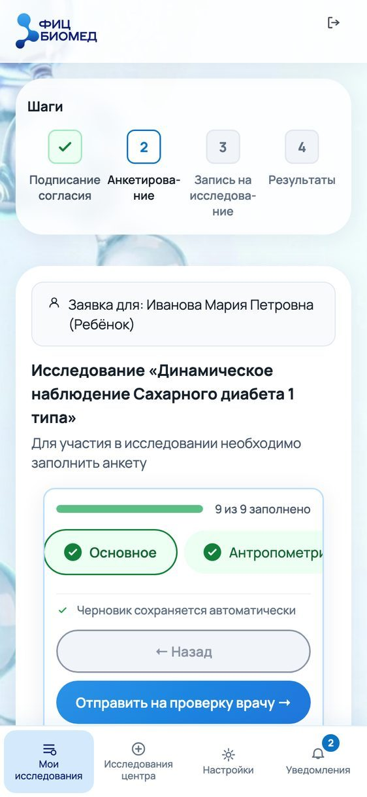
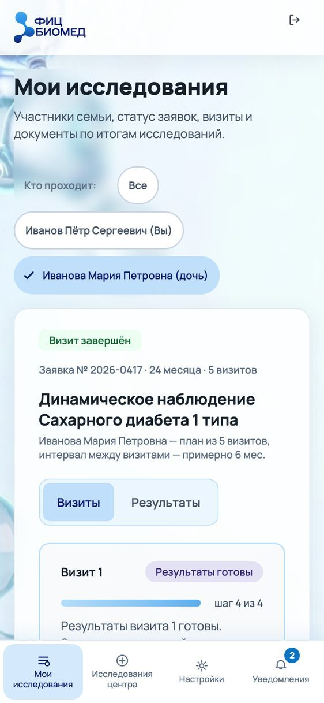

Дизайн-систему я собрала вместе с прототипом и, как и прототип, вела вместе с ИИ-ассистентом. Значения мы сняли с вёрстки прототипа. Система одна на два кабинета. На ней ассистент по моему запросу собрал кабинет врача-модератора, и новых значений придумывать не пришлось. На компонентах системы в Figma собраны флоу наблюдения при диабете для компьютера и телефона. Figma отстаёт от прототипа на правки последних версий.

---

## Проверка

Решения я проверяла на людях. После почти каждой итерации я проводила интервью с участниками и модерируемые юзабилити-тесты прототипа, по четыре-пять интервью на итерацию. Отдельно разговаривала с врачами-модераторами и встречалась с руководителями проекта.

**ДОБАВИТЬ: находки интервью и юзабилити-тестов с участниками.** Что проверяли, кто участвовал, сколько было сессий, что нашли и что после этого поменялось в интерфейсе.

**Тестирование интерфейса с сотрудниками центра.** Прототип смотрели исследователи, координаторы и руководители. Правки появились в прототипе сразу после встречи.

| Что сказали сотрудники | Что я поменяла |
|---|---|
| слово «пациент» не подходит, участники бывают условно здоровыми | в шапке появилось «Личный кабинет» |
| для динамики при диабете нужен возраст до 20 лет | проверка возраста при выборе участника и развилка «Я участник / Мой ребёнок» |
| участники боятся, что их кровь потеряли | стадии образца и пересдача |
| заявки семьи нужно показывать по людям | группы по людям вместо общего списка |

**Прогон сценариев.** Кроме тестов, мы с ИИ-ассистентом прошли 22 сценария на ширине 1280 и 375 пикселей. Нашлось 29 расхождений, 26 мы исправили, ещё три оказались ошибкой самой проверки. Самые серьёзные касались данных. Удаление ребёнка одним кликом стирало все его заявки и результаты. Выход из аккаунта стирал черновик анкеты, хотя экран обещал автосохранение. Возрастной отсев срабатывал после согласия и проверки врачом.

**Разборы до утверждения.** Я провела три разбора: путь целиком по рекомендациям NN/g и Baymard о формах и многошаговых мастерах, момент, когда заводить участника, и визуальный аудит по WCAG 2.2. После них я перенесла добавление участника в окно подачи заявки и подняла контраст подписей и активного шага до нормы.

**Аудиты вида.** После утверждения ассистент по моим запросам подготовил четыре аудита вида: фокус внимания, баланс шрифта, материал стекла и повторный аудит стекла, всего 61 пункт. Решения по ним принимала я. Например, при возврате анкеты вместо двух красных блоков я оставила один. Контраст белой подписи на главной кнопке после смены палитры вырос с 2,14 до 3,31 на светлом конце градиента. Норму 4,5 для текста это не проходит. Это сознательное отступление, оно записано в спецификации. Часть пунктов первого аудита я потом вернула, на живой странице они читались хуже. Аудит тоже ошибался: однажды он сравнил телефон и компьютер в разных состояниях. С тех пор мы сравниваем только одинаковые состояния.

---

## Результат

Запуска ещё не было, замеров нет. Чтобы оценить эффект без выдуманных цифр, я вместе с ИИ-ассистентом посчитала модель и составила план измерения. Цели и допущения модели мои, заказчик их не задавал.

**Объём.** Около 4000 участников в трёх исследованиях. Наблюдение при диабете идёт пять визитов за два года, ВДКН три визита, моногенные исследования один. Как участники распределятся между исследованиями, пока неизвестно, поэтому модель считает два варианта: все в наблюдении при диабете и 2000, 1000 и 1000. Если все придут в наблюдение при диабете, за цикл будет до 64 000 шагов участников и до 44 000 проверок врачами без учёта возвратов.

**Ориентир.** Опубликованного ориентира для двух лет наблюдения с нашим протоколом я не нашла. Ближайший даёт исследование TEDDY, где за детьми наблюдают с рождения. За первый год из него ушли 1220 семей из 8677, это 14 % ([Lernmark и др., 2016](https://pmc.ncbi.nlm.nih.gov/articles/PMC4670659/)). В первые два года выбывало около 11 % в год, к сентябрю 2023 года в исследовании оставались 65 % ([Gesualdo и др., 2024](https://pmc.ncbi.nlm.nih.gov/articles/PMC11177994/)). Среди причин ухода, связанных с протоколом, чаще всего называли забор крови (55 %), слишком тяжёлый протокол (26 %), дорогу (16 %) и частоту визитов (16 %). Ещё 27 % выбывших просто перестали отвечать ([Lernmark и др., 2016](https://pmc.ncbi.nlm.nih.gov/articles/PMC4670659/)). В обзоре 143 когорт исследования, которые снижали барьеры для участников, удерживали медиану 81 % выборки против 71 % у остальных ([Teague и др., 2018](https://pmc.ncbi.nlm.nih.gov/articles/PMC6258319/)).

**Удержание.** Если перенести доли TEDDY на наш протокол, без кабинета до пятого визита дойдут около 76 % участников, разброс 67–85 %. Тяжелее всего первый переход. Кабинет может удержать тех, кто не понял, что делать, забыл про визит или бросил анкету. На медицинские и жизненные причины, забор крови и дорогу кабинет не влияет. Две главные величины модели я задала допущениями, данных под ними нет. На зону кабинета приходится от 10 до 30 % выбывания, в базовом сценарии 20 %. Ориентир сверху дают 27 % выбывших в TEDDY, которые просто перестали отвечать. Из этой доли кабинет убирает от 20 до 60 %, в базовом сценарии 40 %. По модели кабинет добавляет от 0,4 до 3,9 процентного пункта к доле дошедших до последнего визита, в базовом сценарии 1,7 пункта. При 4000 участников в наблюдении при диабете это от 17 до 156 человек с полным набором данных, в базовом сценарии около 70. Один пункт этой доли равен 40 людям.

Прежнюю цель 81 % я ставила без ориентира на два года. По модели для неё кабинет должен убрать пятую часть всего выбывания, это выше верхнего сценария. Цель по удержанию я поставлю от уровня, измеренного после запуска.

**Время врача.** Время проверки не измеряли. Каждая минута, сэкономленная на проверке анкеты, даёт от 210 до 380 часов за цикл. Разброс зависит от распределения участников и числа возвратов.

| Тип | Метрика | Как мерить | С чем сравнивать |
|---|---|---|---|
| Главная | доля дошедших до последнего визита, по каждому исследованию | когорта от первого визита | TEDDY в пересчёте на протокол, около 76 % |
| Опережающая | переход между соседними визитами, отдельно первый | запись в окне визита | первые полгода TEDDY |
| Опережающая | анкета начата и отправлена врачу | по разделам анкеты | первые два месяца после запуска |
| Качество | заявки, возвращённые повторно, и число полей в возврате | по каждому возврату врача | первые два месяца после запуска |
| Качество | время проверки анкеты врачом | медиана от открытия до решения | первые две недели после запуска |
| Контрольная | потеря данных при переключении участника | журнал ошибок | должна быть ноль |

Метрики нужно завести до запуска. При визите раз в полгода потерянные первые полгода данных означают целый цикл визитов. Причину ухода координатор отмечает по списку, чтобы отделить зону кабинета от остального выбывания. После первых двух переходов станет видно, что менять. Если растёт доля переставших отвечать, менять нужно напоминания и вход. Если анкету бросают на одном разделе, его нужно сократить.

---

## Первая версия

Продукт создаётся с нуля, поэтому перед запуском я вместе с ИИ-ассистентом прошла продуктовый цикл по директивам: персоны, список функций, приоритизация по MoSCoW и состав первой версии.

Основная персона — родитель ребёнка в наблюдении при диабете. Персоны пока гипотезы, их нужно сверить с интервью участников. В список вошли 57 функций: 28 обязательных, 14 желательных, 10 возможных и 5 отложенных. Обязательной функция становилась, если без неё основной сценарий невозможен, если она напрямую связана с задачей основной персоны или если она есть у всех конкурентов. Серьёзные проблемы UX-аудита я тоже отнесла к обязательным, хотя путь формально можно пройти. Главная метрика считает, сколько участников дошли до последнего визита, и запуск с известными проблемами на основном пути потерял бы людей первого цикла.

Из 28 обязательных функций 20 уже есть в прототипе. Пять нужно доделать в интерфейсе: восстановление доступа, текст ошибки у поля, понятный шаг записи, пояснение к отклонениям в результатах и чат с оператором. Три лежат вне интерфейса: письма и SMS о событиях заявки, источник стадий образца и метрики, заведённые до запуска.

---

## Что не сделано

**Уведомления вне кабинета.** Писем и SMS о событиях заявки нет. Без них человек через полгода не узнает, что открылась запись. На этом стоит главная метрика.

**Проблемы UX-аудита.** Экспертный UX-аудит всего кабинета, который ассистент готовил по моему запросу, нашёл 18 проблем, четыре из них серьёзные: восстановление доступа, текст ошибки у поля, шаг записи и пояснение к результатам. В прототип они пока не внесены.

**Доступность.** Мобильная версия и работа с клавиатуры сделаны. Осталось две проблемы. При открытии окна фокус попадает в него, но клавиша Tab выводит на страницу. Всплывающие уведомления скринридер не озвучивает.

**Интеграция с лабораторией.** Её нет, стадии образца в прототипе переключаются вручную. Сделать её можно будет, когда центр выберет лабораторную систему.

**Замеры в кабинете врача.** Прототип кабинета врача я показывала врачам и координаторам центра. Замеров не было: время проверки одной заявки никто не измерял ни до, ни после. Поэтому о скорости работы врача я ничего не утверждаю.

**Правки вида без проверки на людях.** Правки по аудитам вида я на участниках ещё не проверяла.

**Вопросы для клиники и юристов.** Что происходит, когда ребёнок становится совершеннолетним. Сохраняется ли у родителя доступ к данным взрослого участника. Что делать с историей при удалении профиля. Кто в семье распоряжается общим научным отчётом. Отвечать на них сама я не стала. Все четыре я записала в реестр с вариантами ответа [ПРОВЕРИТЬ: был ли реестр отдельным документом для заказчика]. Команде дешевле обсудить их до разработки, чем переделывать после.

---

## Выводы

**Проверять модель данных в первую неделю.** Это я сделала бы иначе. Переключатель участников обещал несколько заявок, которых в данных не было, и календарь, статусы и согласия пришлось пересматривать. Теперь я сначала ищу на экранах элементы, которые обещают структуру, и проверяю, есть ли она в данных.

**Цель ставить от измеренного уровня.** Это я тоже сделала бы иначе. Цель удержания 81 % я поставила без ориентира на два года, и модель показала, что она выше верхнего сценария. Теперь я ставлю цель на каждый переход между визитами, а уровень беру после первых замеров.

**Метрики заводить до запуска.** При визите раз в полгода первые полгода без метрик означают целый потерянный цикл.

**Показывать только то, что есть в данных.** Прогресс считает заполненные разделы, у будущих визитов нет выдуманных дат.

**Проверять саму проверку.** Скрипт три недели сравнивал дизайн-систему со старым файлом прототипа и показывал ноль расхождений. С тех пор имя рабочего файла записано в одном месте, а сверку я проверяю намеренной поломкой.

*Прототип собран в Claude на HTML, CSS и JavaScript, кадры сняты с его рабочей версии 44. Демо-панель, которая имитирует врача и лабораторию, на кадрах скрыта, данные участников вымышленные. Прототип, разборы и аудиты я делала вместе с ИИ-ассистентом Claude: ставила задачи, принимала решения и проверяла результат. Текст кейса подготовлен с помощью ИИ-ассистента по материалам проекта. Модель эффекта я считала вместе с ИИ-ассистентом, цели и допущения модели мои, ссылки на опубликованные исследования стоят рядом с цифрами.*
