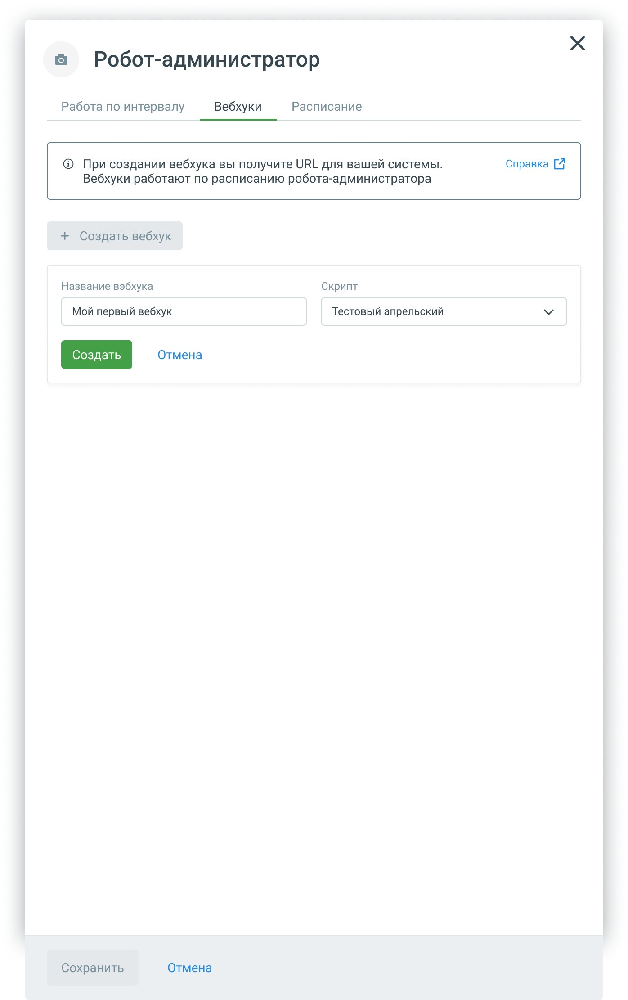
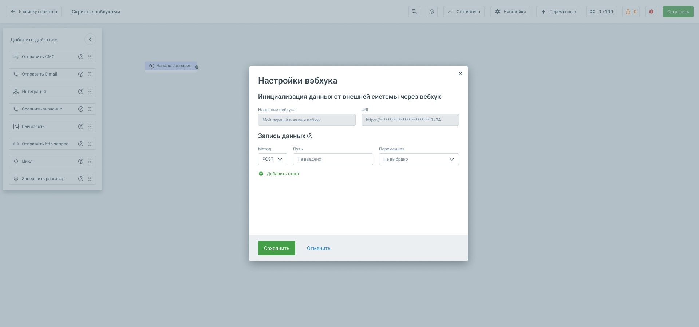
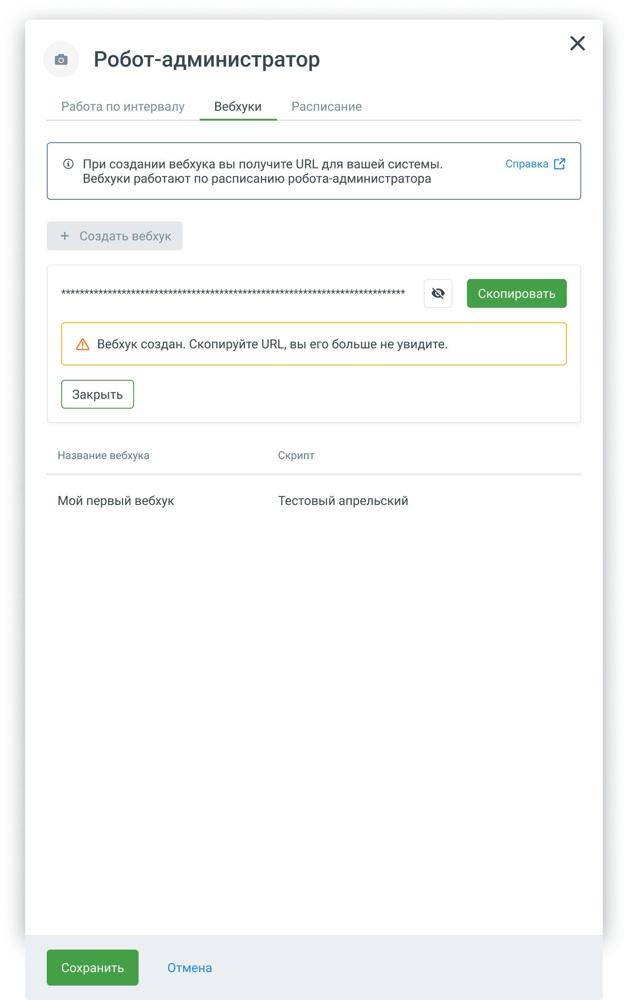
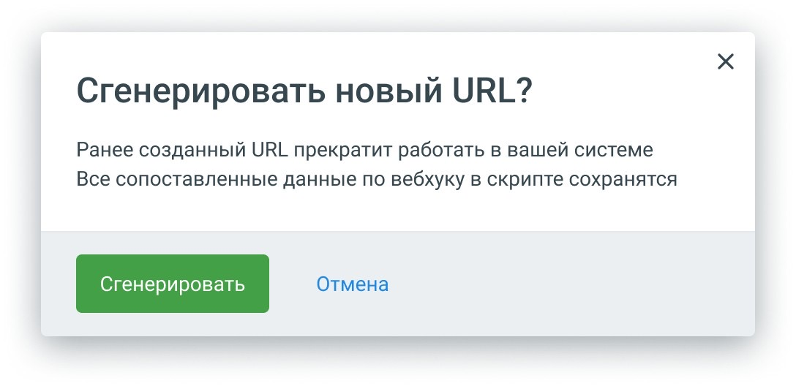
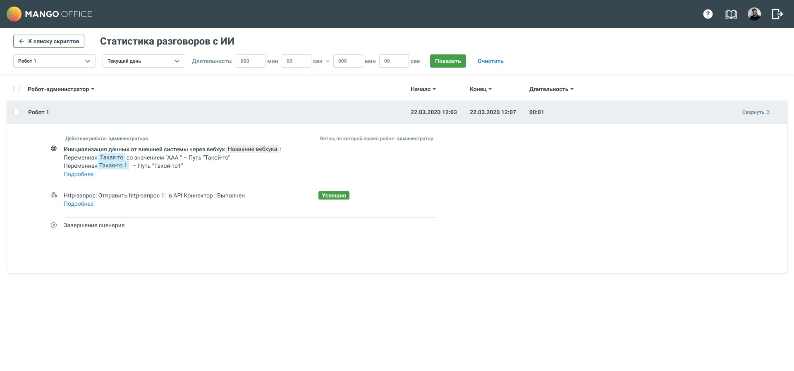
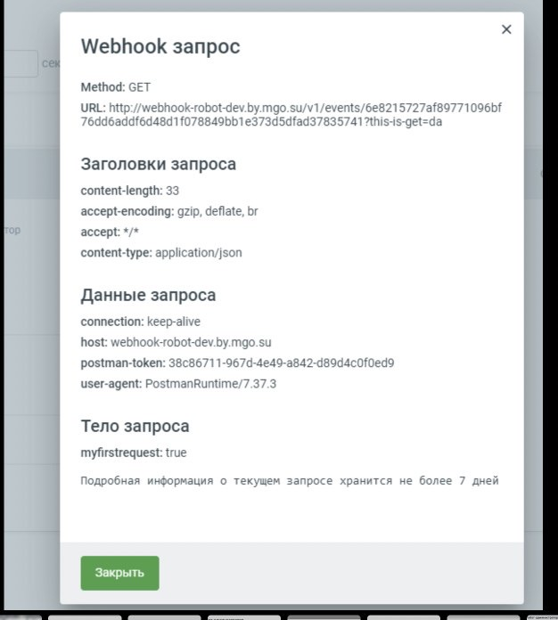

# Вебхуки в роботе-администраторе

Робот-администратор опрашивал внешнюю систему по расписанию, не чаще раза в десять минут, и большинство запросов возвращались пустыми. Вебхук разворачивает связь: внешняя система сама сообщает роботу, что пора звонить. Кейс о том, где разместить настройку, что делать с расписанием и почему команда отклонила три требования заказчика.

MANGO OFFICE · робот-администратор · приём входящих вебхуков · задача `ROBOTS-3277`

---

**Роль.** Продуктовый дизайнер. Я нарисовала макеты приёма вебхуков, от вкладки в карточке робота до настройки в скрипте, статистики и таблицы роботов. По записям встреч на дизайн остались две задачи: где настраивать сопоставление параметров и как показать очередь заданий.

**Команда.** Заказчик фичи, разработчик движка, команда интеграции и продуктовая команда. Решения принимались на четырёх рабочих встречах. Постановку написала продуктовая команда.

**Сроки.** Четыре встречи, около пяти часов записей.

**Масштаб.** Робот-администратор стоит 10 000 ₽, на аккаунте их может быть три. Основные внешние системы в сценариях: Битрикс и AmoCRM.

**Статус.** Решения приняты на встречах, макеты готовы. Что вошло в релиз, по записям не видно.

---

## Коротко

**Что было.** Робот-администратор ходил во внешнюю систему по расписанию, не чаще раза в десять минут. При минимальном интервале реакция на событие занимала до десяти минут, а большинство запросов возвращались пустыми.

**Что я сделала.** Нарисовала макеты приёма входящих вебхуков. Вебхук создаётся в карточке робота: название, скрипт и адрес, который система выпускает сама. Сопоставление параметров с переменными в настройках скрипта. В статистике видно исходный хук, чтобы его можно было отладить.

**Главное решение.** Три требования заказчика команда проверила и отклонила: API-ключ, настройку разделителя параметров и готовые шаблоны под Битрикс и AmoCRM. Интерфейс от этого стал короче.

**Результат.** Архитектура и интерфейс согласованы на встречах, макеты нарисованы. Появилась идея кнопки «Протестировать», которая превращает отладку в основной способ настройки, в макете её нет. Что вошло в релиз, по записям не видно.

---

## Место в продукте

«Роботы» объединяют пять сущностей MANGO OFFICE: голосовой робот, чат-бот, робот-администратор, AI-робот и AI-ассистент. Робот-администратор в этом семействе работает без диалога: он забирает данные из CRM, готовит кампании обзвона и следит за ними. Вебхуки нужны именно ему.

*Схема продукта*

---

## Задача

Робот-администратор опрашивал внешнюю систему по расписанию, не чаще раза в десять минут. Минимальный интервал у робота 10 минут, по умолчанию стоит 30. У этой схемы два недостатка. При минимальном интервале робот узнаёт о событии в среднем через пять минут, а в худшем случае через десять. И большинство запросов возвращают «ничего нет», поэтому опрашивать чаще нельзя: пустых запросов станет ещё больше.

Целевой сценарий такой. В Битриксе лид переходит на нужный этап воронки. Битрикс сразу отправляет хук с данными клиента. Робот принимает их, передаёт в кампанию обзвона, и начинается звонок.

О проблеме команда знала из запросов клиентов, в постановке названы Netit24 и интеграторы. Перестраивать бизнес-процесс клиенты не хотели, они уже вложили в него деньги. Гипотеза постановки: вебхуки помогут привлечь больше клиентов и закрывать больше кейсов, связанных с автоматизацией исходящих звонков.

---

## Пользователи

Конструктор роботов рассчитан на администратора без технического бэкграунда. С вебхуками оказалось иначе. На встрече прямо сказали, что клиентов для разговора найти не удалось и что это «в основном интеграторский кейс». Настраивать вебхуки будут интеграторы, по сути разработчики, или клиент закажет настройку под ключ.

Попытку упростить интерфейс сняли на той же встрече. На вопрос, можно ли сделать конструктор без URL, ответили встречным вопросом: как без URL его сделать.

Это определило дизайн. Пользователь знает, что такое POST, JSON и параметры запроса. Ему важнее предсказуемость, чем подсказки для новичка.

Была и стратегическая цель. Заказчик хотел сделать из робота аналог Albato, только гибче: связывать любые системы с открытым API. На встрече говорили, что несколько грамотных сотрудников смогут собирать шаблоны и выпускать тысячи интеграций без разработчика.

---

## Ограничения

**Тариф.** Робот-администратор стоит 10 000 ₽, и на аккаунте их может быть три. Привязывать к каждому вебхуку отдельного робота никто не станет. На встрече это посчитали так: добавление номера телефона в таблицу будет стоить десять тысяч. Для сравнения, в Битриксе внутренние роботы входят в тариф, их можно настроить сколько угодно, а сам Битрикс стоит около 5 590 ₽ в месяц на 50 пользователей.

У тарифа была и вторая сторона. Если разрешить одному роботу принимать хуки для разных сценариев, продажи роботов упадут, и это сказали прямо. Отдел продаж со своей стороны ответил, что менеджерам разрешили давать скидку.

**Лимит переменных.** У робота 50 переменных. Подрядчик «Связь 24» упёрся в этот лимит ещё в декабре. Запросов на расширение в поддержку не приходило, но команда сама засомневалась, что это что-то доказывает: такие запросы могут просто теряться.

**Одна логика на робота.** На встрече сказали, что робот не может одновременно работать по расписанию и принимать хуки: сначала приходят параметры, потом по ним выполняется скрипт. В итоге робот работает и так, и так, подробнее в разделе «Расписание».

**Движок.** У разработчика движка вебхук только вызывает скрипт по ссылке и не принимает параметры. Для параметров нужны свои шлюзы.

---

## Решения

### Где настраивать вебхук

**Отказались.** Собрать всю настройку в карточке робота, рядом с расписанием. Всё в одном месте.

**Выбрали.** Развести настройку по двум местам. В карточке робота вебхук создаётся и связывается со скриптом. В конструкторе сопоставление: какие параметры забрать и в какие переменные записать. На встречах говорили о карточке как о месте для URL и метода, в макете поля метода нет.

Причину назвали на встрече. В карточке оказались бы расписание, хук, список полей и переменные, а переменные человек создаёт в конструкторе. Ему пришлось бы ходить между двумя местами, и это было бы неочевидно. Отсюда правило: настройка живёт рядом с данными, с которыми она работает.

Где именно в конструкторе настраивать вебхук, постановка оставила дизайну. Обсуждали три места: блок «Начало», новый блок в левом меню и настройки в верхнем меню. В макете я вынесла сопоставление в настройки скрипта: адрес вебхука только для просмотра и запись данных в переменные, до 20 связок, по образцу ответа в блоке HTTP-запроса. Если вебхук на скрипт ещё не назначен, там подсказка, где его создать.

Ещё у робота-администратора появился тип скрипта: входящий или исходящий запрос, по аналогии с входящими и исходящими звонками у голосовых роботов. Во входящем скрипте первым стоит переделанный блок HTTP-запроса. В макете ROBOTS-3277 типа скрипта нет.

### Расписание

Заказчик фичи считал, что расписание здесь лишнее: если внешняя система решила отправить хук, его надо обработать в любое время. В движке при этом вебхук тоже был привязан к расписанию, и хук, пришедший в нерабочее время, вставал в очередь.

На встрече выяснили, откуда взялась эта привязка. Вебхук собирались вешать на робота-администратора, а робот нужен был только ради расписания. Из-за цены робота заводить отдельного робота под вебхук никто не будет.

**Отказались.** Оставлять расписание рабочим вместе с вебхуком и копить задания в очереди до начала рабочего времени.

**Выбрали на встречах.** Если вебхук настроен, робот работает 24 на 7. Если вебхук не настроен, расписание работает как раньше.

Один из участников встречи рассказал, что говорил с двумя клиентами, и расписание не понадобилось ни одному: Битрикс сам решает, когда отправить хук. Для сценариев вроде маршрутизации по часовым поясам расписание предложили сделать блоком внутри скрипта.

В макете решение стало гибче. Робот с вебхуком может работать и круглосуточно, и по расписанию. В карточке робота три вкладки: «Работа по интервалу», «Вебхуки» и «Расписание». На вкладке «Вебхуки» подсказка «Вебхуки работают по расписанию робота-администратора», а по умолчанию расписание бесконечное. Так робот с вебхуком из коробки работает 24 на 7, как решили на встречах, а клиент, которому нужно рабочее время, ограничивает его расписанием. Постановка добавила и гибридный режим: робот принимает вебхук и при этом сам работает по интервалу.

### Очередь заданий

Пока расписание ограничено, пришедший хук ждёт в очереди, и пользователь нигде этого не видит. Статистика показывает только выполненные задания.

Команда обсуждала счётчик заданий в очереди без подробностей. Сразу возразили, что пользователь не увидит число, пока не откроет окно, и неизвестно, нужно ли оно ему. Вопрос так и не решили, и это стало ещё одним аргументом за режим 24 на 7: иначе пришлось бы проектировать экран очереди, о содержании которого никто не мог договориться.

В макете расписание можно ограничить, и вопрос вернулся: хук, пришедший вне расписания, снова ждёт в очереди. В постановке накопление таких хуков помечено «пока откладываем».

### Отклонённые требования заказчика

**API-ключ.** Заказчик просил добавить авторизацию. Но в URL вебхука уже есть уникальный хэш. Если утечёт URL, его перевыпускают. Ключ утечёт так же, и с ним придётся делать то же самое. Ключ добавил бы поле в интерфейс и не добавил бы защиты.

**Настройка разделителя параметров.** Заказчик считал, что Битрикс и AmoCRM передают параметры с разными разделителями. Команда проверила: разделитель у обоих одинаковый, амперсанд. Системы с другим разделителем встречались, но команда интеграции назвала их самописными и редкими. Настройку убрали из первого этапа.

**Шаблоны под Битрикс и AmoCRM.** Шаблоны упростили бы настройку для самых частых систем. Команда отказалась, потому что задача была сделать универсальный инструмент без привязки к конкретной системе. Цена этого решения в том, что клиент прописывает всё вручную.

### Несколько вебхуков

По постановке у робота может быть несколько вебхуков, один адрес на один скрипт. Новый скрипт создаётся прямо в списке, без нового окна. В таблице роботов видно, на какие скрипты назначены вебхуки, чтобы нужного робота не искать по карточкам.

### Отладка

Интегратор настраивает вебхук, отправляет тестовый хук и смотрит, что пришло. Поэтому в статистике решили показывать четыре вещи:

- исходный хук целиком, по кнопке «Подробнее», как у блока HTTP-запроса;
- что записалось в переменные по сопоставлению;
- именно исходный запрос, потому что система может преобразовать GET в POST;
- хранение не дольше семи дней, как у HTTP-запроса.

Для этого нужно прокси-приложение, которое переводит пришедший хук в формат движка и хранит исходник.

На третьей встрече появилась идея кнопки «Протестировать». Человек нажимает её, отправляет настоящий хук и выбирает нужные поля мышкой, а пути к ним система прописывает сама, как в блоке HTTP-запроса. Разработчик подтвердил, что это можно сделать. С такой кнопкой отладка становится основным способом настройки: не нужно угадывать формат и прописывать пути вручную.

---

## Результат

На встречах команда договорилась о главном:

- вебхук в карточке робота, сопоставление параметров в настройках скрипта;
- тип скрипта «входящий запрос»;
- робот с вебхуком работает 24 на 7; в макете это значение по умолчанию, и расписание можно ограничить;
- три требования заказчика отклонены, интерфейс короче;
- исходный хук в статистике для отладки и идея кнопки «Протестировать».

Макеты готовы: вкладки карточки робота, создание вебхука, скрытый адрес, перевыпуск адреса, удаление, несколько вебхуков, настройки в скрипте, статистика с исходным запросом, таблица роботов со скриптами вебхуков.

Тарифный вопрос остался открытым. Что из решений вошло в релиз, по записям не видно.

---

## Выводы

**Настройку стоит размещать рядом с данными, с которыми она работает.** Переменные создаются в конструкторе, поэтому сопоставление параметров тоже там, хотя вебхук создаётся в карточке робота.

**Требование заказчика стоит проверить до того, как рисовать под него поле.** Три требования заказчика не прошли проверку, и интерфейс стал короче.

**Тариф влияет на дизайн так же, как движок.** Пока робот стоит десять тысяч и их три, привязывать к нему каждый вебхук нельзя.

**Отладку стоит проектировать вместе с настройкой.** Интегратор проверяет вебхук тестовым хуком, поэтому в статистике виден исходный запрос целиком и то, что записалось в переменные.

**Значение по умолчанию может примирить два решения.** Встречи договорились о режиме 24 на 7, а части клиентов нужно рабочее время. Бесконечное расписание по умолчанию дало оба варианта без отдельного переключателя.
